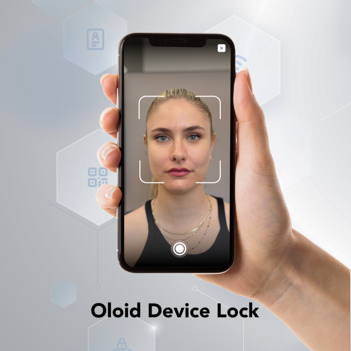

{/* Source: Intercom article 9393375 -  */}
{/* Generated by intercom_to_mintlify.py - re-running overwrites this file. */}

Oloid Device Lock is an Android-based application that enables Multi-factor authentication (MFA) of users using physical identity factors (like face, badge, NFC tags, password, and PIN). This application allows employees to seamlessly log into Workforce/ HRMS systems without entering a Username and Password.

The **Device Lock** feature is primarily used for securing access to devices, applications, and systems by ensuring that only authorized individuals can use or access them. It simplifies access to Workforce, HRMS systems and helps organizations meet compliance requirements by enforcing robust authentication mechanisms. This application is especially useful for enterprise environment, and factories. **Device Lock** improves security, simplifies access, and enhances the overall user experience while aligning with organizational needs for secure and efficient operations.

To know more about **Oloid Device Lock**, see[Getting Started with Oloid Device Lock](/platforms/android/devicelock/devicelock-app-setting-up-and-using-oloid-devicelock-app).
