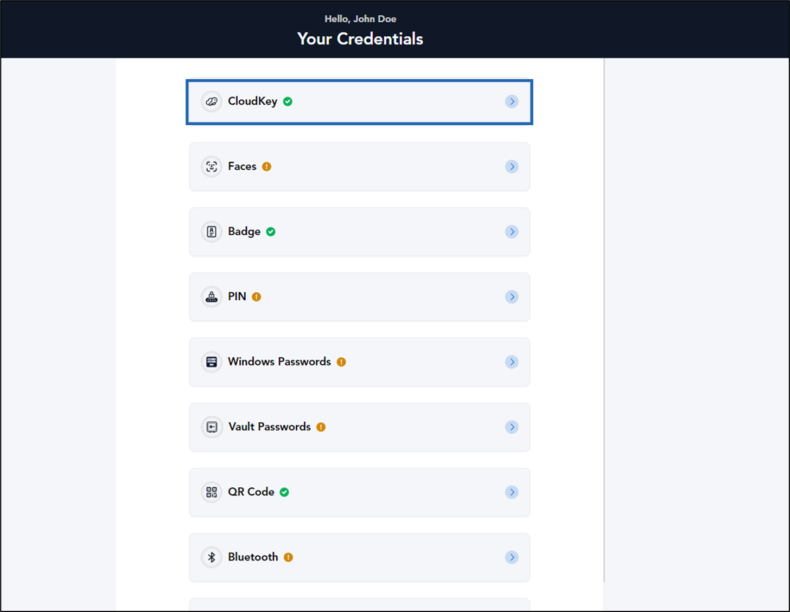
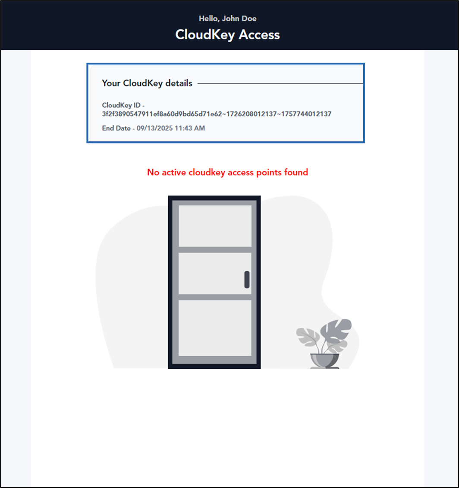

{/* Source: Intercom article 9874251 -  */}
{/* Generated by intercom_to_mintlify.py - re-running overwrites this file. */}

Steps to view the CloudKey:

1. Login to the **Oloid User Portal**.
2. On the homepage, click **CloudKey**.

   

   The **CloudKey Access** page is displayed and you can view **Your CloudKey Details** on the page.

   
