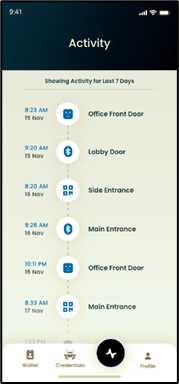

{/* Source: Intercom article 9310661 -  */}
{/* Generated by intercom_to_mintlify.py - re-running overwrites this file. */}

Activity

Tap **Activity** on the menu at the bottom of the screen to view transactions of last 7 days.

