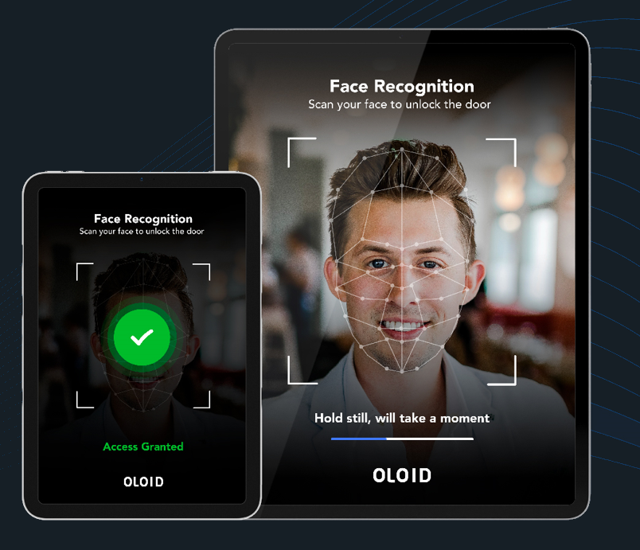
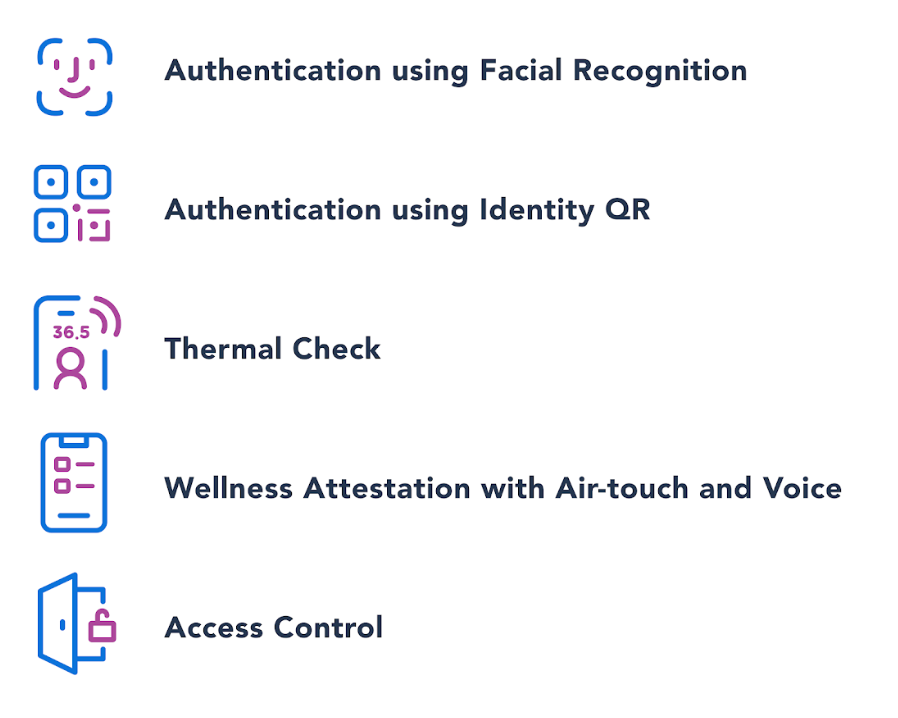

{/* Source: Intercom article 7222296 -  */}
{/* Generated by intercom_to_mintlify.py - re-running overwrites this file. */}

Oloid Verify/Connect is a contactless authentication application for time and attendance clocking, payroll compliance, and workplace access. It includes into workflow temperature checks and self-attestation checks using gesture and voice-based technology.

**Features**

To use **Oloid Verify/Connect**, all you’ll need is an iPad and an OloID Admin account.

**Steps to get started:**

Ø Install the iPad

Ø Download the Oloid Verify/Connect App

Ø Configure your Oloid Verify/Connect in Oloid Platform for required features

Ø Start using your app
