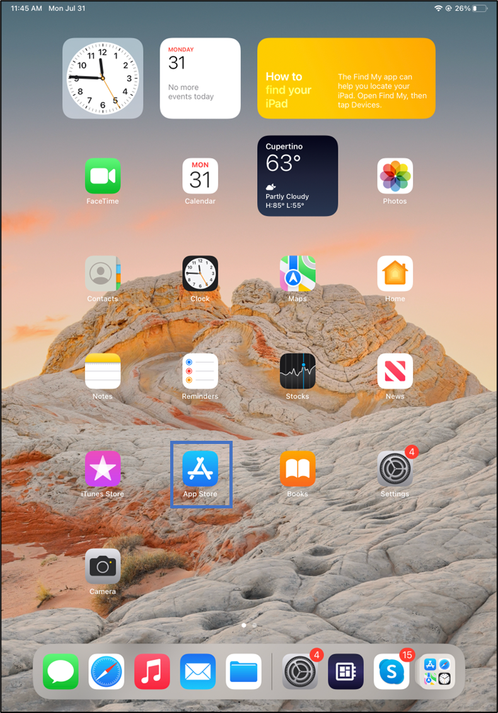
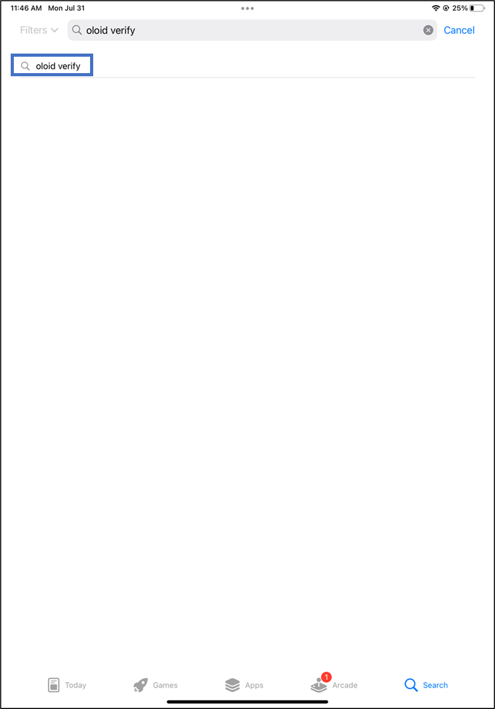
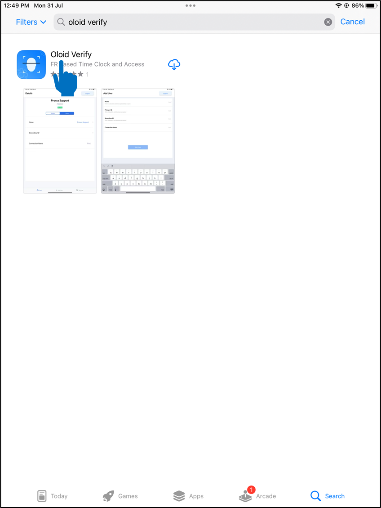
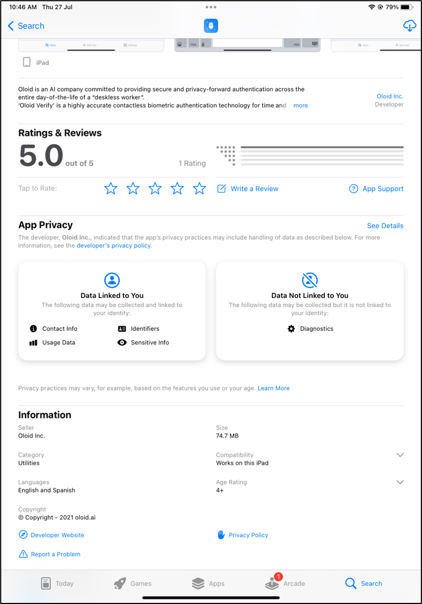
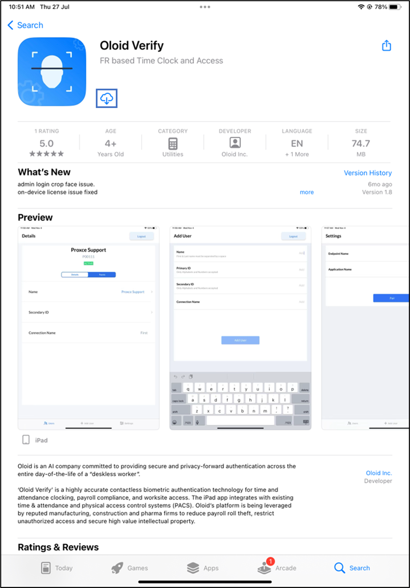
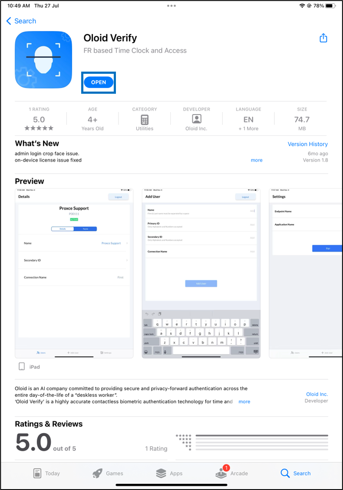
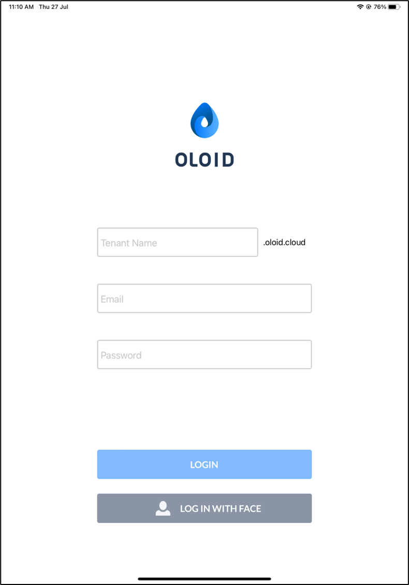

{/* Source: Intercom article 8176883 -  */}
{/* Generated by intercom_to_mintlify.py - re-running overwrites this file. */}

**Pre-requisite:**

- Make sure you have a stable internet connection and an Apple ID.

To download and install the Oloid Verify/Connect app on your iPhone or iPad:

1. Locate the **App Store** on your home screen and tap on it to launch the application.

   

2. Tap on the **Search** icon located at the bottom right corner of the screen.

   

   The Search bar is displayed.
3. In the search bar at the top of the screen, type **Oloid Verify**/**Connect** and tap on the search result.

   

4. Select **Oloid Verify**/**Connect** app.

   

5. Review the app's details, ratings, and user reviews to make sure it's the correct app you want to download.

   

6. Tap the **Get** button located next to the **Oloid Verif**y/**Connect** app icon.

   

   <Note>
     **Note:** If prompted, enter your Apple ID password or use Touch ID/Face ID to confirm the download.
   </Note>

   Once the installation is complete, the **Get** button is changed to an **Open** button.

   

7. Tap on the **Open** button to launch the **Oloid Verify**/**Connect** app.

   

   The login screen is displayed.
