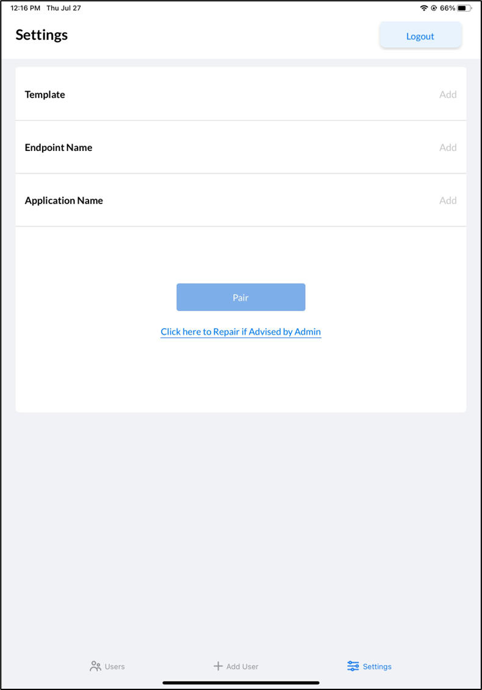
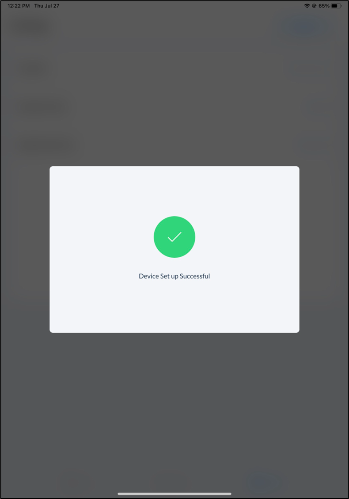
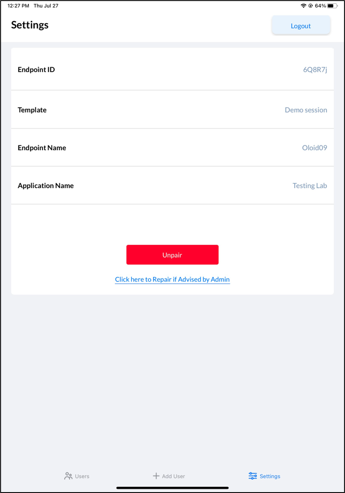

{/* Source: Intercom article 8181293 -  */}
{/* Generated by intercom_to_mintlify.py - re-running overwrites this file. */}

To pair an endpoint:

1. Log in as Admin to Oloid **Verify**/**Connect**.

   <Note>
     **Note:** For more information on logging in to admin mode, see **[How to log into the admin mode of Oloid Verify/Connect App as a Supervisor](/drafts/platforms/ios/connect-passwordless/oloid-connect-app-how-to-log-in-to-admin-mode-as-a-supervisor-or-admin)**.
   </Note>

   The **Settings** page is displayed on successful login.

   

2. Do the following:
   1. Add **Template (**optional**)**.

      <Note>
        **Note:** Templates allow Admins to configure Endpoints at scale. A template has to be created in Tenant Admin Portal.
      </Note>

   2. Enter **Endpoint Name**.
   3. Select **Application Name** from **Application Name** dropdown.
   4. Click **Pair**.

      

      The settings are saved.

      

      The endpoint is successfully paired.

