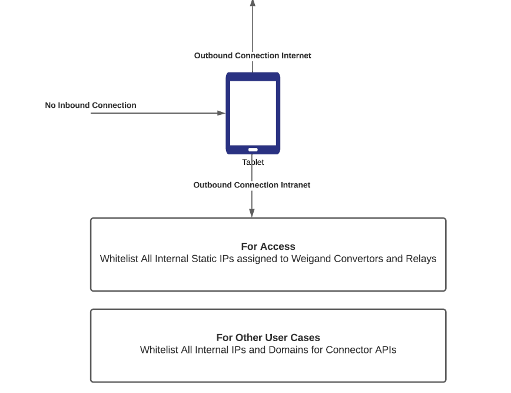

{/* Source: Intercom article 8181542 -  */}
{/* Generated by intercom_to_mintlify.py - re-running overwrites this file. */}

Oloid Verify/ Connect **Network architecture** refers to the way **network** devices and services are structured to serve the connectivity needs of client devices.

Please ensure tablet network ( wifi or ethernet ) is able to communicate with below servers. All calls are outbound

| 1 | oloid.cloud | 80, 443 | Production Oloid Face Vault Platform Root Domain |
| --- | --- | --- | --- |
| 2 | *.oloid.cloud | 80, 443 | Production Flex Tenant Sub Domains |
| 3 | oloiddev.com | 80, 443 | Development Oloid Face Valut Platform Root Domain |
| 4 | *.oloiddev.com | 80, 443 | Development Flex Tenant Sub Domains |
| 5 | fr.proxce.co | 80, 443 | Legacy Development Server ( Used for telemetry ) |
| 6 | Auth.Face-vault.co | 80, 443 | Legacy Production Server ( Used for telemetry ) |
| 7 | *.crashlytics.co | 80, 443 | Capturing Crash Logs |
| 8 | *.amazonaws.com | 80, 443 | Accessing AWS Resources directly ( e.g S3 ) |
| 9 | pce.proxce.co | 80, 443 | Rule Engine ( for Email Alerts ) |
| 10 | cv.proxce.co | 80, 443 | Legacy Computer Vision Server |
| 11 | *.googleapis.com | 80, 443 | Firebase Pub Sub Production Interface |
| 12 | visionlabsbv.prod.sentinelcloud.com | 80, 443 | On Device FR License Management Server |
| 13 | google.com | 80, 443 | Google Cloud Platform related APIs |

