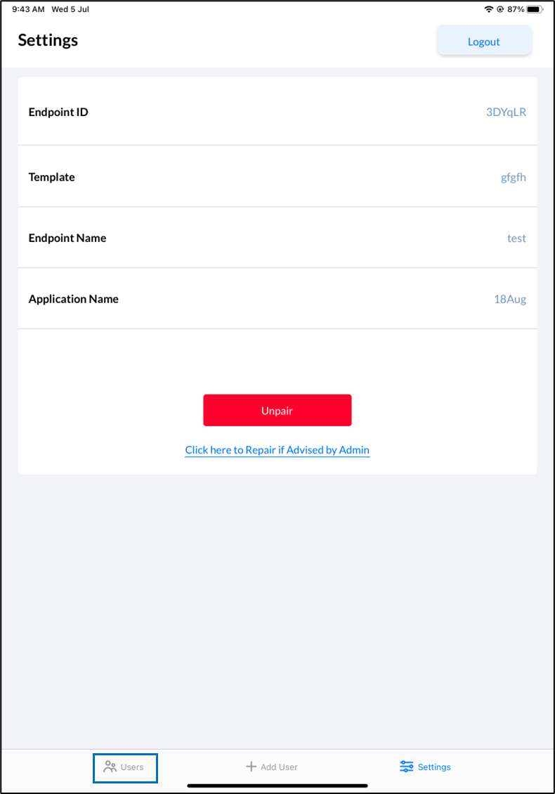
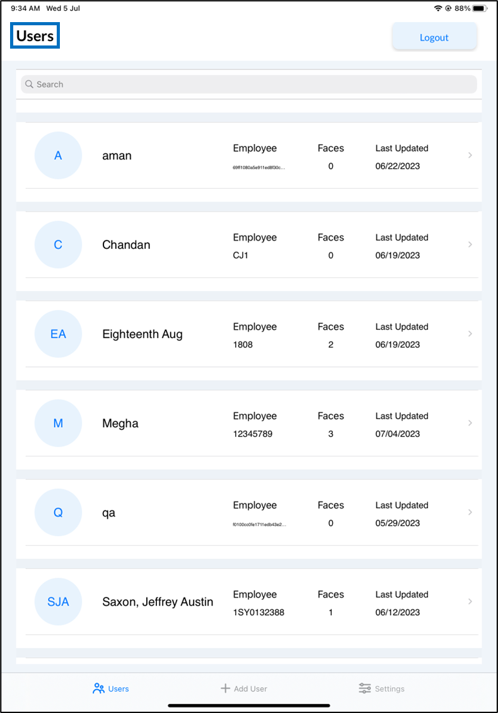
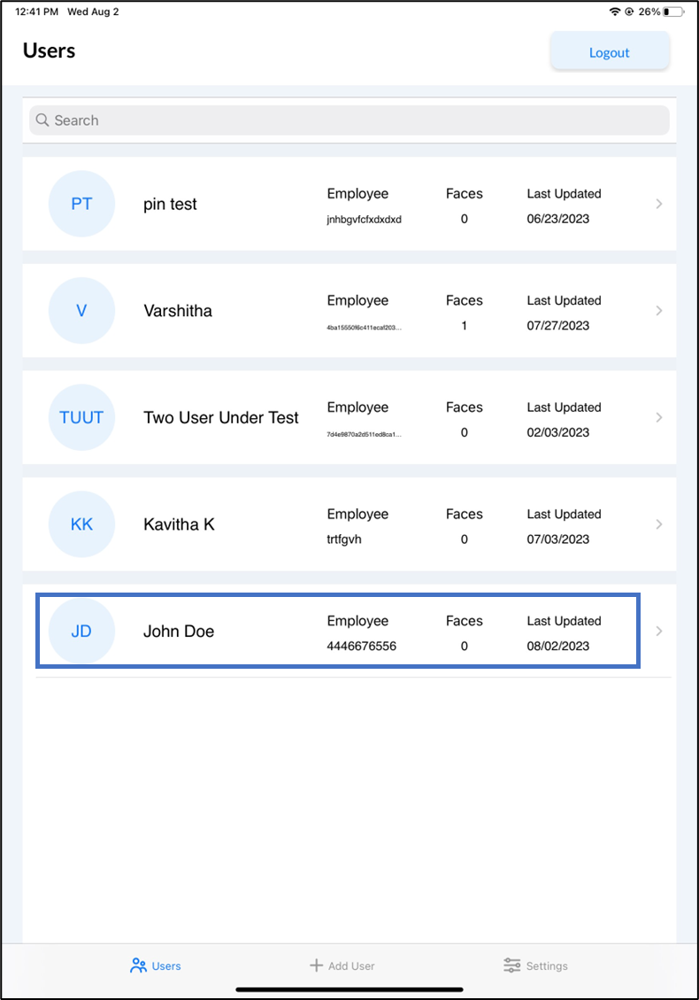
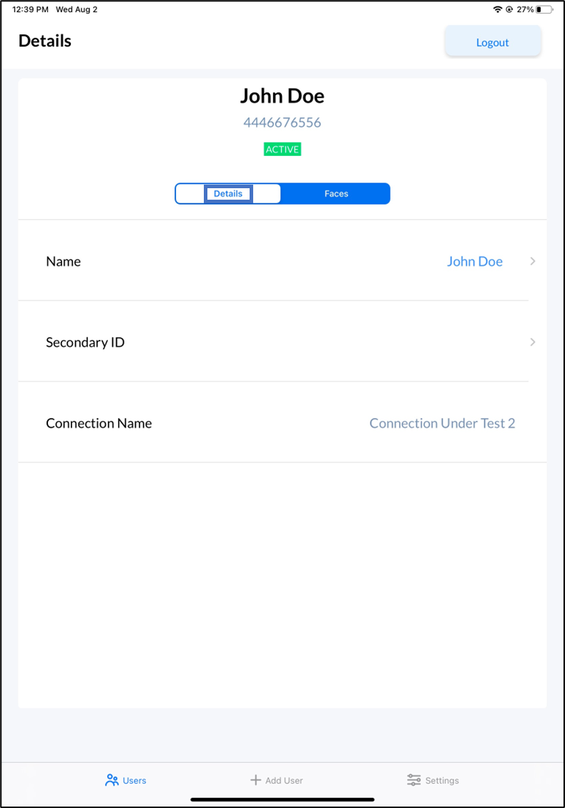
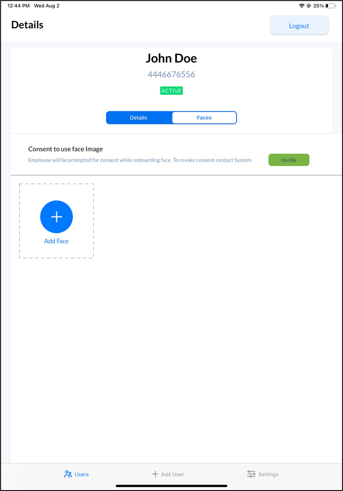
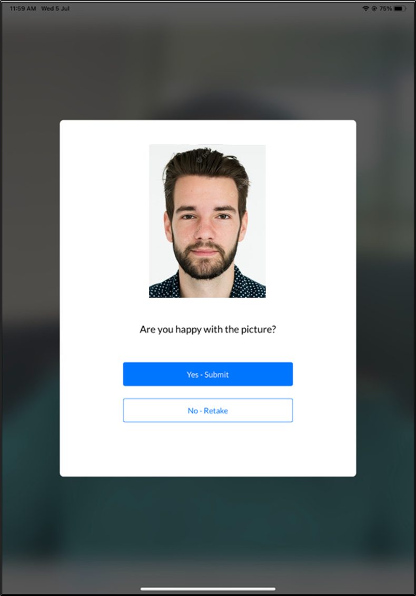

{/* Source: Intercom article 8094014 -  */}
{/* Generated by intercom_to_mintlify.py - re-running overwrites this file. */}

## Introduction

This feature of Oloid Connect app allows the user to add faces to their profile.

<Note>
  **Note:** If connection is enabled to take consent for user, it will ask for consent before uploading the pic.
</Note>

## Pre-requisite

User should be added to the connection.

To add faces,

1. Do one of the following:
   1. For existing user:
      1. Tap **Users** on the menu at the bottom of the screen.

         

         The Users page is displayed with the list of users.

         

      2. Select user to add a face from **Users** list.

         

         The User details screen opens.

         

   2. For new User:
      1. Tap **+Add User** on the menu at the bottom of the screen to add a user. See **[Add User](/drafts/platforms/ios/time-clock/oloid-connect-verify-add-user-archived)**.
         The User details screen opens.

         

2. Tap **Faces** tab and select **Add Face**.

   

   The camera turns on.
3. Capture the user face.
4. The pop-up screen appears with the captured image.

   

5. Do one of the following:
   1. Tap **Yes- Submit** to submit the image.
      The face is submitted successfully and is displayed on the details screen.
   2. Tap **No- Retake** to take the photo again.
      The camera turns on to retake photo.

      <Note>
        **Note:** You can add a maximum of five faces per user.
      </Note>

      Your face should be visible in the camera, else it might get rejected. It is recommended to avoid wearing things that cover your facial features such as sunglasses, masks, headbands etc. Refer to Oloid's Image Reference Guide to see guidelines on face onboarding images.
