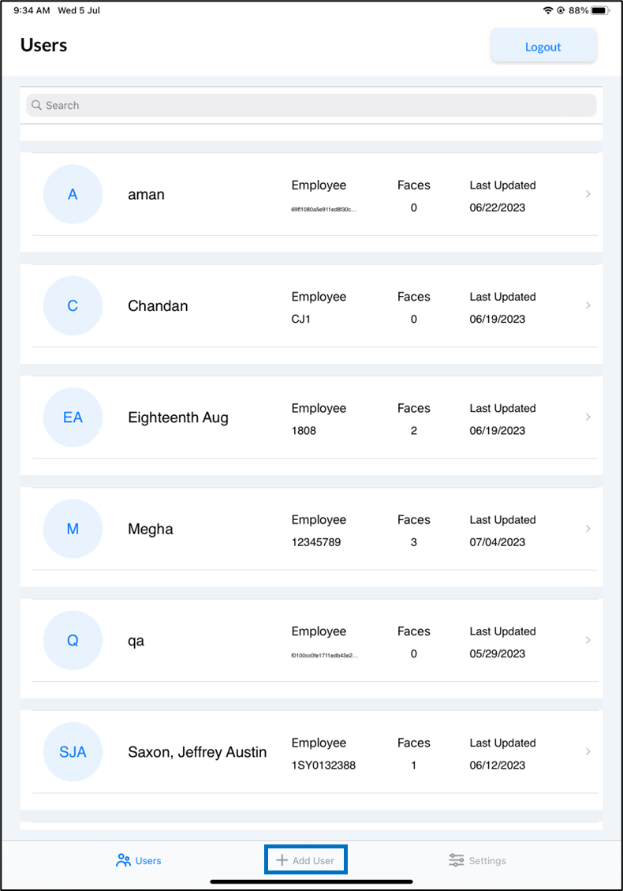
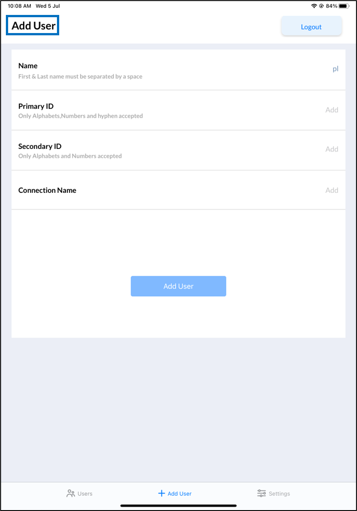
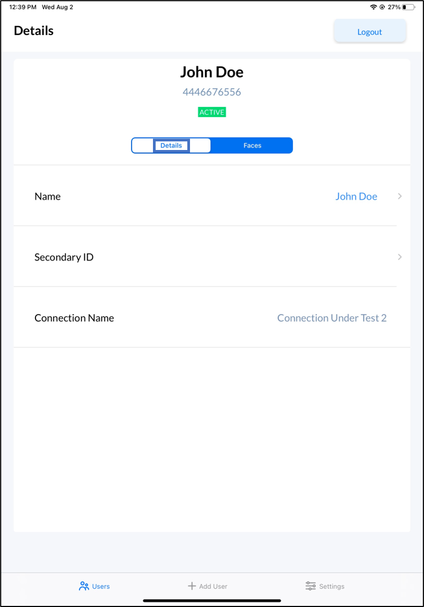

{/* Source: Intercom article 8093513 -  */}
{/* Generated by intercom_to_mintlify.py - re-running overwrites this file. */}

## Introduction

This feature of Oloid Connect app allows the user in tenant admin mode to add new users using the app.

To add user,

1. Tap **+Add User** on the menu at the bottom of the screen.

   

   The **Add User** screen opens.

   

2. Enter **Name**.
   First name and Last name should be separated by a space.
3. Enter **Primary ID**.
   Only alphabets, numbers, and hyphen are accepted.
4. Enter **Secondary ID**.
   Only alphabets and numbers are accepted.
5. Select connection name from **Connection Name** list.
6. Tap **Add User**.
   A new user is added and user details are displayed in **Details** screen.

   
