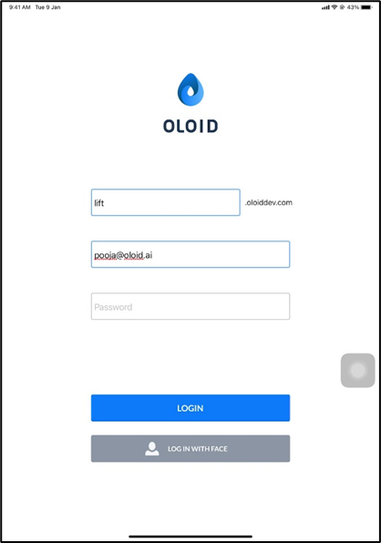
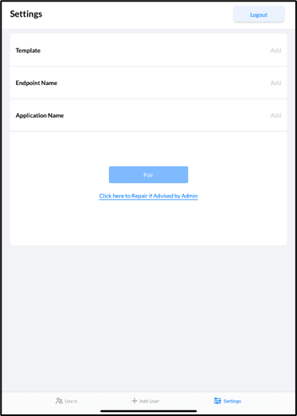
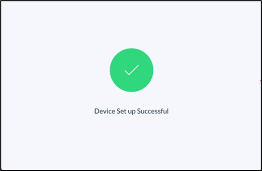
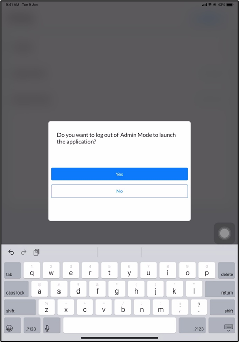

{/* Source: Intercom article 6904472 -  */}
{/* Generated by intercom_to_mintlify.py - re-running overwrites this file. */}

**Pre-requisite:**

- You should be a Tenant Admin.
- Application, Connections, and template (optional) are configured in Tenant Admin Portal.

1. Go to **App Store** and download **Oloid Verify/Connect App**.

2. Install the application and upon successful installation, launch the app.

The login page is displayed.

3. Enter **Tenant Name**.

4. Enter your email id in the **Email** text field.

5. Enter your password in the **Password** text field.

6. Tap **LOGIN**.

The **Settings** page is displayed.

<Note>
  **Note:** If your face is added to the Tenant Portal as a Tenant Admin, you can tap on **LOG IN WITH FACE** to log in using your face.
</Note>

7. Do the following on the **Settings** page.

a. Add **Template** (optional).

b. Enter **Endpoint Name**.

c. Select Application Name from **Application Name** list.

d. Click **Pair.**

The settings are saved and the Device Setup success message is displayed.

<Note>
  **Note:** Once the iPad is successfully paired, other settings can be configured in the tenant admin portal.
</Note>

8. The application prompts you to log out of Admin mode.

9. Do one of the following:

a. Click **Yes** to log out and launch the application (**preview mode**).

The app displays preview mode and allows you to capture live Images for facial transactions.

<Note>
  **Note:** To go back to admin mode, **double-click with two fingers** on preview mode and tap **Yes- To Continue**.
</Note>

b. Click **No** to stay logged in to the admin mode.

You can now

i. [View User Details](/drafts/platforms/ios/time-clock/oloid-connect-verify-view-user-details-archived)

ii. [Add User](/drafts/platforms/ios/time-clock/oloid-connect-verify-add-user-archived)

iii. [Add Faces](/drafts/platforms/ios/time-clock/oloid-connect-verify-add-faces-archived)
