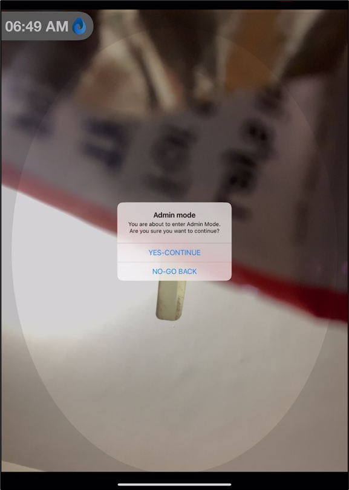
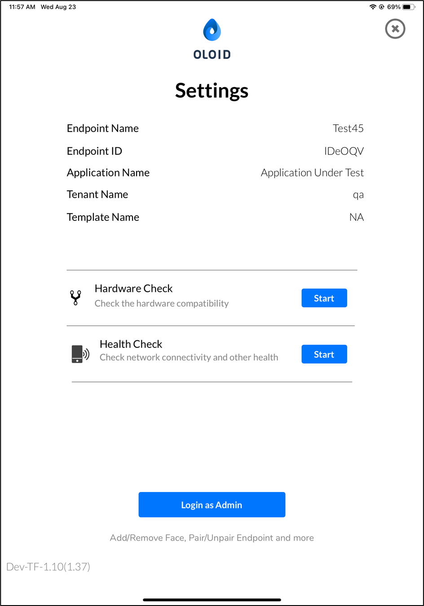

{/* Source: Intercom article 8293952 -  */}
{/* Generated by intercom_to_mintlify.py - re-running overwrites this file. */}

## Pre-requisite

Endpoint should be paired.

## To see the endpoint details on the endpoint

1. Launch the **Connect**/**Verify** app in the preview mode.
2. **Double-tap** the screen to log into **Admin Mode**.

   

3. Tap **YES-CONTINUE**.
   The Settings page is displayed.
4. On the **Settings** page, the endpoint details are displayed.

   
