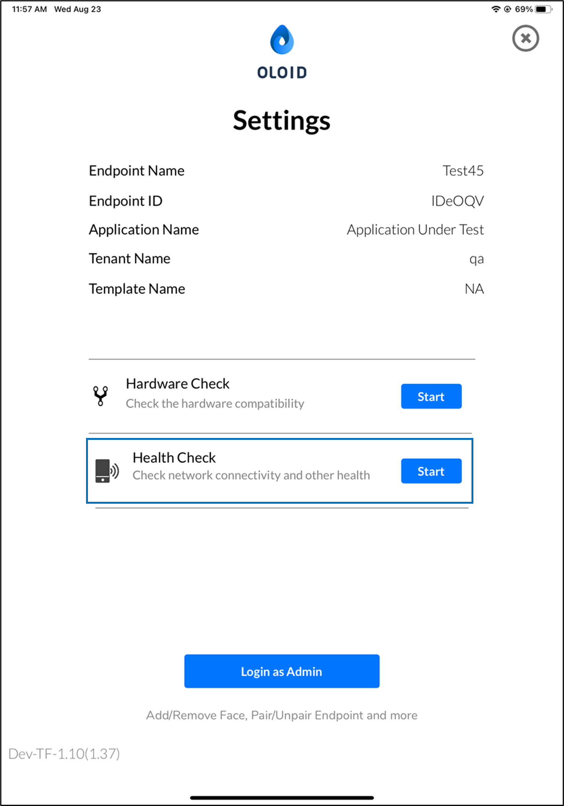
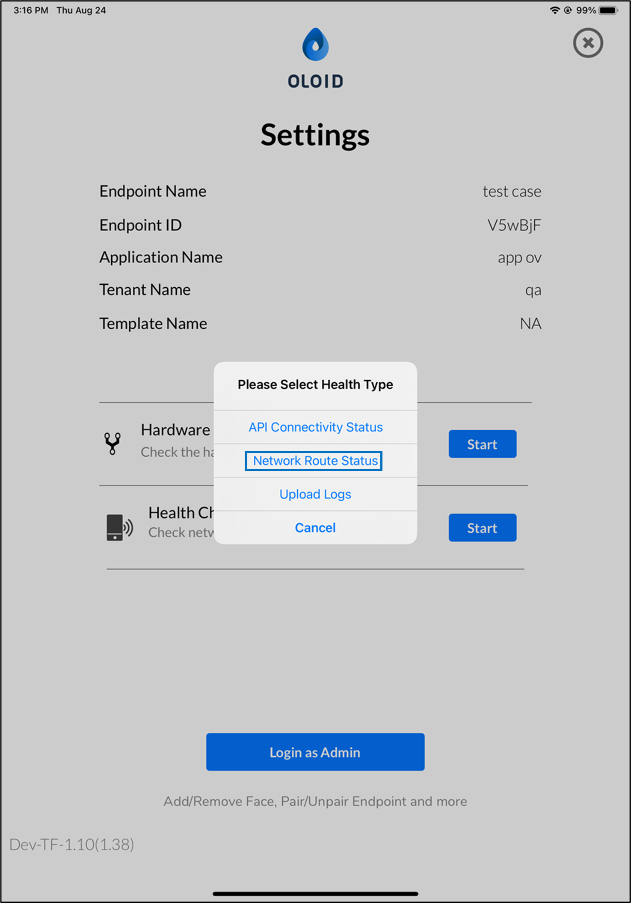
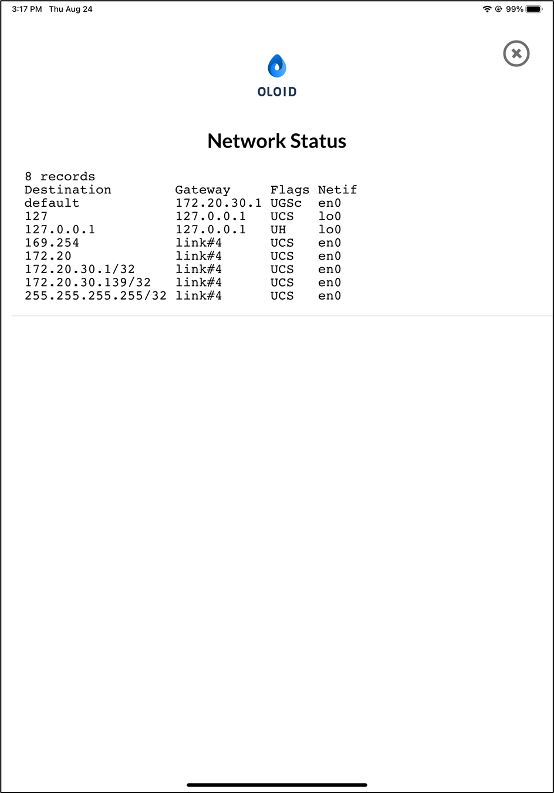

{/* Source: Intercom article 8294042 -  */}
{/* Generated by intercom_to_mintlify.py - re-running overwrites this file. */}

To test network connectivity on the endpoint:

1. Launch your Oloid **Verify/Connect** App.
2. **Double-tap** on the Preview screen with two fingers.

   <Note>
     **Note:** You can see Preview screen once the Oloid Verify App is paired.
   </Note>

   To access endpoint details, refer [Oloid Connect/Verify: How to see the endpoint details on the endpoint](/drafts/platforms/ios/time-clock/oloid-connect-verify-how-to-see-the-endpoint-details-on-the-endpoint).
3. Click **YES-CONTINUE** to log into Admin Mode.
   The Settings screen is displayed.
4. Go to the **Settings** page of Oloid **Verify/Connect** app.
5. Tap **Start** in **Health Check** section.

   

   The **Please Select Health Type** pop-up box is displayed.

On the pop-up box, tap **Network Route Status**.

The **Network Status** page is displayed.

