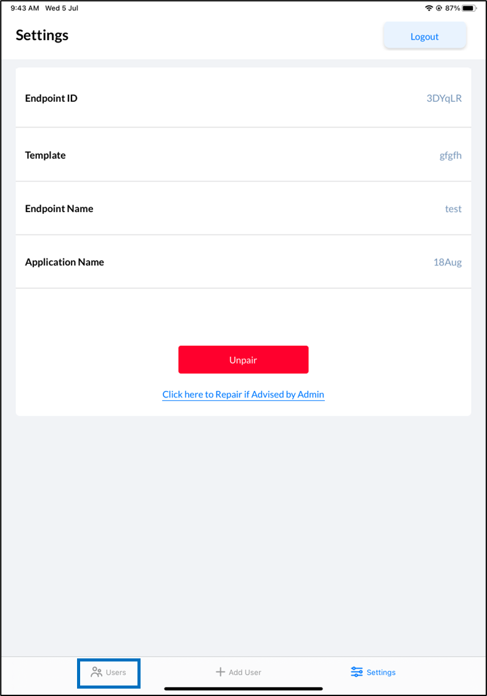
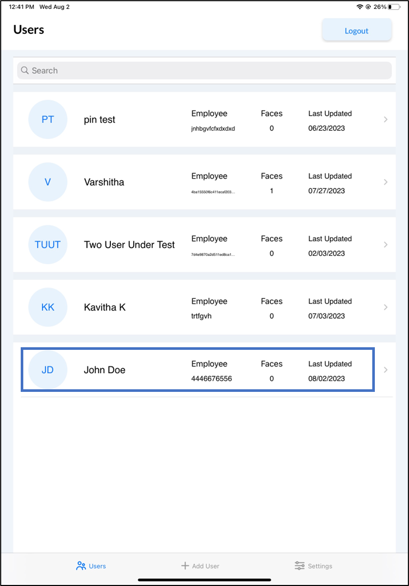
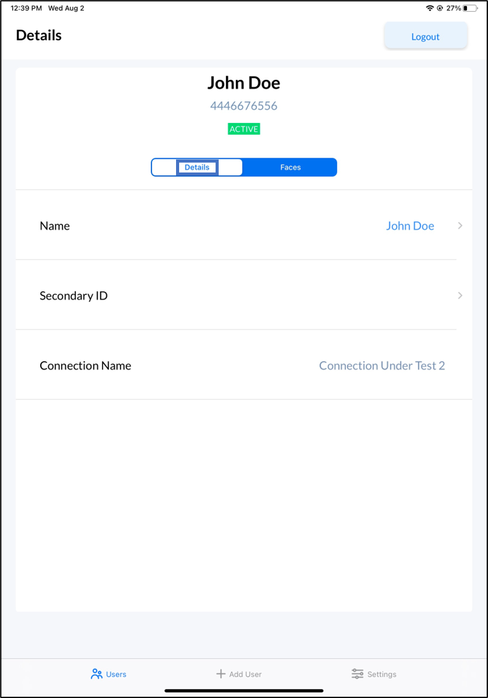

{/* Source: Intercom article 8077954 -  */}
{/* Generated by intercom_to_mintlify.py - re-running overwrites this file. */}

## Introduction

The Users screen displays a list of users in the Oloid Verify/Connect app.

### Pre-requisite

You should be logged in as a tenant admin.

### To view User details

1. Tap **Users** on the menu at the bottom of the screen.

   

   The **Users** page with list of users is displayed.
2. Tap on the selected user to view details.

   

   The User details are displayed on the screen.

   

   <Note>
     **Note:** You can search for a user using the name or primary id of the user.
   </Note>
