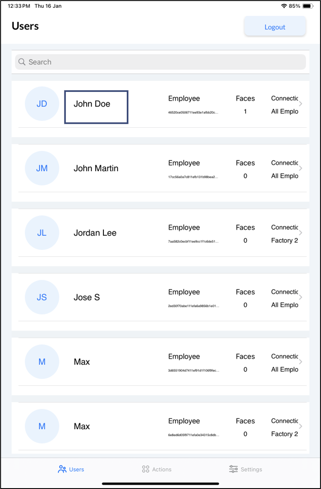
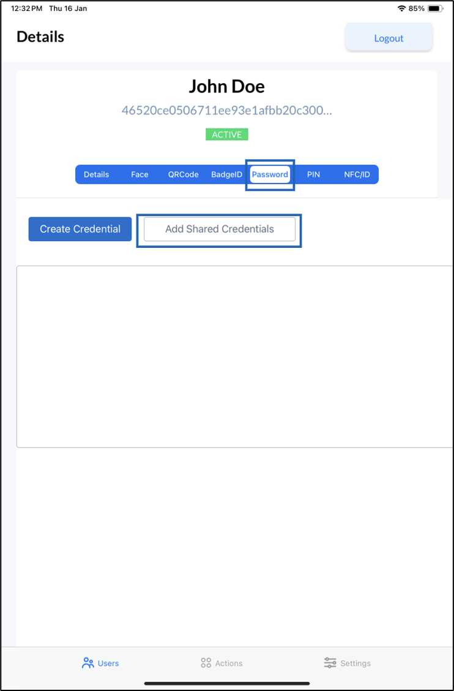
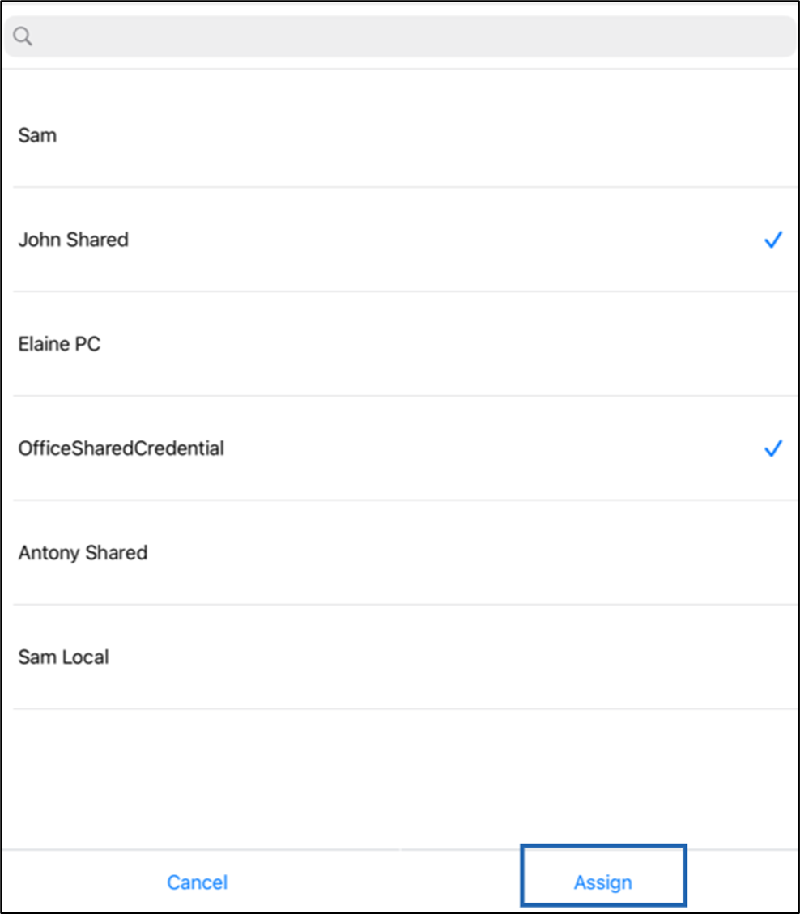
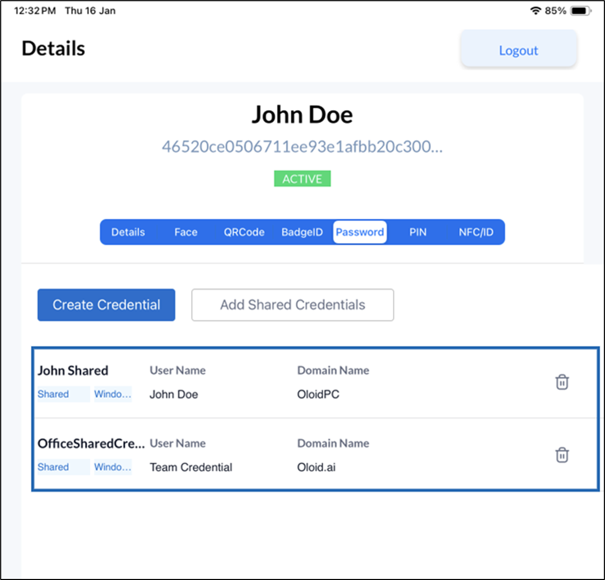

{/* Source: Intercom article 10410135 -  */}
{/* Generated by intercom_to_mintlify.py - re-running overwrites this file. */}

Steps to add Shared Credential:

1. Login to **Admin Mode** in **Oloid Connect App**.

   <Note>
     **Note:** For knowing more about logging in to Admin Mode, see [How to login to Admin More in Oloid Connect as A Supervisor/Admin](/platforms/ios/time-clock/oloid-connect/how-to-log-in-to-admin-mode-in-the-oloid-connect-app).
   </Note>

   The **Users** screen is displayed.
2. Select **User**.

   

   The **Details** screen is displayed.
3. Go to **Password** > tap **Add Shared Credentials**.

   

   The list of shared credential is displayed.
4. Select **Credential**(s) > tap **Assign**.

   

   The **Shared Credentials** are added and listed under Password tab.

   
