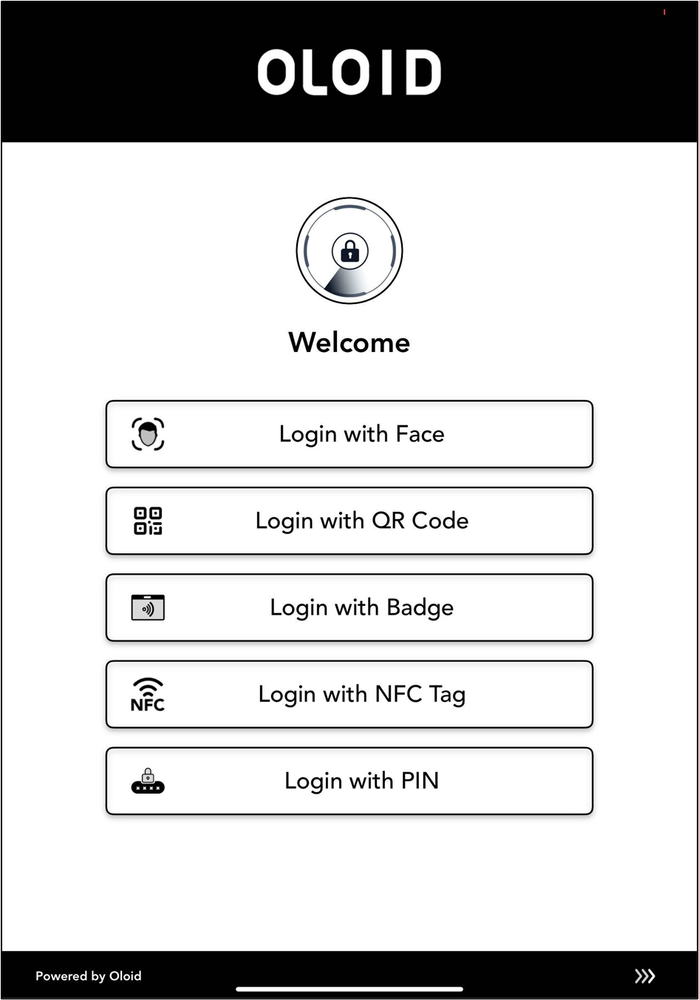
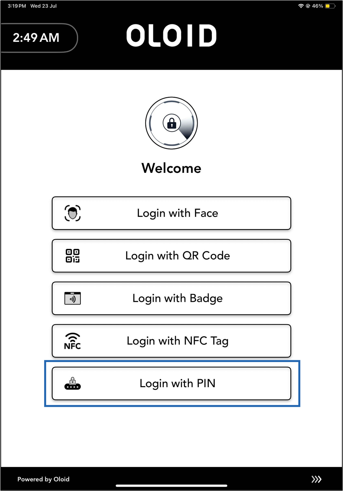
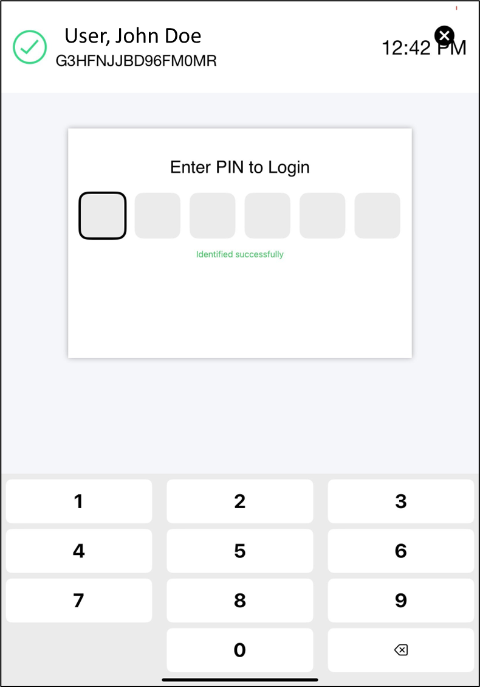
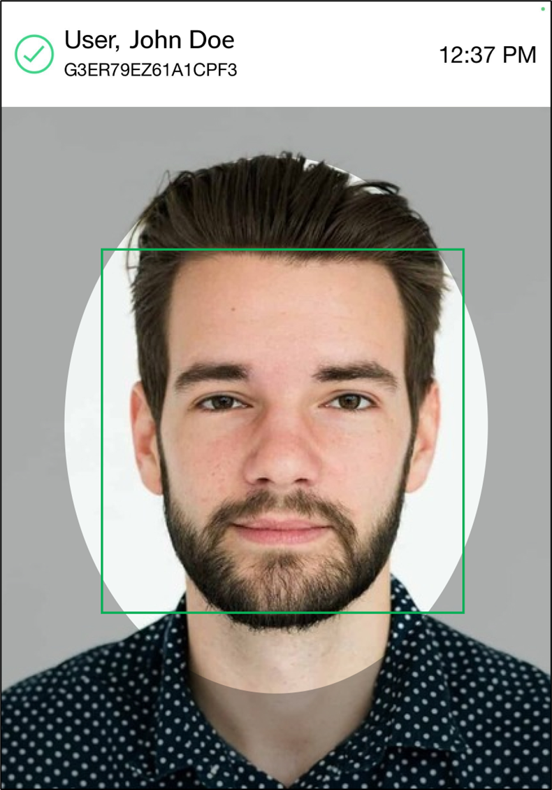
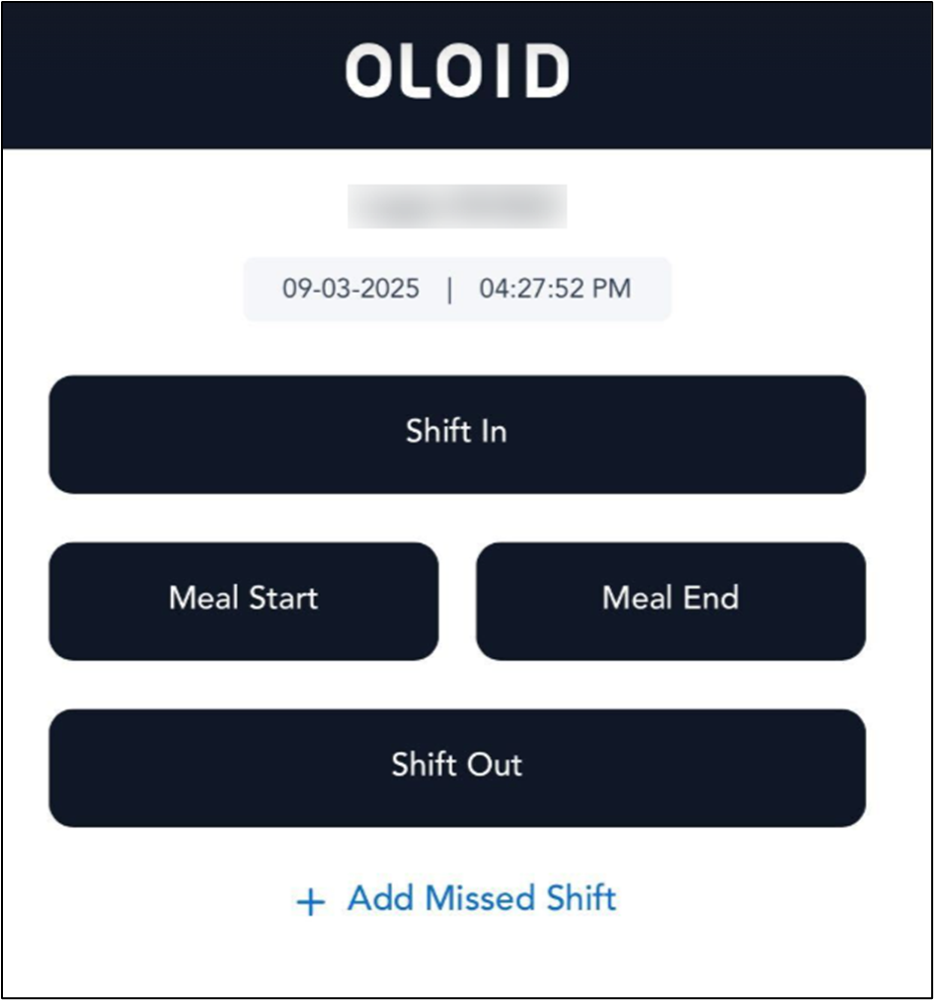

{/* Source: Intercom article 12146294 -  */}
{/* Generated by intercom_to_mintlify.py - re-running overwrites this file. */}

## Prerequisite

- In the Tenant Admin Portal, admin must do the following:
  - Add PIN for the user. For more details, refer [How to add PIN as credential to users.](/platform/tenant-admin-portal/tenant-admin-portal-how-to-add-pin-credential-for-user)
  - Assign a face credential to the user. For more details, refer [Face Onboarding](/more/passwordless-authenticator/face-onboarding)
  - Enable PIN option under the Oloid Connect application in Authentication tab. For more details, refer [How to create and configure Oloid Connect Application in Tenant Admin Portal](/platforms/ios/time-clock/oloid-connect/oloid-connect-how-to-create-and-configure-application-in-tenant-admin)

## Steps to log in using PIN and Face

1. Launch the **Oloid Connect App**.

   <Note>
     **Note:** Since the endpoint is already paired, the App will launch in the Auth selection screen of the App. For more, refer to [How to pair an Oloid Connect endpoint](/platforms/ios/time-clock/oloid-connect/oloid-connect-how-to-pair-an-endpoint).
   </Note>

   

   The Auth selection screen is displayed.
2. Tap **Login with PIN.**

   

   The **Enter PIN to Login** screen is displayed.
3. Enter PIN.

   

   After successful authentication, the Camera opens to capture the user's face.

Place your Face inside the ovel shape in the screen.

After successful authentication user details are appeared on the top of the screen.

On Face authentication, you are directed to User Portal for selecting the intent.

## Sample Screen

4. 
