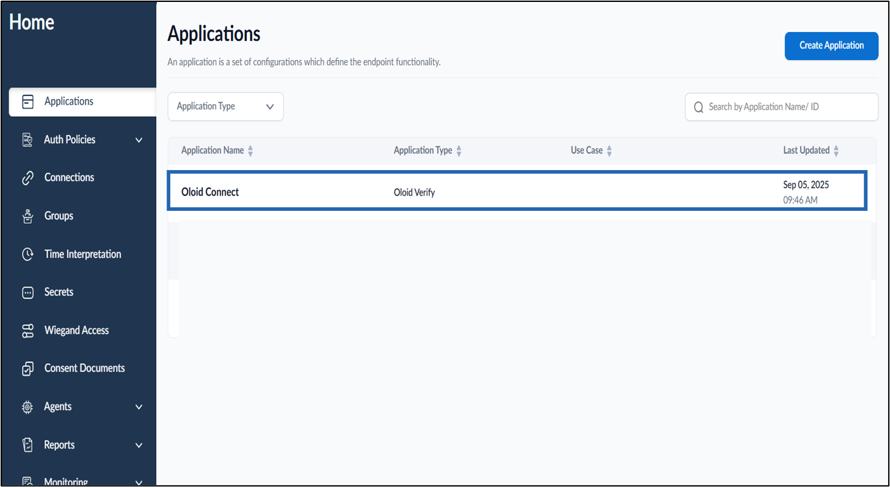
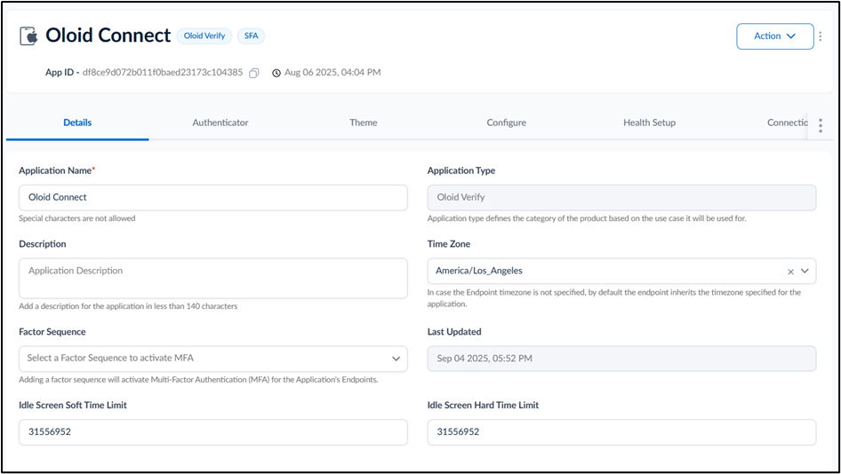
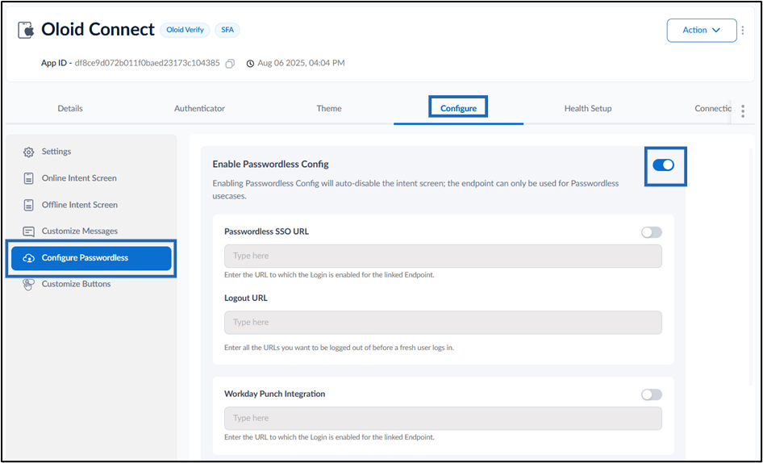
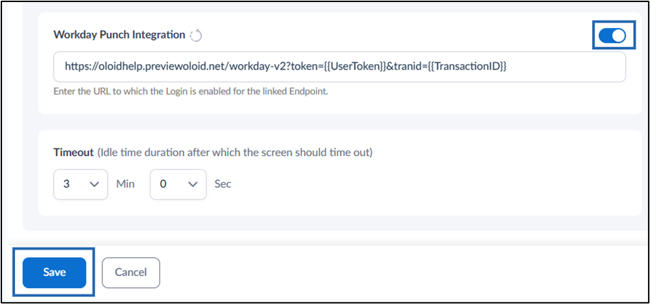

{/* Source: Intercom article 12164087 -  */}
{/* Generated by intercom_to_mintlify.py - re-running overwrites this file. */}

## Steps to configure Workday

1. Log in to the **Tenant Admin Portal**.
2. On the **Applications** page, select the **Oloid Connect** application to edit.

   

   The application page is displayed.

   

3. Go to **Configure tab.**
4. Click **Configure Passwordless** tab > **Enable Passwordless Config** toggle on.

   

5. Enable **Workday Punch Integration** toggle on.
   - In the **URL** field, enter the Workday URL in the following format.

     <Note>
       **Note:** This URL is used to record punches in Workday for the linked endpoint.
     </Note>

   - Configure the **Timeout** value to specify the idle duration (in minutes and seconds) after which the screen times out.
6. Click **Save** to apply the changes.

   

<Note>
  **Note:** For Workday application to function Passwordless Session Token should be enabled in the endpoint. Go to **Endpoint** > **Configure** tab > **Integration** > Enable **Passwordless Session Token** and **user token** toggle.
</Note>
