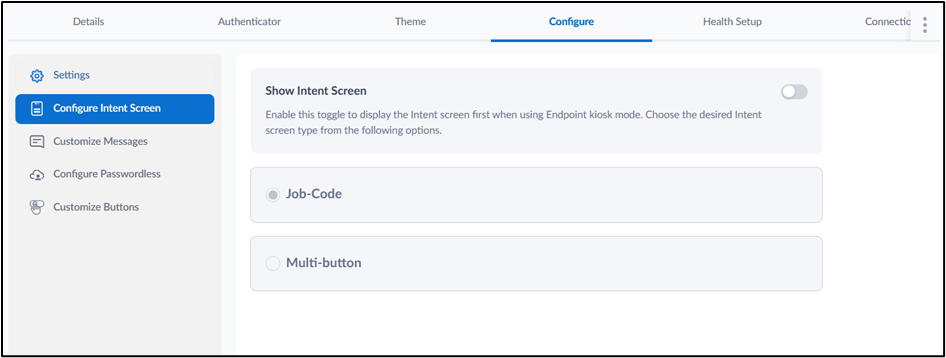
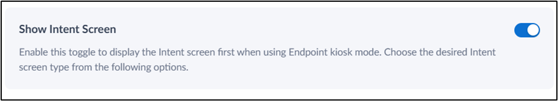
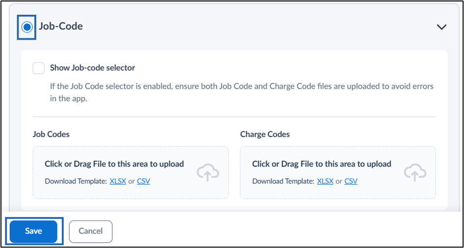
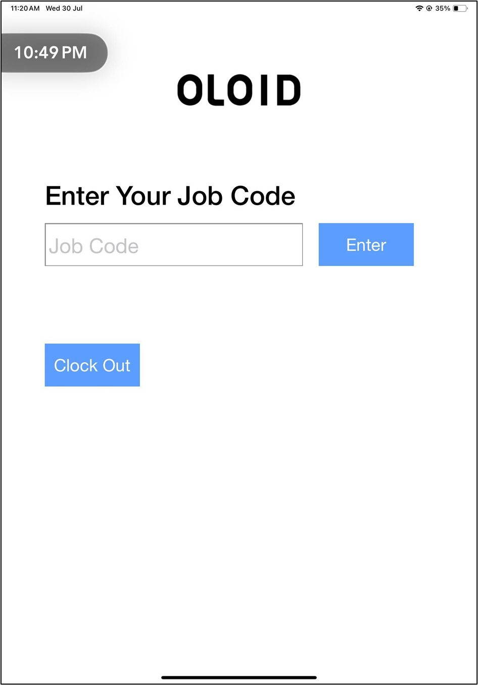
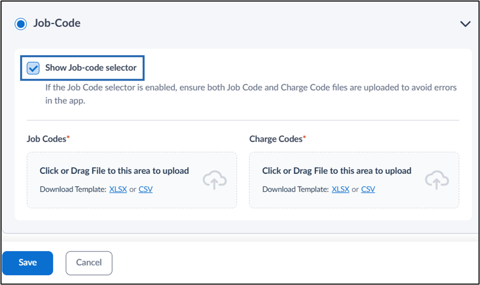
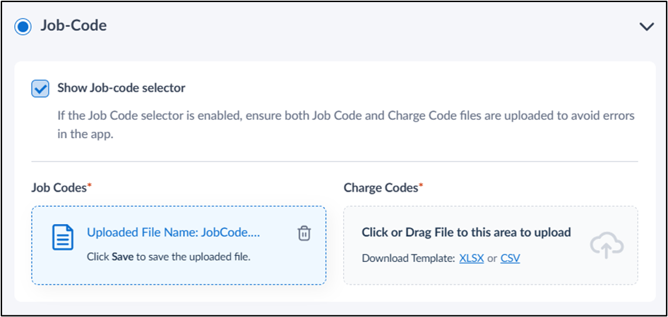
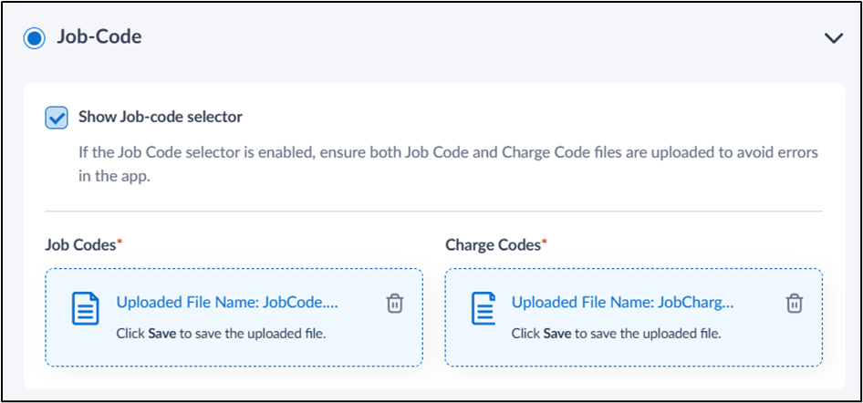
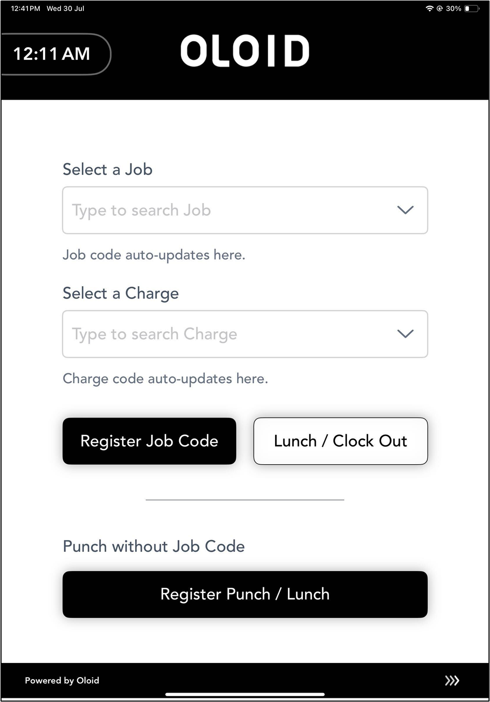

{/* Source: Intercom article 12298603 -  */}
{/* Generated by intercom_to_mintlify.py - re-running overwrites this file. */}

### Introduction

The intent screen is used in Endpoint Kiosk mode to allow users to define their actions, such as entering a job code or selecting from various options. This helps organizations guide employees through the correct steps when clocking in or clocking out.

## Steps to customize Job Code screen

1. Log in to Tenant Admin Portal.
2. Go to **Application** > **Configure** tab > **Configure Intent Screen**.

   <Note>
     **Note:** You must configure the application with which your endpoint is paired.
   </Note>

   

3. Turn on **Show Intent Screen** toggle.

   

4. Select **Job Code** to allow users to enter the job code.

   <Note>
     **Note:** You can Select the show Job Code selector option if you want to customize the Job Code screen.
   </Note>

   

5. Click **Save.**
   The intent screen is configured and displays the Job Code in the preview screen.

## Sample intent screen for Job Code

The user selects **Clock Out** after completing the assigned work.

## Configure Job Code and Charge Code

**Prerequisite**

You must prepare the Job Code and Charge Code templates before uploading. For more, refer to [How to prepare Job and Charge Code Template](/platforms/ios/time-clock/oloid-connect/oloid-connect-how-to-prepare-job-and-charge-code-template)

1. Go to the **Job-Code** section.
2. Select the **Show Job-code selector** checkbox to enable the fields for uploading Job Codes and Charge Codes.

   

### Upload Job Code File

1. In the **Job Codes** section, click or drag your file to the upload area.

   <Note>
     **Note:** The file must be in **XLSX** or **CSV** format.
   </Note>

2. If needed, download the file template:
   - Click **XLSX** to download the Excel template.
   - Click **CSV** to download the CSV template.

     <Note>
       **Note:** Fill out the template with valid job codes before uploading.
     </Note>

     

     The Job Code file is uploaded successfully.

### Upload Charge Code file

1. In the **Charge Codes** section, click or drag your file to the upload area.

   <Note>
     **Note:** The file must be in **XLSX** or **CSV** format.
   </Note>

2. If needed, download the file template:
   - Click **XLSX** to download the Excel template.
   - Click **CSV** to download the CSV template.

     <Note>
       **Note:** Fill out the template with valid Charge codes before uploading.
     </Note>

     

Click **Save**.

The Job Code file is uploaded successfully.

## Sample intent screen for Job-code selector

