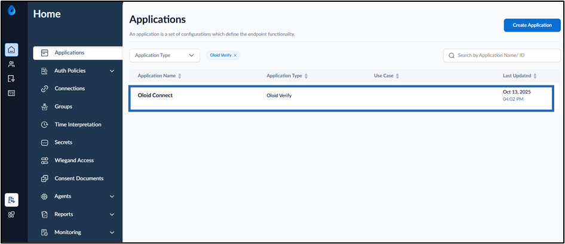
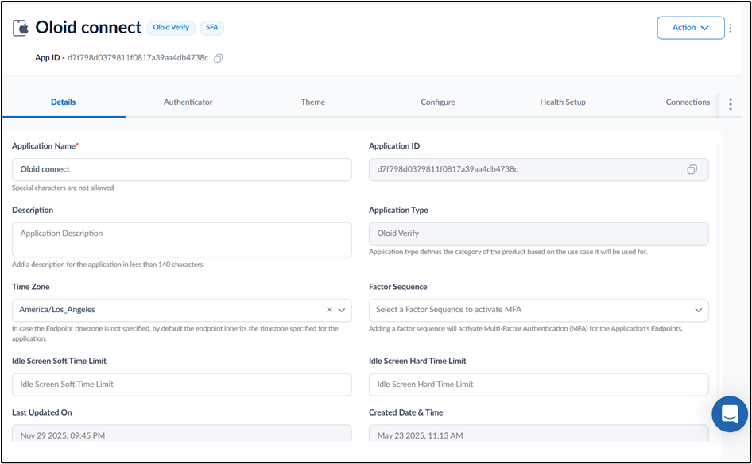
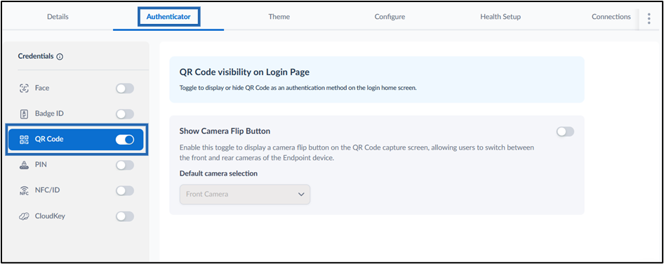
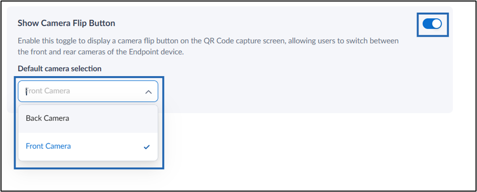
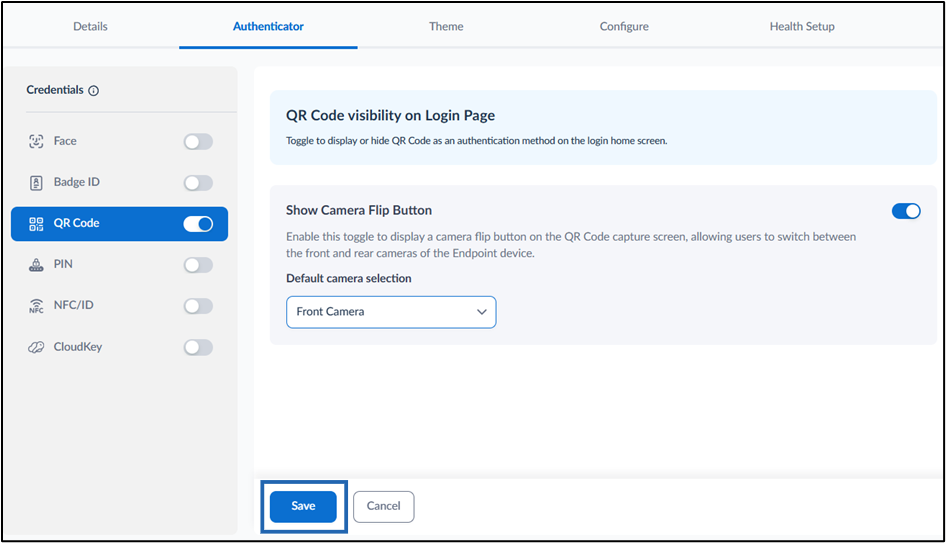

{/* Source: Intercom article 12965245 -  */}
{/* Generated by intercom_to_mintlify.py - re-running overwrites this file. */}

## Steps to enable Show Camera Flip Button

1. Log in to the **Tenant Admin Portal**.
2. On the **Applications** page, click on the Oloid Connect application.

   

   The application page is displayed.

   

3. Go to **Authenticator** > **QR Code** tab.

   

4. Turn on **Show Camera Flip Button** toggle button.

   

5. Click **Save**.

   

   The configuration is saved successfully.
