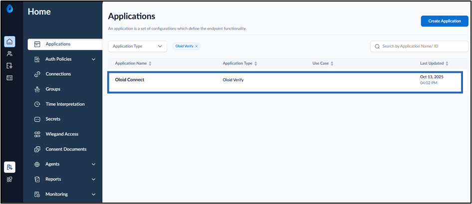
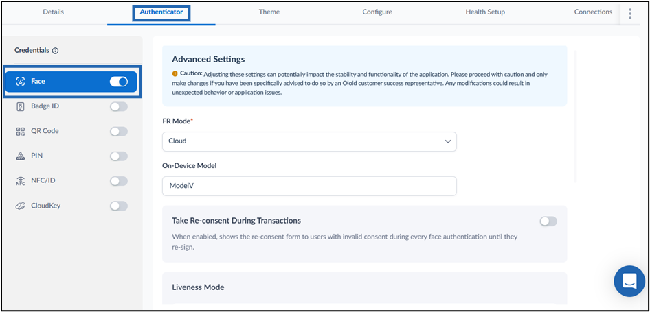
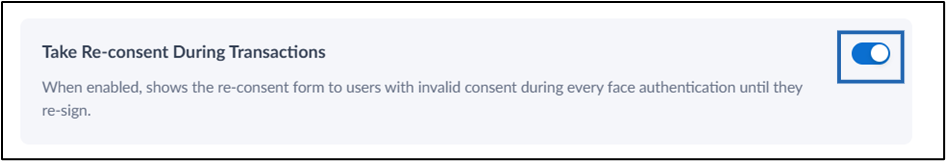
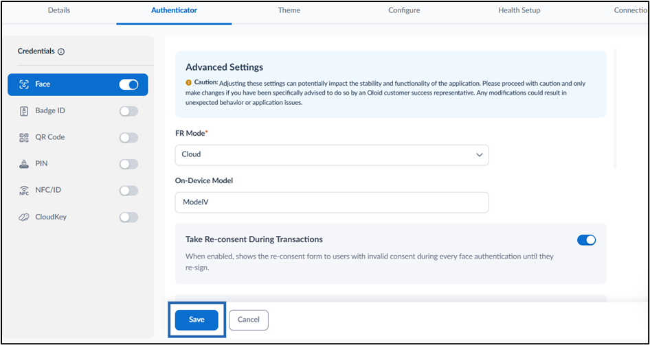

{/* Source: Intercom article 12958185 -  */}
{/* Generated by intercom_to_mintlify.py - re-running overwrites this file. */}

## Steps to enable Take Re-consent During Transactions Toggle

1. Log in to the **Tenant Admin Portal**.
2. On the **Applications** page, click on the Oloid Connect application.

   

   The application page is displayed.

   

3. Go to **Authenticator** > **Face** tab.

   

4. Turn on **Take Re-consent During Transactions** toggle button.

   

5. Click **Save**.

   

   The configuration is saved successfully.
