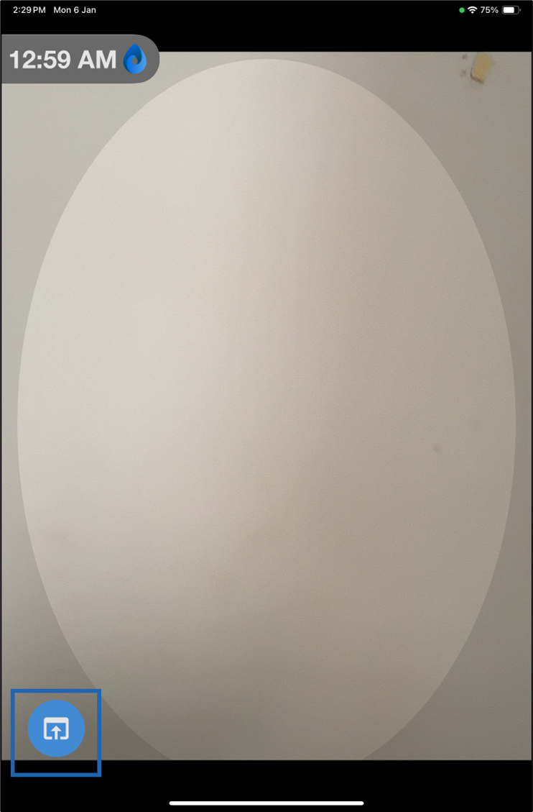
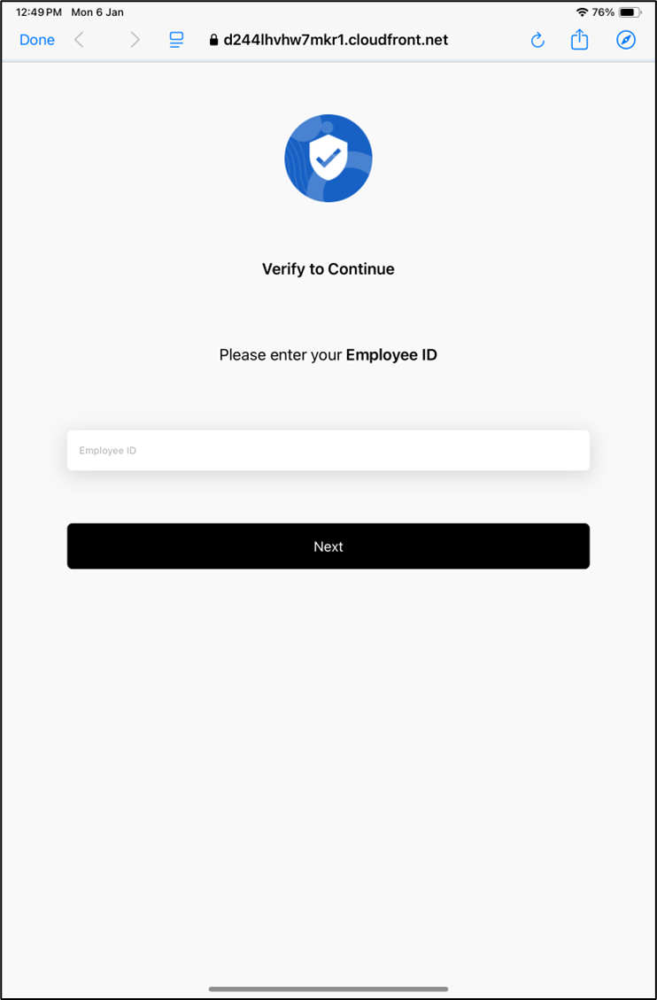
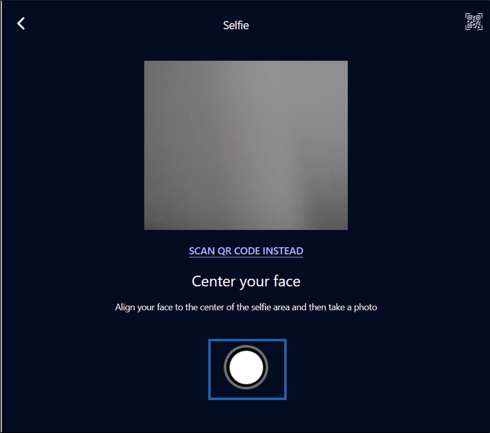
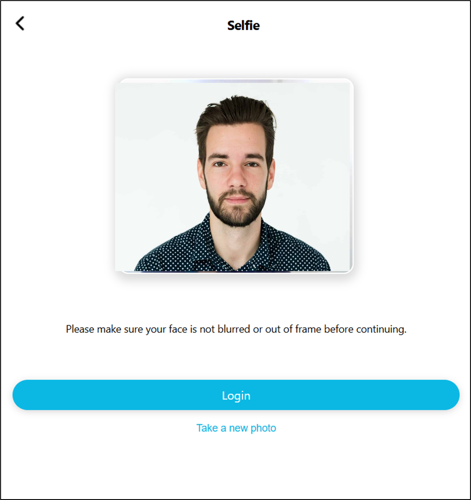
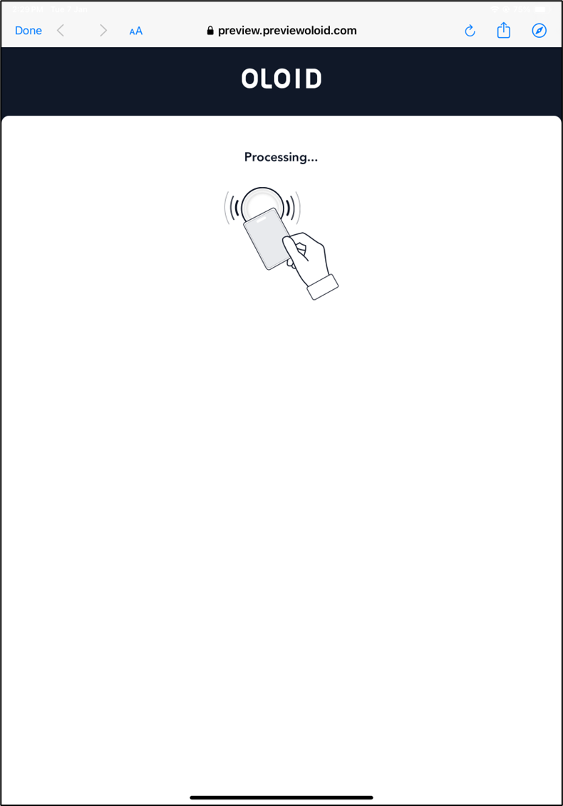
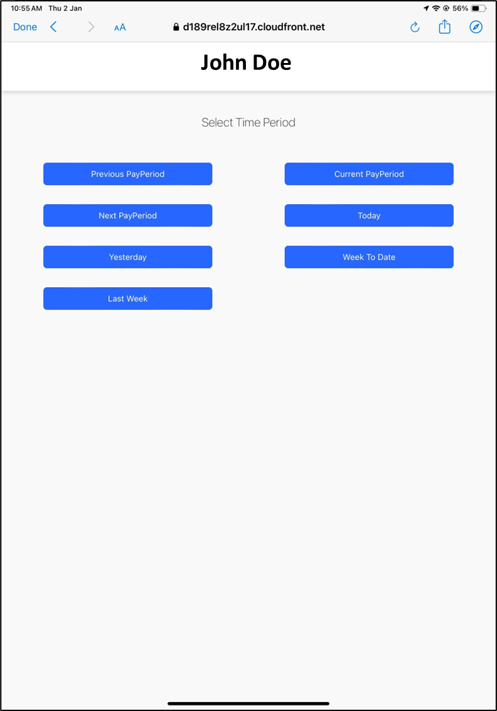
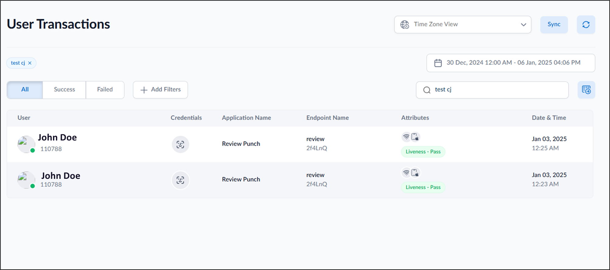

{/* Source: Intercom article 10357117 -  */}
{/* Generated by intercom_to_mintlify.py - re-running overwrites this file. */}

Steps to review transactions in Oloid Connect:

1. Open **Oloid Verify App**.
   The **camera** opens as a preview screen.
2. Tap on the **Web Button** from the bottom left corner of the screen.

   <Note>
     **Note:** If Intent screen is displayed then you have to follow the Intent screen process to reach Welcome screen. To know more see, Oloid Connect- How to use Intent screen.
   </Note>

   

   The **Verify to Continue** screen is displayed.
3. Enter you **Employee ID** > and tap on **Next**.

   

4. Do one of the following:

   <Note>
     **Note:** The authentication screen opens based on the configuration.
   </Note>

   1. Authenticate using Face or QR Code.
      The **Selfie** screen is displayed to capture Face or QR Code.
      1. Place your **face or QR Code** in front of the camera and tap on camera button to capture.

         

         The confirmation screen is displayed.

         

      2. Do one of the following:
         - Tap on **Login** to continue.
         - Tap on **Take a new photo** to recapture the face/QR Code.
   2. Authenticate using Badge.
      1. Scan the Badge on the reader.

         

         <Note>
           **Note:** Make sure the Badge reader is connected with the device.
         </Note>

         The processing is started to authenticate.

         

         The **Select Time Period** screen is displayed.
5. Tap on a button of any time period you want to view the transactions of.

   

   The **User Transactions** screen is displayed to review.

   
