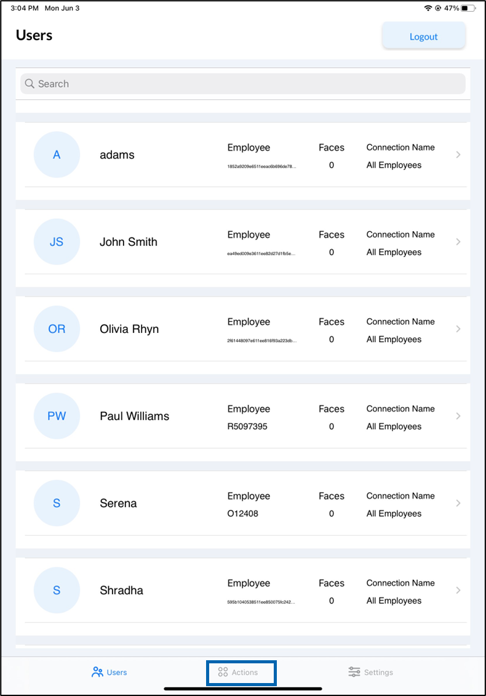
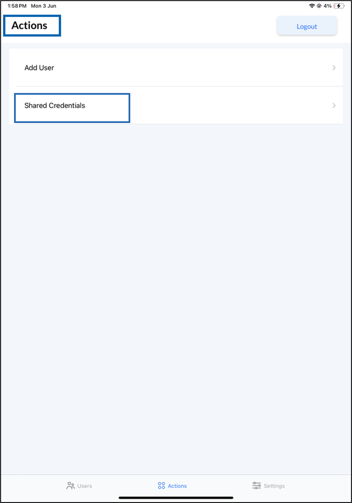
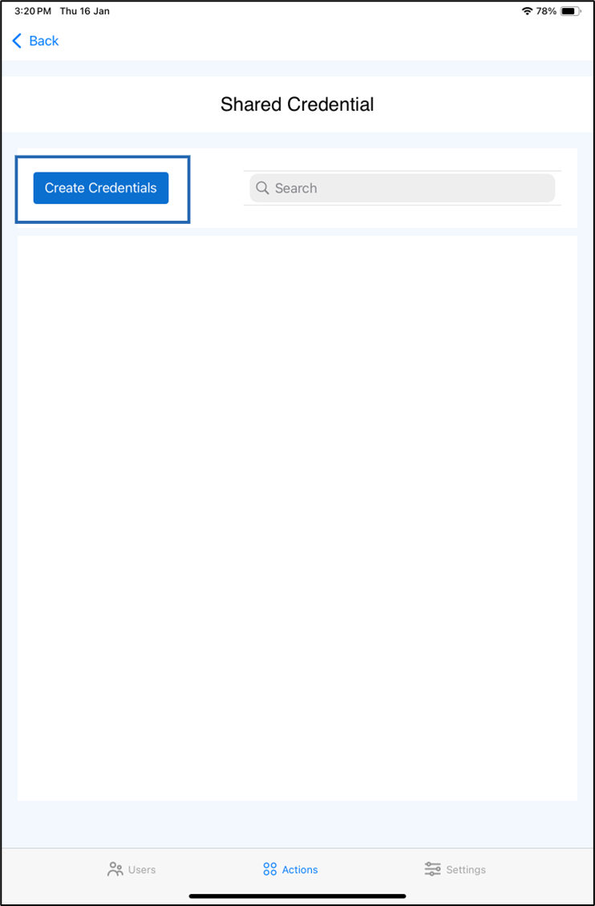
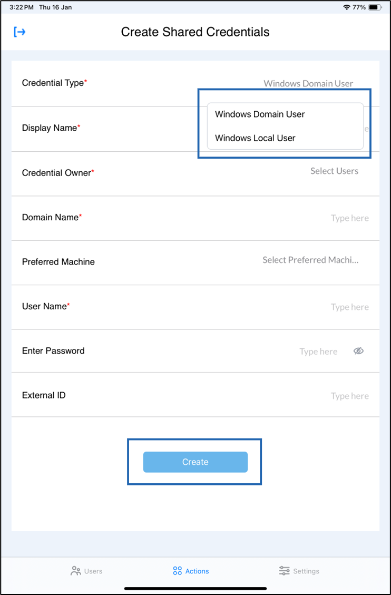
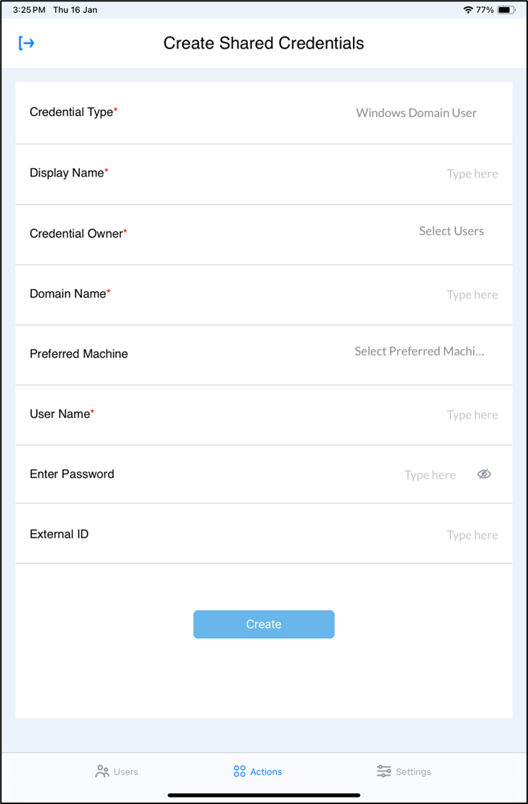
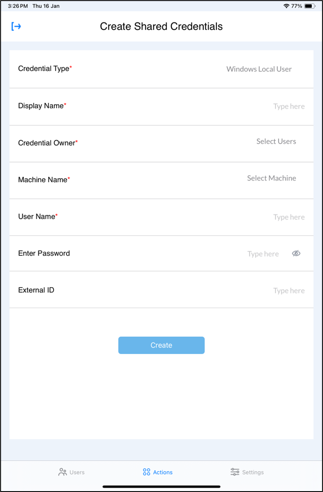

{/* Source: Intercom article 9414423 -  */}
{/* Generated by intercom_to_mintlify.py - re-running overwrites this file. */}

## Introduction

This feature of Oloid Connect app allows the Tenant Admin/Supervisor to create shared credential using the app.

To create shared credential:

1. Tap **Actions** on the menu at the bottom of the screen.

   

   The **Actions** screen opens.

   

2. Select **Shared Credentials**.
   The **Shared Credential** screen is displayed.
3. Select **Create Credentials**.

   

   The **Create Shared Credential** screen is displayed.

   

4. Do any of the following
   1. [Create Windows Domain User Credential](#windows-domain-user-credential)
   2. [Create Windows Local User Credential](#windows-local-user-credential)
5. Tap **Create**.
   The Shared Credential is created and list under Shared Credential tab

### Windows Domain User Credential

1. Select **Windows Domain User** in Credential Type.
2. Enter **Display Nam**e.
3. Select **Credential Owner** from the list.
4. Enter **Domain Name**.
5. Select **Preferred Machine**(s) from the list. (Optional)
6. Enter **User Name** for the account.
7. Enter **Password**. (Optional)
8. Enter **External ID**. (Optional)
9. Tap **Create**.

The shared credential for Domain Users is created.

### Windows Local User Credential

1. Select **Windows Local User** in Credential Type.
2. Enter **Display Name**.
3. Select **Credential Owner** from the Users' list.
4. Select **Machine Name**.
5. Enter **User Name** for the account.
6. Enter **Password**. (Optional)
7. Enter **External ID**. (Optional)
8. Tap **Create**.

The Shared Credential for Local Users is create.
