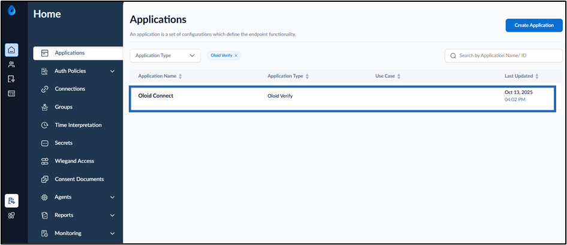
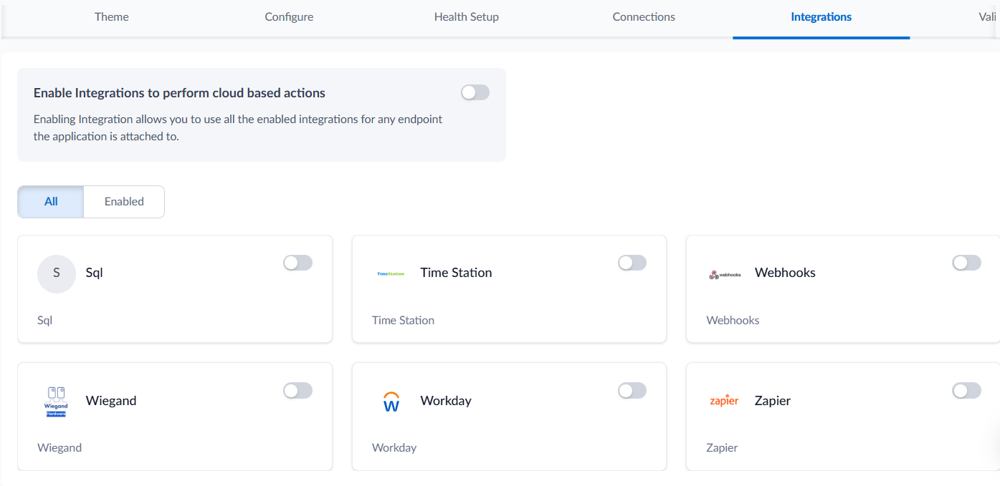
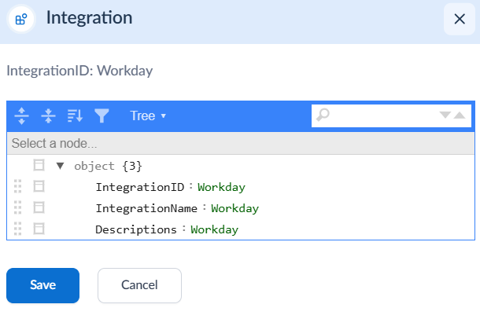

{/* Source: Intercom article 15642958 -  */}
{/* Generated by intercom_to_mintlify.py - re-running overwrites this file. */}

## Steps to Configure Workday Time Clock

1. Log in to the **Tenant Admin Portal**.
2. On the **Applications** page, click on the preferred Oloid Connect application.

   

   The application **details** page is displayed.

   

3. Go to **Integrations** tab.
4. Enable **Workday** toggle.

   

   The **integration** pop up box is displayed.
5. Click **Save.**

   

   The Workday integration is enabled successfully
