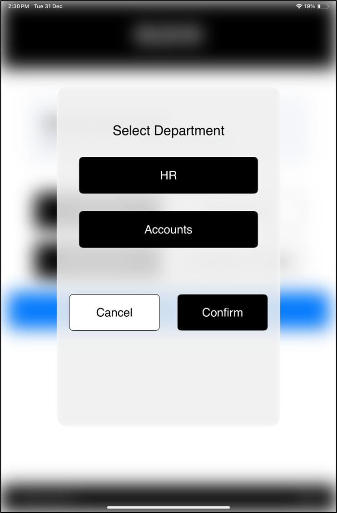
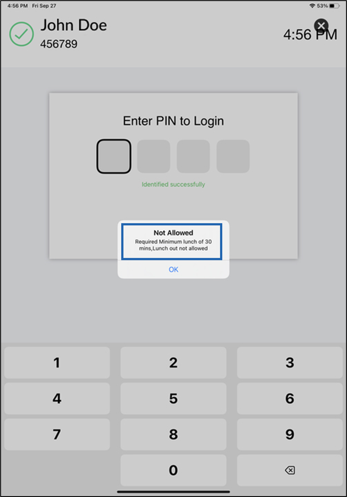
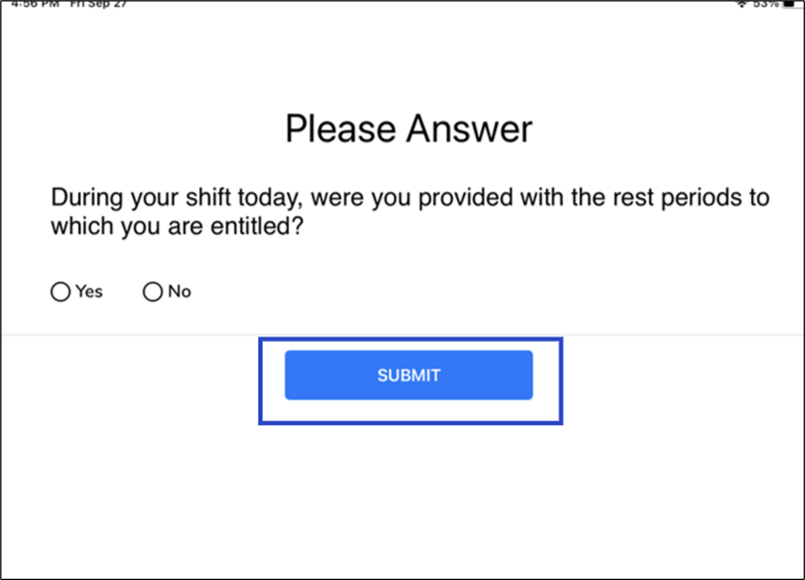

{/* Source: Intercom article 10337638 -  */}
{/* Generated by intercom_to_mintlify.py - re-running overwrites this file. */}

Intent screen is used to monitor user's actions by entering the Job Code or selecting from multiple buttons.

- [Job Code](#steps-to-verify-with-job-code)
- [Multi-button](#steps-to-verify-with-multi-button)

## Steps to verify with Job Code

1. Launch **Oloid Connect App**.
   The **Enter Your Job Code** screen is displayed.
2. Do one of the following:
   1. Enter **Job Code** and tap on **Enter** to check-in
   2. Enter **Job Code** and tap on **Check Out** to check-out.
      The **Welcome** screen is displayed.

      <Note>
        **Note:** To know more about logging in with face, QR Code, Badge, Pin and NFC ID, See, How to Log in with Face, How to log in with QR, How to log in with Badge, How to log in with PIN, How to log in with NFC ID.
      </Note>

## Steps to verify with Multi-button

1. Launch **Oloid Connect App**.
   The **Intent Screen** is displayed.
2. Select your choice from following given button
   The **Welcome Screen** is displayed.

   <Note>
     **Note:** You can log in using Face, QR Code, Badge, PIN, and NFC ID. To know more, see **How to Punch in to Oloid Connect.**
   </Note>

| Conditions | Action to be done |
| --- | --- |
| **Select Department screen is displayed** | 1. Tap on **In Punch.** The **Select Department** screen is displayed.  2. Select any one department. 3. Click Confirm. The Welcome screen is displayed |
| **Lunch Break Rule** | The user cannot End Lunch before the Lunch Break duration is over. If the user tries to do so then a warning pop-up is displayed.  |
| **Survey Form Question** | The Survey Question screen is displayed and the user has to answer a survey question after checking out.  |
