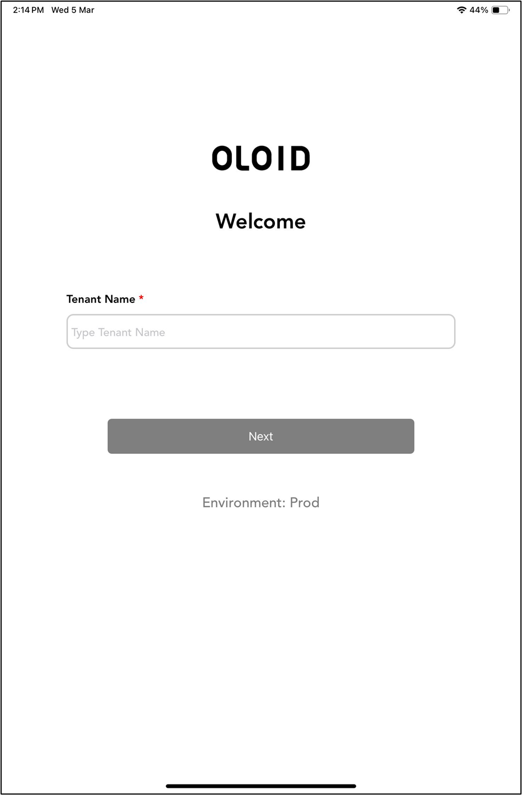
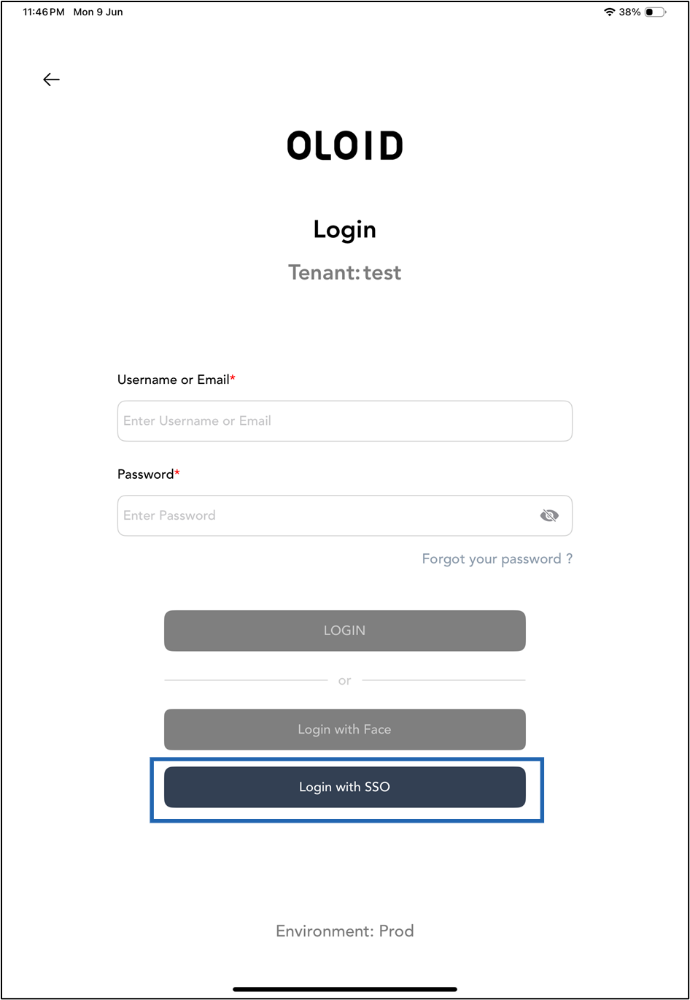
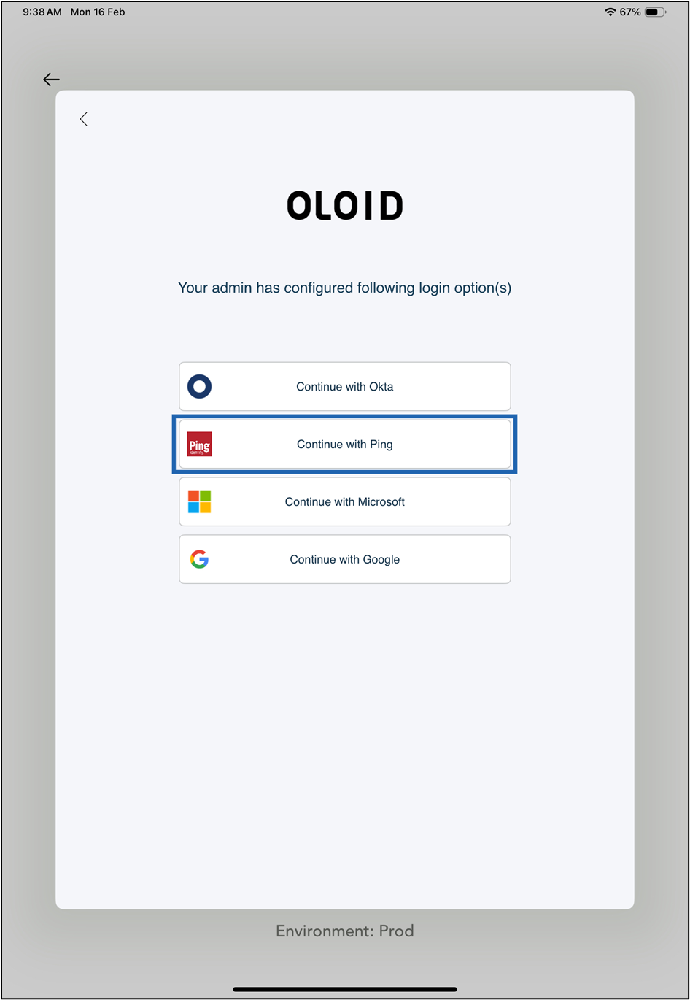
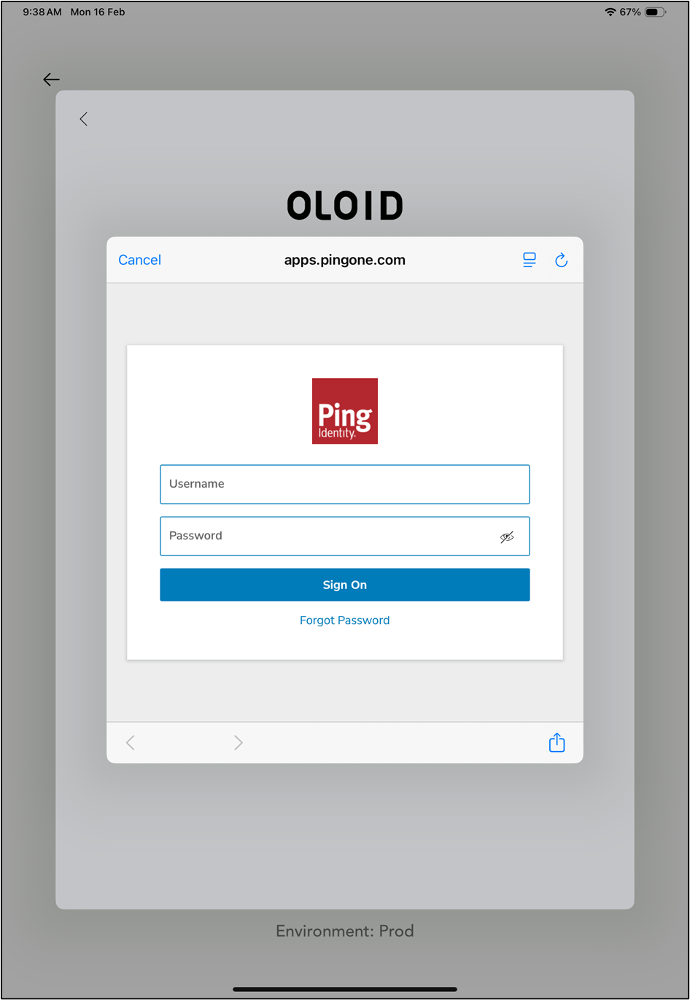
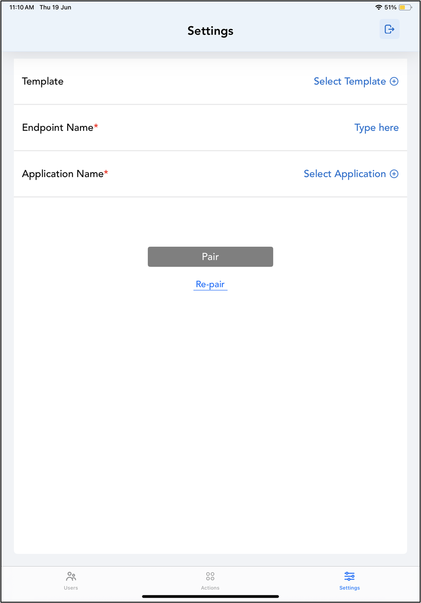

{/* Source: Intercom article 14483914 -  */}
{/* Generated by intercom_to_mintlify.py - re-running overwrites this file. */}

## Introduction

The PingOne SSO Login feature in the Oloid Connect App allows Tenant Admin and Supervisor to securely access Admin Mode using PingOne SSO credentials.

## Prerequisites

- You must create and configure the **Oloid Connect** application in the **Tenant Admin Portal**. For more, refer to [How to create and configure Oloid Connect Application in Tenant Admin Portal](/platforms/ios/time-clock/oloid-connect/oloid-connect-how-to-create-and-configure-application-in-tenant-admin)
- You must download the Oloid Connect app from App Store. For more details, refer [How to download Oloid Connect app](/platforms/ios/time-clock/oloid-connect/oloid-connect-how-to-download-and-install-on-ipad).

## Steps to log in with PingOne SSO

1. Launch the **Oloid Connect**  app.

   

2. Tap **Pair as Supervisor.**

   

   The Welcome screen is displayed.
3. Enter **Tenant Name,** then tap **Next**.

   

   The **Login** page is displayed.
4. Tap **Login with SSO**.

   

   The screen with **SSO options** is displayed.
5. Tap **Continue with Ping**.

   

   The PingOne sign-in pop up box is displayed.
6. Do the following:
   1. Enter **Username.**
   2. Enter **Password**.
   3. Click **Sign in**.

      

      You are successfully logged in to Oloid Connect Admin Mode.

---

##### SEO Keywords

|Oloid Connect PingOne SSO| PingOne SSO login Oloid Connect| Login with PingOne in Oloid Connect|
