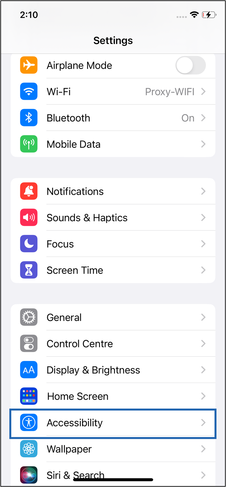
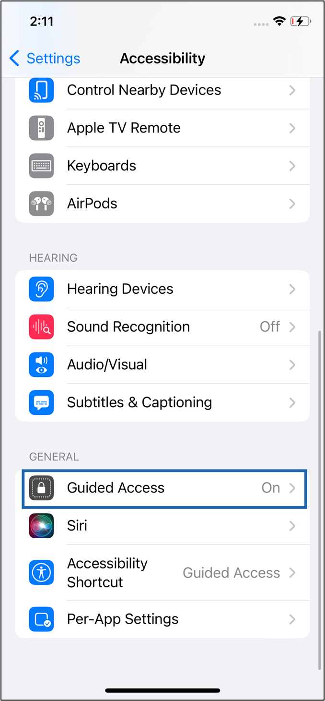
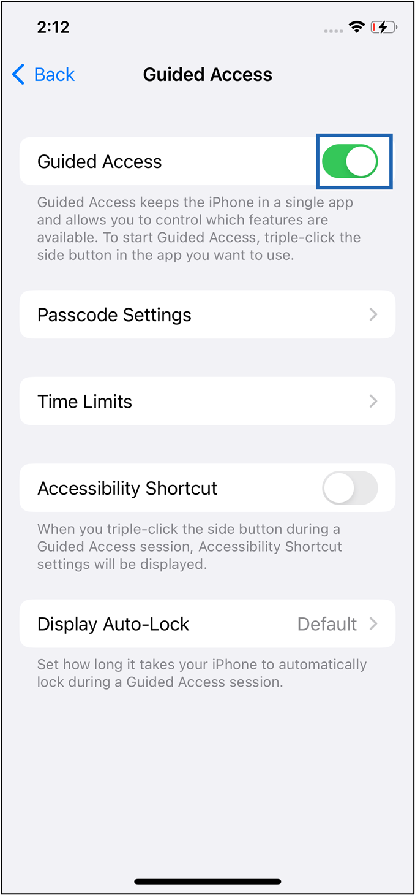
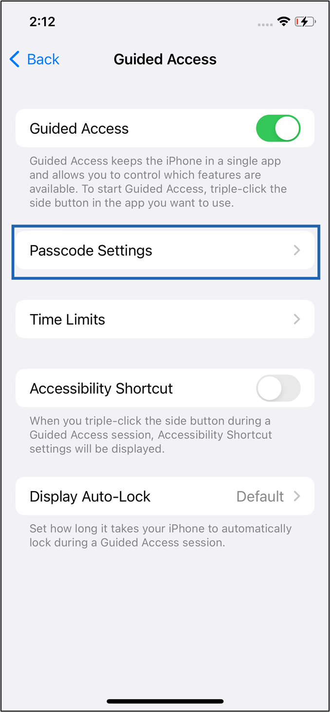
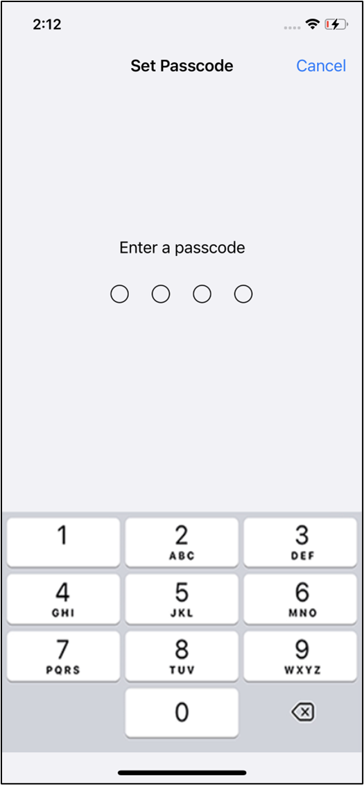

{/* Source: Intercom article 13428004 -  */}
{/* Generated by intercom_to_mintlify.py - re-running overwrites this file. */}

## Introduction

Guided Access Mode on iPhone allows you to lock the device to a single app. This is useful when the iPhone is used as a dedicated endpoint, ensuring users stay within the Oloid Connect app.

### The following topics are covered in this document.

- How to set up Guided Access in iPhone
- How to enable Guided Access Mode in iPhone
- How to disable Guided Access Mode in iPhone

## Steps to Set up Guided Access Mode

1. Open your iPhone.
2. Go to **Settings > Accessibility.**

   

3. Scroll down the list to the bottom and tap **Guided Access.**

   

4. Tap the toggle to switch on Guided Access.

   

5. Tap **Passcode Settings**.

   

6. Tap **Set Guided Access Passcode.**

   

7. Enter a passcode, then re-enter it to confirm.

## Steps to Enable Guided **Access M**ode

1. Open the Oloid Connect application, triple-click the side button.
