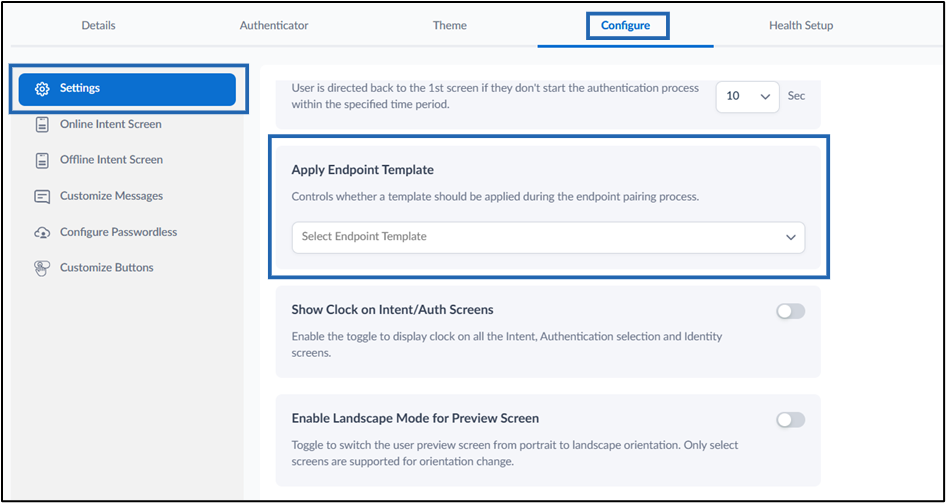
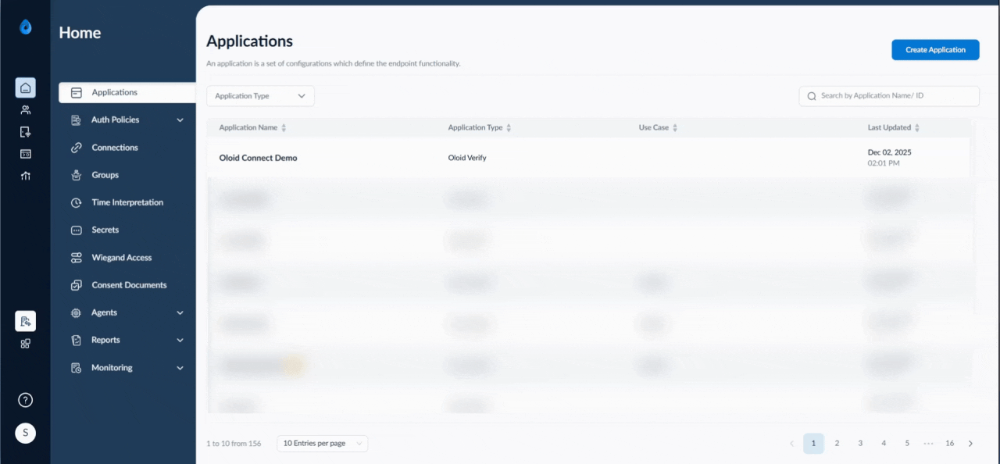

{/* Source: Intercom article 12965315 -  */}
{/* Generated by intercom_to_mintlify.py - re-running overwrites this file. */}

## Steps to Apply Endpoint Template

1. Log in to the **Tenant Admin Portal**.
2. On the **Applications** page, click on the Oloid Connect application.

   

Go to **Configure** > **Settings** tab, and select the **endpoint template** from the dropdown list in the field.

The system applies the selected template to the endpoint during the pairing process.

### GIF for Reference

3. 
