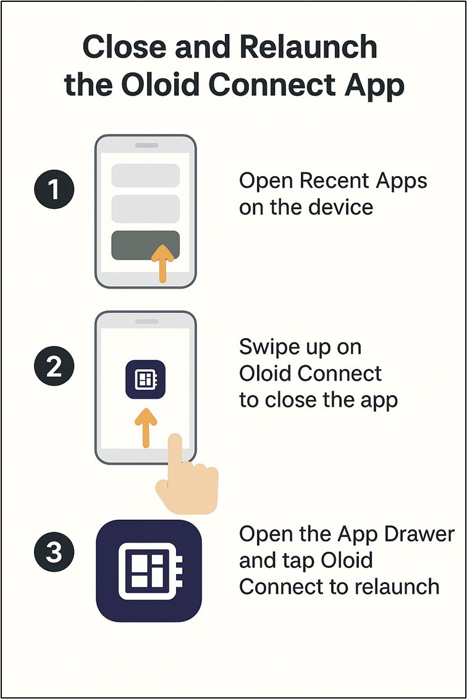

{/* Source: Intercom article 13158359 -  */}
{/* Generated by intercom_to_mintlify.py - re-running overwrites this file. */}

## Purpose

Quickly restart the Oloid Connect app to refresh the application or resolve minor sync issues.

## Steps

1. Open Recent Apps on the device.
2. Swipe up on Oloid Connect to close the app.
3. Open the App Drawer and tap Oloid Connect to relaunch.

   

## Outcome

The Oloid Connect app is successfully restarted and ready for use.

##### Notes

- Restarting the app helps resolve temporary sync or UI issues.
- No admin permissions are required.
