{/* Source: Intercom article 10428791 -  */}
{/* Generated by intercom_to_mintlify.py - re-running overwrites this file. */}

Pre-requisite:

- The Endpoint should be paired . To know more about pairing an Endpoint, see **[How to pair an Oloid Connect endpoint](/platforms/ios/time-clock/oloid-connect/oloid-connect-how-to-pair-an-endpoint)**.
- The user must be a Supervisor.

## Steps to configure an endpoint for Oloid Connect

1. Log in to **Oloid Portal** using **supervisor credential**.
   The **Users** page is displayed.
2. Select **Endpoint** from the left menu panel.

   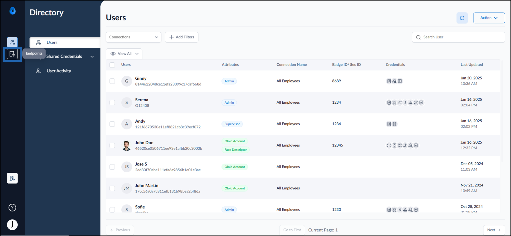

   The **Endpoints** page is displayed.
3. Select **Endpoint Name** to configure.

   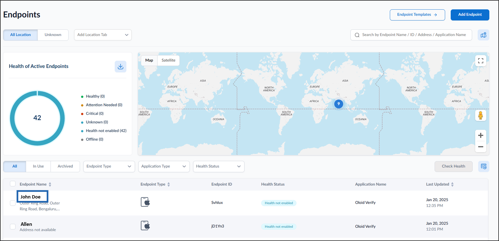

   The **Endpoint Details** page is displayed.

   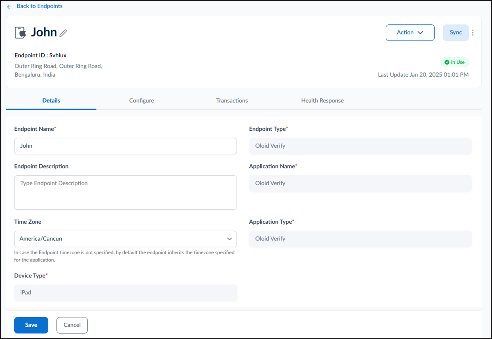

4. Do the following:
   1. [Configure Details tab](#configure-details-tab)
   2. [Design Configure tab](#design-configure-tab)
   3. Configure Transaction tab
   4. [Configure Health Response tab](#configure-health-response)
      The Endpoint is configured successfully.

## Configure Details Tab

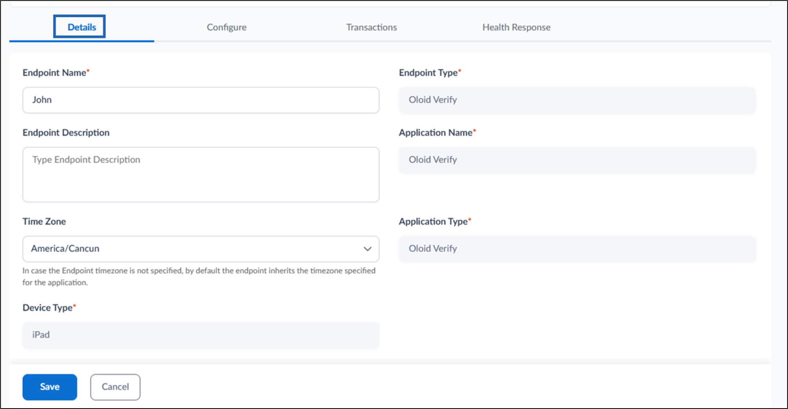

1. Edit **Endpoint Name**.

   <Note>
     **Note:** Endpoint name is auto populated with the name used while pairing. You can edit the name if required.
   </Note>

2. Enter **Endpoint Description**. (Optional)
3. Select **Timezone** from the dropdown list. (Optional)
4. Click **Save**.

## Design Configure Tab

You can set up the configure tab by configuring browser settings and customizing button labels.

### Endpoint Settings

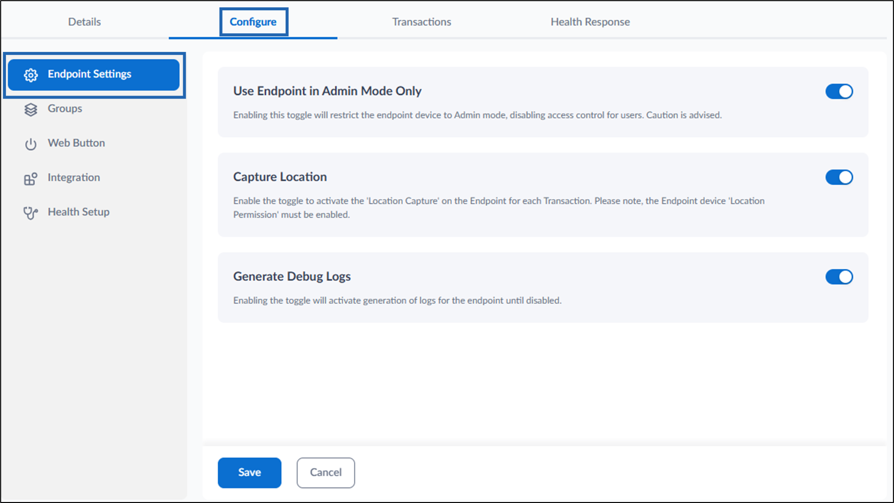

1. Enable **Use Endpoint in Admin Mode Only** to disable access control for Users.
2. Enable **Capture Location** to activate Location Capture on Endpoint for each transaction.

   <Note>
     **Note:** The Location Permission of the endpoint device must be enabled.
   </Note>

3. Enable **Generate Debug Logs** to activate log generation for the endpoint until disabled.
4. Click **Save**.

### Groups

Enable **One Face/User (On Device FR)** to ensure that only one facial image of user is stored on the device as a reference for On-device Transactions.

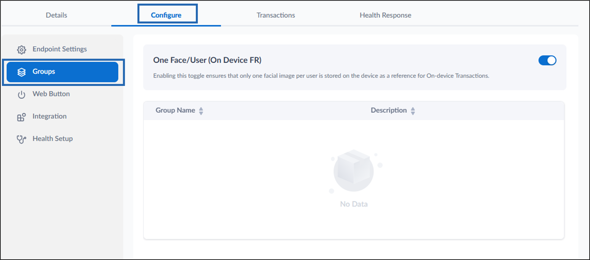

### Web Button

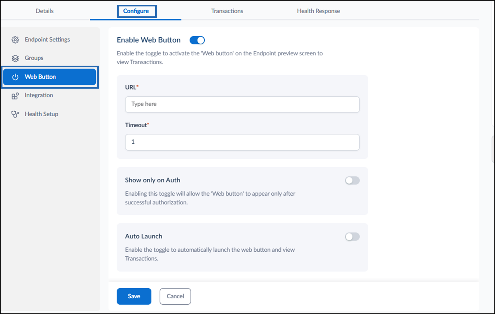

1. Turn on **Enable Web Button** to allow the users to review punches in Oloid Connect App.
2. Do the following:
   1. Enter **URL**.

      <Note>
        **Note:** Enter the URL of the website where the user can review punches.
      </Note>

   2. Enter **Timeout**.
   3. **Show only on Auth** - *TBD*.
   4. Enable **Auto Launch** to automatically launch the web button to **review punches**.

### Integration

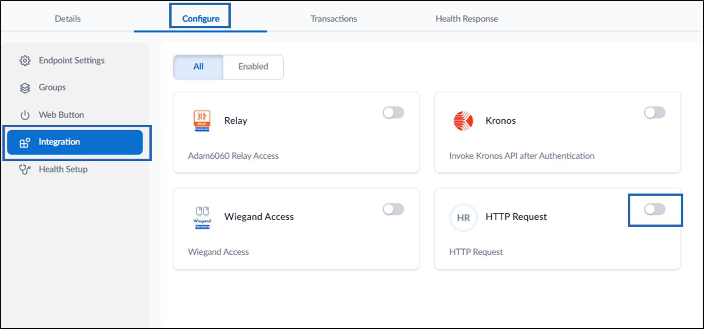

To enable Passwordless, HTTP Request must be enabled and configured. Contact **[Oloid Support](mailto:support@oloid.ai)** to enable and configure HTTP Request.

### Health Setup

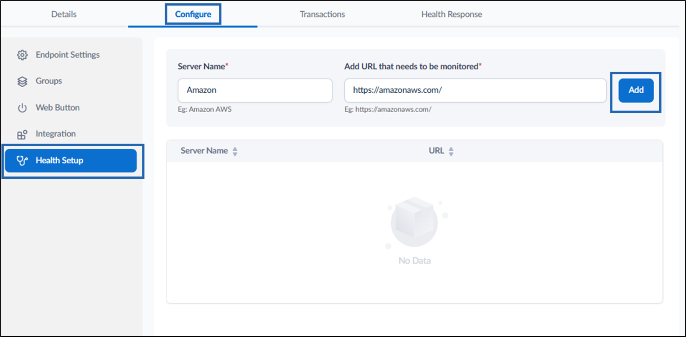

1. Enter **Server Name**.
2. Enter URL in **Add URL that needs to be monitored field**.
3. Click **Add**.

The Server is added and listed under Health Setup list.

## View Transactions

You can view the transactions for the endpoint.

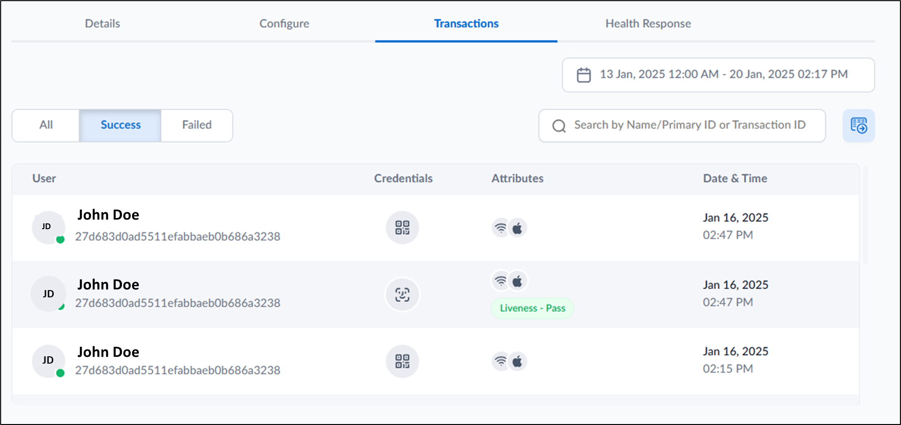

## Configure Health Response

You can check the health status of the endpoint.

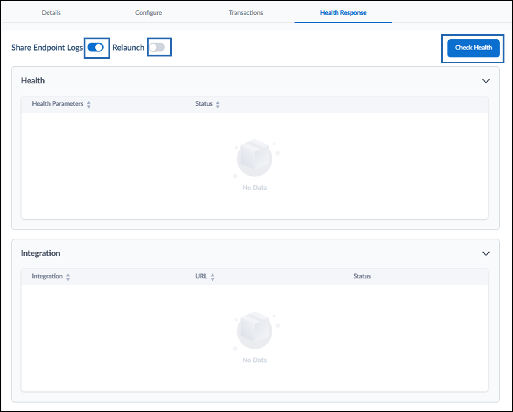

- Enable **Share Endpoint Logs** toggle button to share the logs.
- Enable **Relaunch** toggle button to relaunch the endpoint.
- Click **Check Health** to initiate health check successfully.

<Note>
  **Note:** To configure Health setup for the endpoint, see **[How to add health alerts in the endpoint](/platform/tenant-admin-portal/how-to-add-health-alerts-in-the-endpoint).**
</Note>
