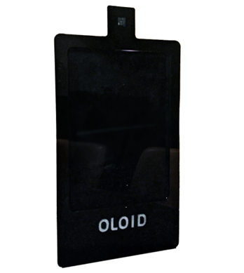
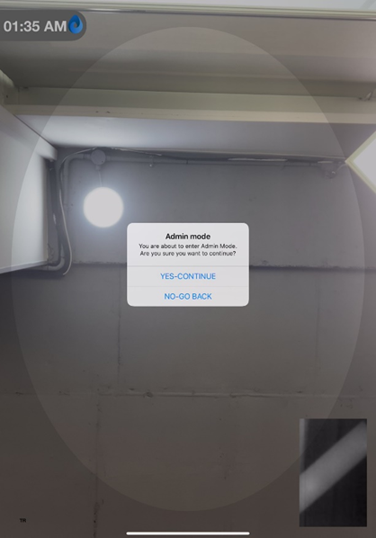
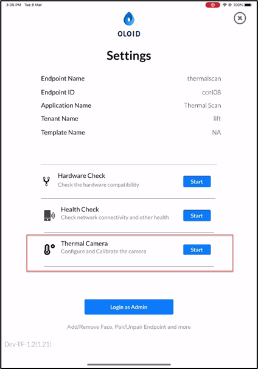
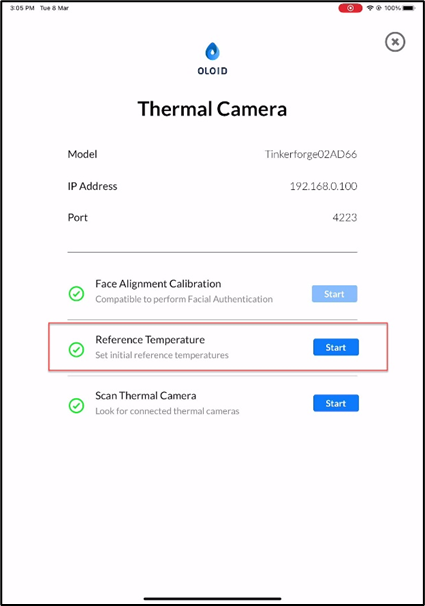
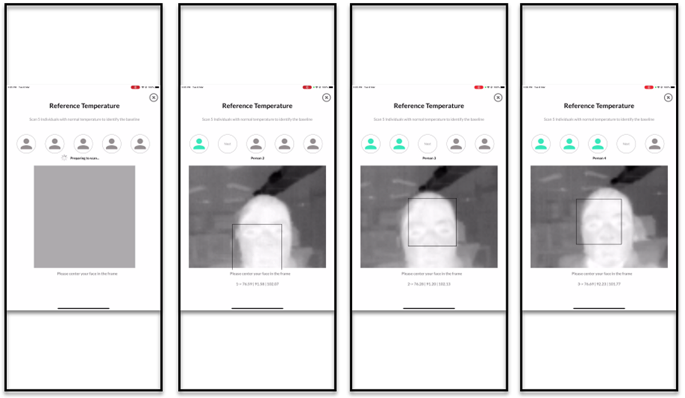
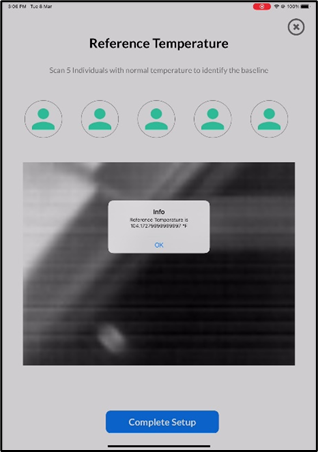
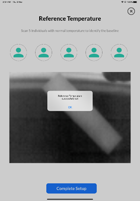

{/* Source: Intercom article 7193356 -  */}
{/* Generated by intercom_to_mintlify.py - re-running overwrites this file. */}

**Oloid thermal kit**:

This kit contains the Oloid iPad with thermal camera assembled with it.

**Pre-requisites:**

- The thermal settings are configured at application level in Tenant Admin Portal.
- The thermal settings are configured at endpoint level in Tenant Admin Portal.
- The thermal camera reference temperature configuration is done in the Oloid Connect App in the Admin section.

## Thermal Camera Installation and Configuration

To enable thermal check using Oloid Connect app, the thermal camera needs to be configured for reference temperature.

### To Configure Reference Temperature

1. Launch the Oloid Connect App in preview mode.

2. Double-tap on the screen to log into Admin Mode.

3. Tap **YES-CONTINUE**

4. The Settings screen is displayed.

5. Tap on Thermal Camera **Start.**

The **Thermal Camera** screen is displayed.

6. Tap on Reference Temperature **Start.**

7. Scan five individuals one by one. You must enter your face on the frame for camera to capture the skin temperature.

8. Once scanning is done, the pop-up box displays the reference temperature.

9. Tap **Ok**.

10. Tap **Complete Setup**.

The reference temperature is set.
