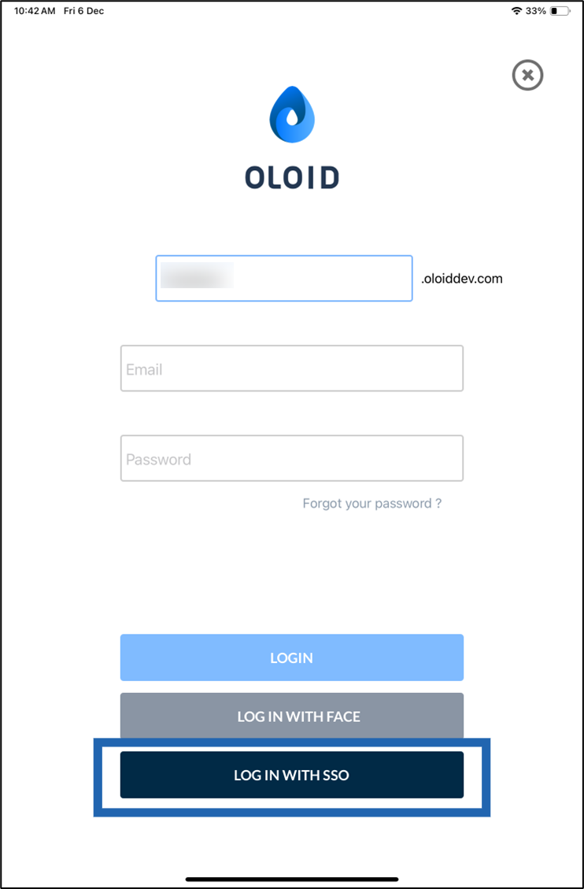

{/* Source: Intercom article 10255776 -  */}
{/* Generated by intercom_to_mintlify.py - re-running overwrites this file. */}

**Pre-requisite:**

You must open admin mode in the Oloid Verify app. See **[How to log into the admin mode of Oloid Verify App as a Supervisor](/platforms/ios/time-clock/oloid-verify/oloid-verify-how-to-log-in-to-admin-mode-as-admin-or-supervisor)** to know more.

Steps to login with Okta SSO:

1. Launch the **Oloid Verify App** .
   The login screen is displayed.
2. Click on **LOGIN WITH SSO**.

   

   <Note>
     **Note:** You get **LOGIN WITH SSO** option only when the endpoint is paired. Check out **[How to pair an Oloid Verify endpoint](/platforms/ios/time-clock/oloid-verify/oloid-verify-how-to-pair-an-endpoint)** to know more.
   </Note>

   The screen with **SSO options** is displayed.
3. Select **Continue with Okta**.
