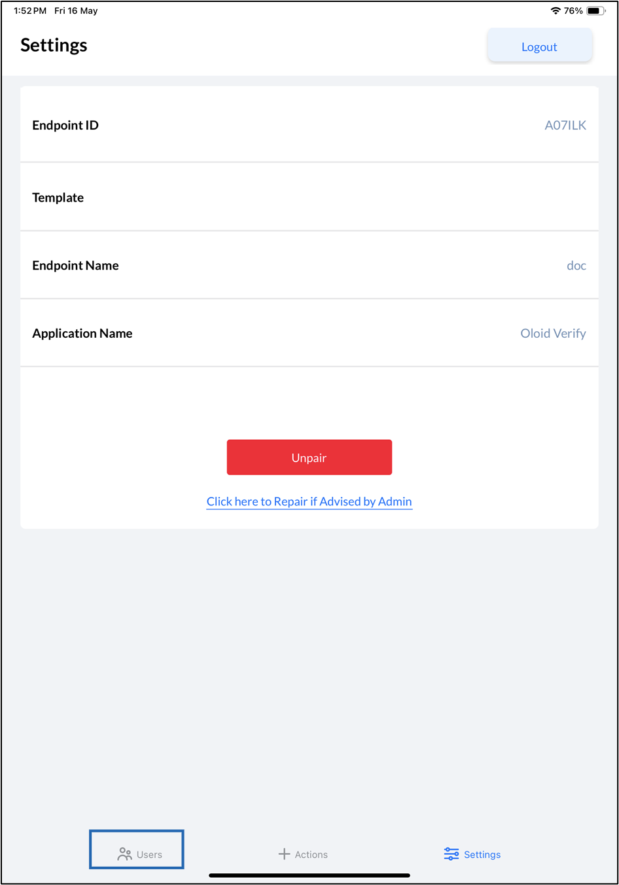
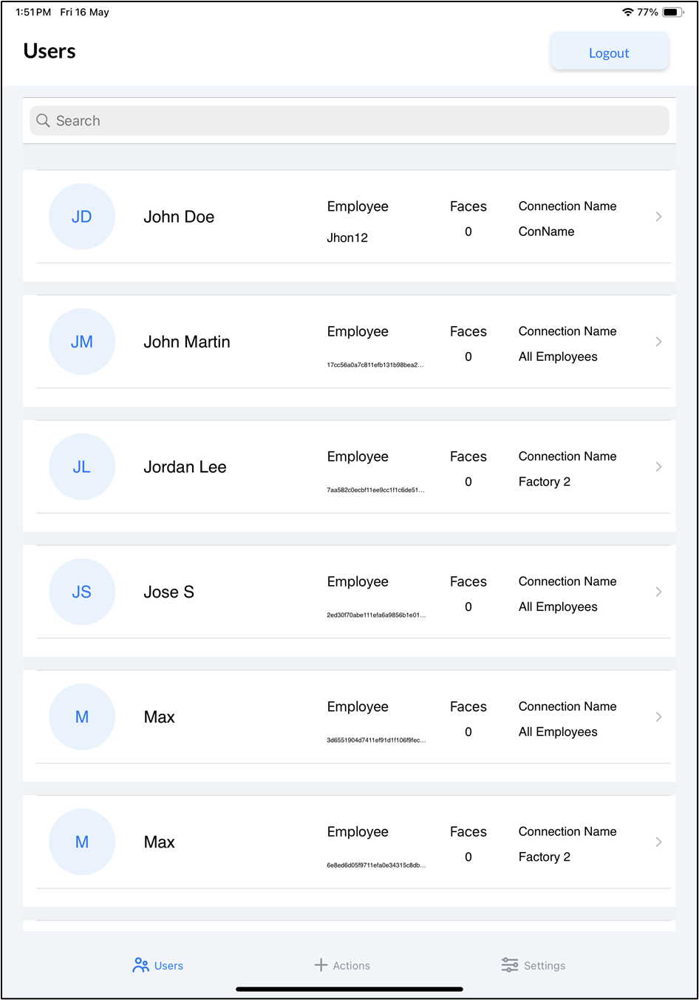
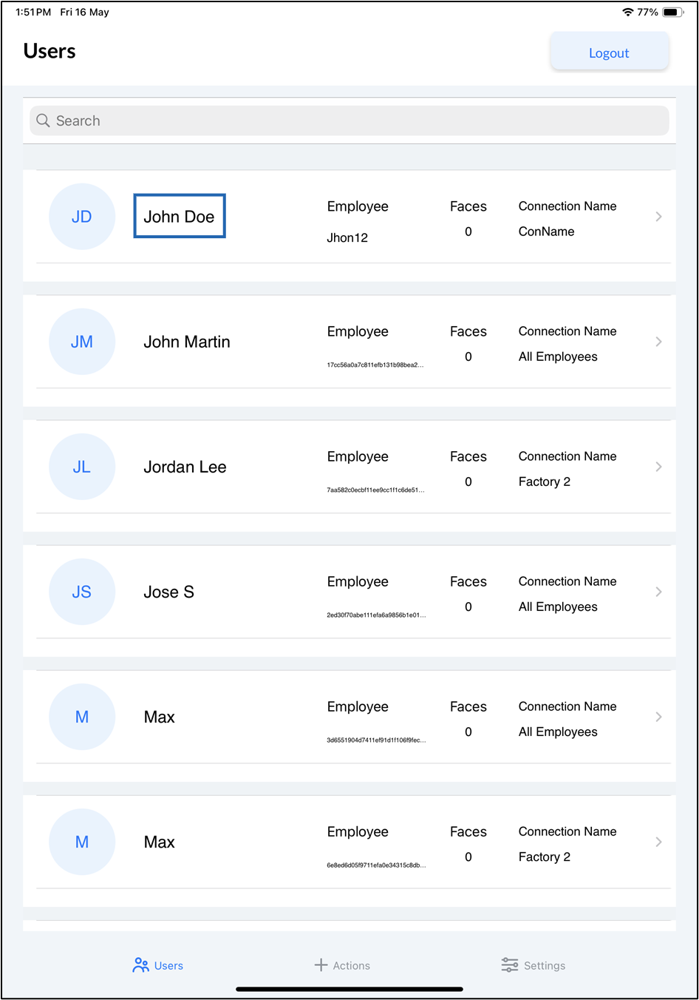
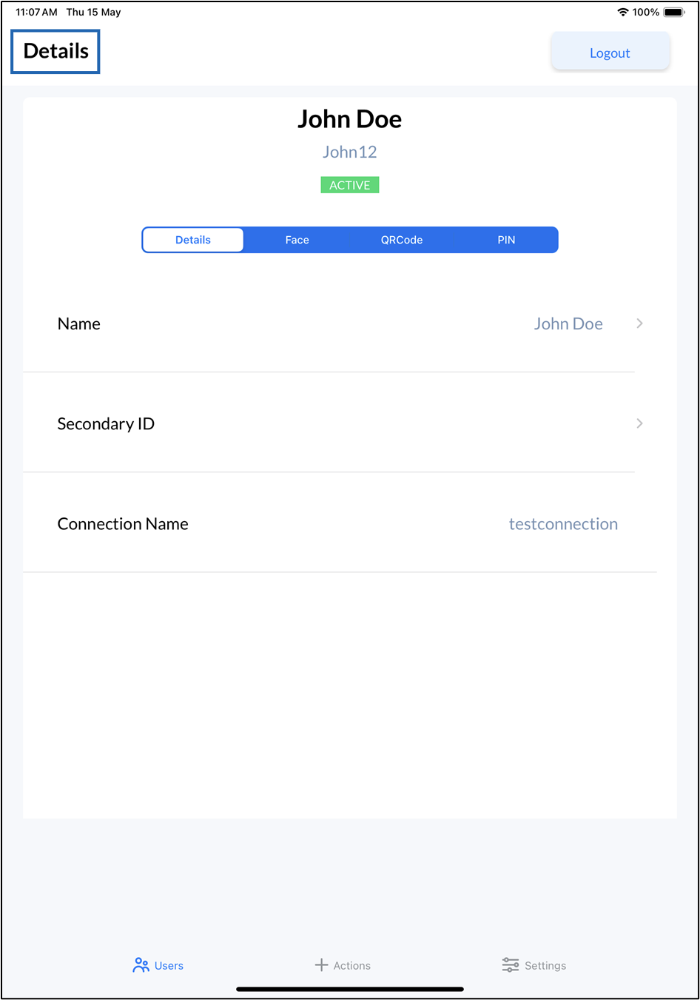
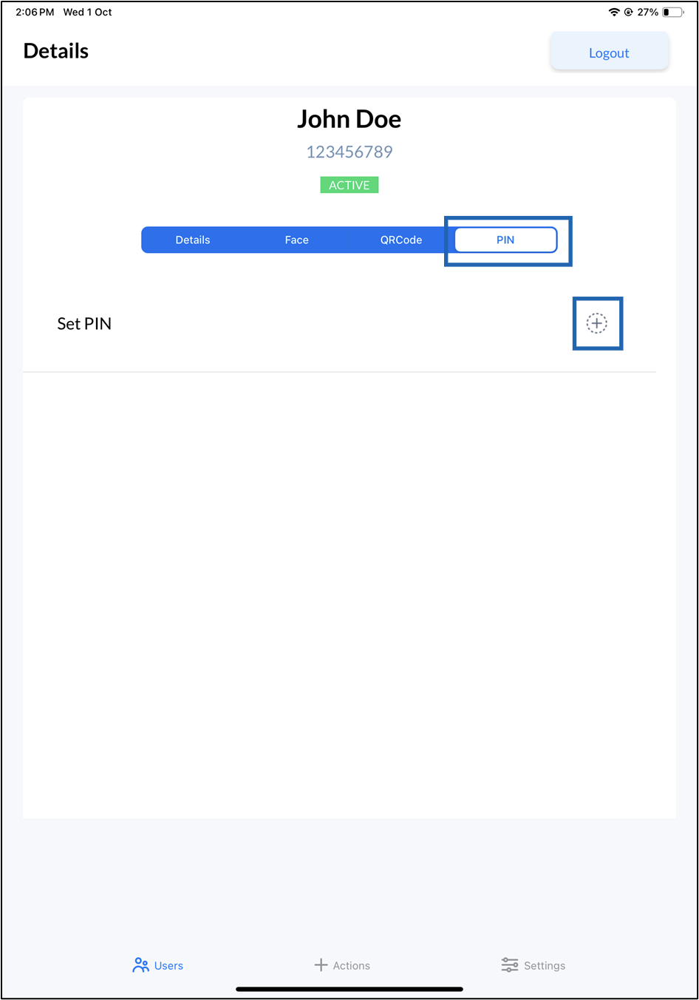
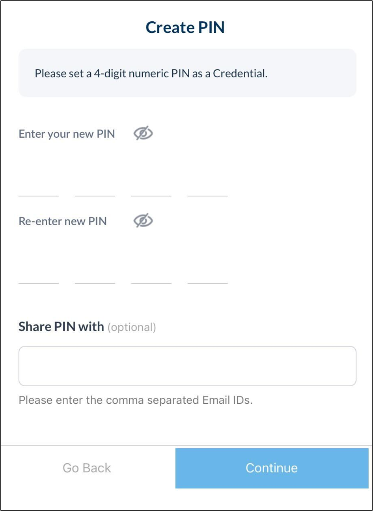
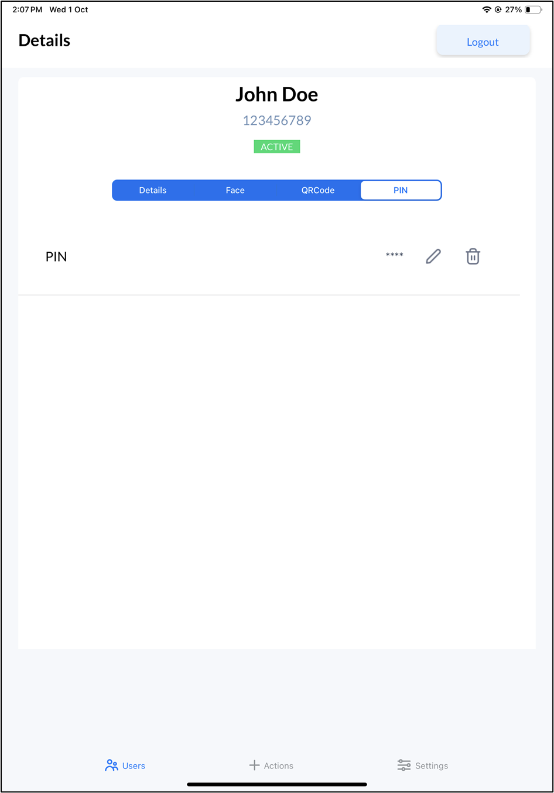

{/* Source: Intercom article 9571329 -  */}
{/* Generated by intercom_to_mintlify.py - re-running overwrites this file. */}

***Doc to be deleted as it is a duplicate one***

## Introduction

This feature of the Oloid Verify app allows Tenant Admins and Supervisors to add PIN credentials for users.

### Pre-requisite

- User should be added to the connection.
- Ensure that the endpoint is properly paired. For more, refer to [How to pair an Oloid Verify endpoint](/platforms/ios/time-clock/oloid-verify/oloid-verify-how-to-pair-an-endpoint)

#### Steps to Add PIN

1. Log in to **Oloid Verify App**. For more, refer to [How to log in to the admin mode of Oloid Verify App as a Supervisor/Admin](/platforms/ios/time-clock/oloid-verify/oloid-verify-how-to-log-in-to-admin-mode-as-admin-or-supervisor).
   The **Settings** page is displayed.
2. Tap **Users** on the menu at the bottom of the screen.

   

   The **Users** page is displayed with the list of users.

   

3. Select user to add QR code from **Users** list.

   

   The user details page is displayed.

   

4. Tap **PIN** tab, then tap**Add** button next to **Set PIN**.

   

   The **Create PIN** pop-up box is displayed.

   

5. On the pop-up box, do the following:
   1. Enter new PIN.
   2. Re-enter new PIN.

      <Note>
        **Note:** You can also share PIN with respective email IDs.
      </Note>

      The PIN is created and displayed under the **PIN** tab.

