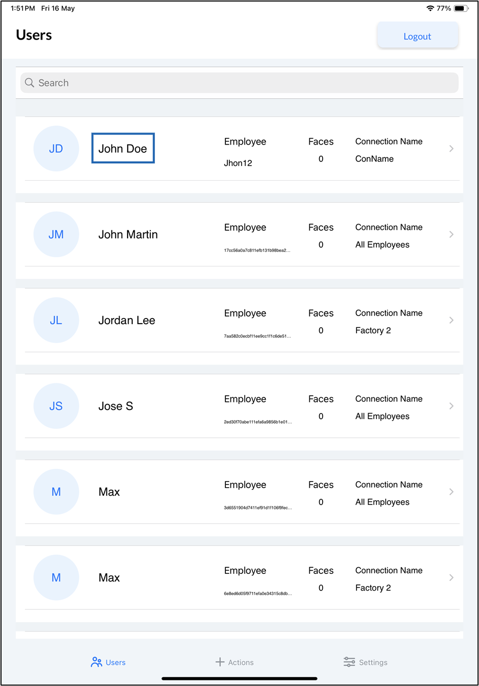
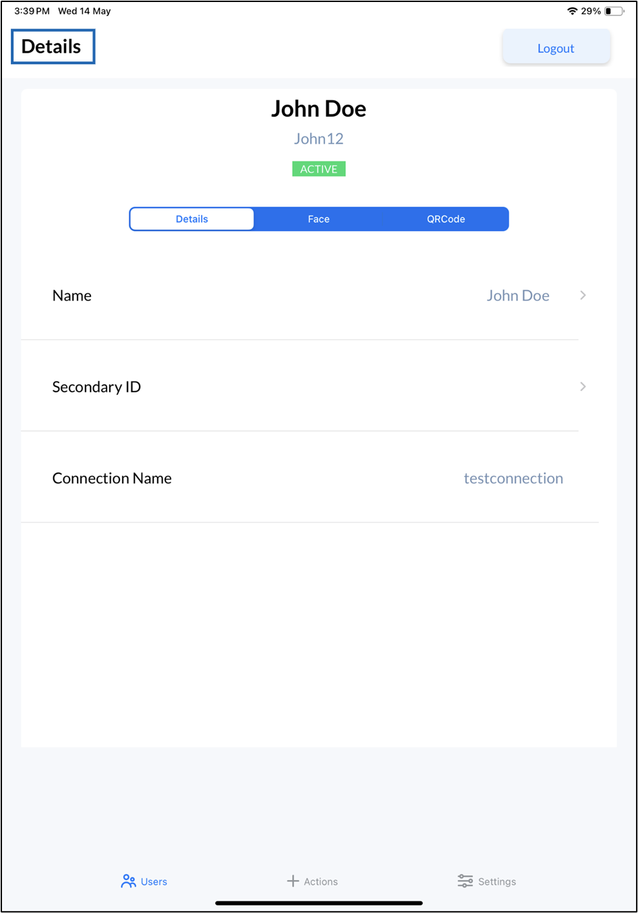
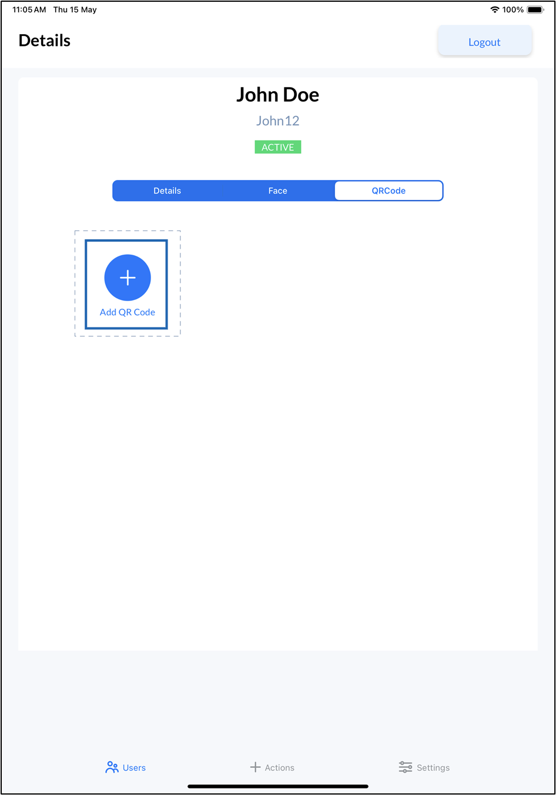
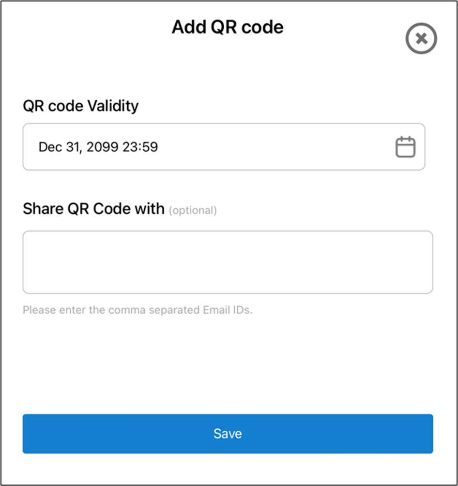
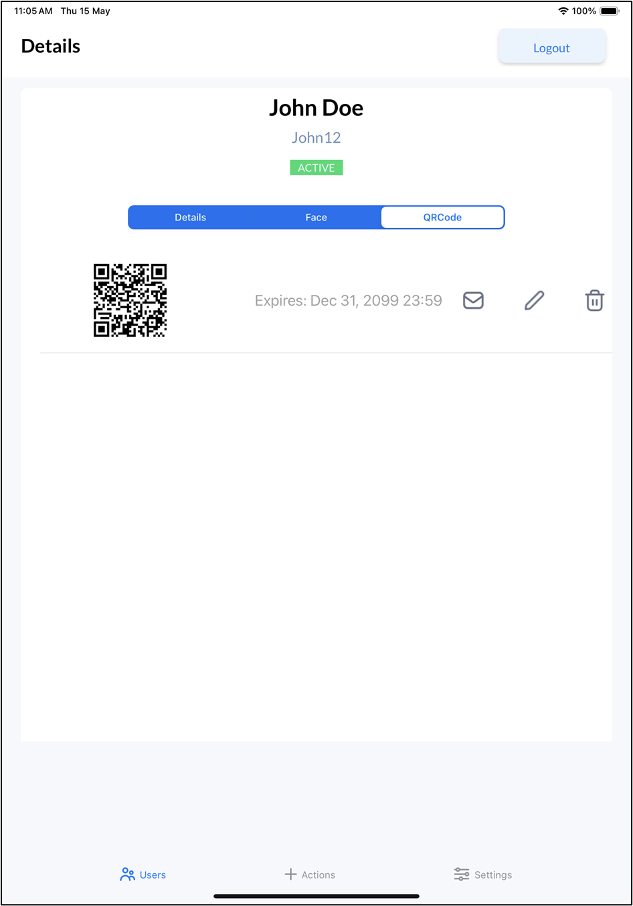

{/* Source: Intercom article 10198762 -  */}
{/* Generated by intercom_to_mintlify.py - re-running overwrites this file. */}

## Steps to add QR code

1. Log in to admin mode in **Oloid verify** App.
   See **[How to log into the admin mode of Oloid Verify App as a Supervisor/Admin](/platforms/ios/time-clock/oloid-verify/oloid-verify-how-to-log-in-to-admin-mode-as-admin-or-supervisor)** too know more
   The **Users** page is displayed.
2. Select a user.

   

   The user details page is displayed.

   

3. Go to **QR Code** > click **+ Add QR Code**.

   

   The **Add QR Code** pop-up is displayed.

   

4. On the pop-up, do the following.
   1. Select **QR Code Validity**.

      <Note>
        **Note:** The default value for QR Code validity is Dec 31, 2099 23:59.
      </Note>

   2. Enter Email ID(s) in **Share QR Code with**. (Optional)

      <Note>
        **Note:** Separate the Email IDs with a comma.
      </Note>

   3. Click **Save**.
      The QR Code is generated successfully.

      
