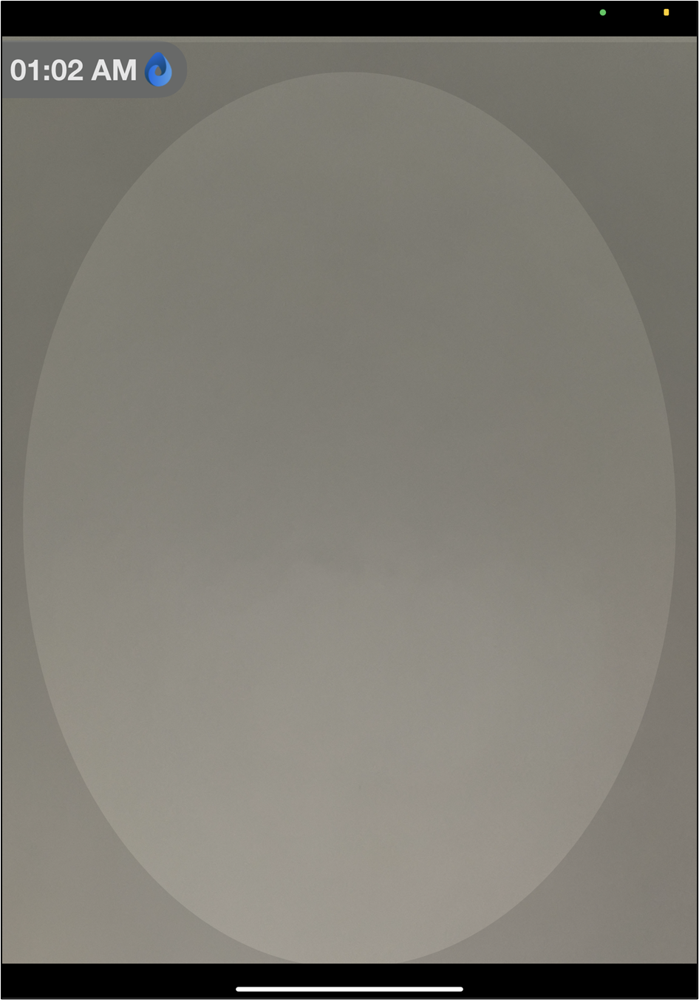
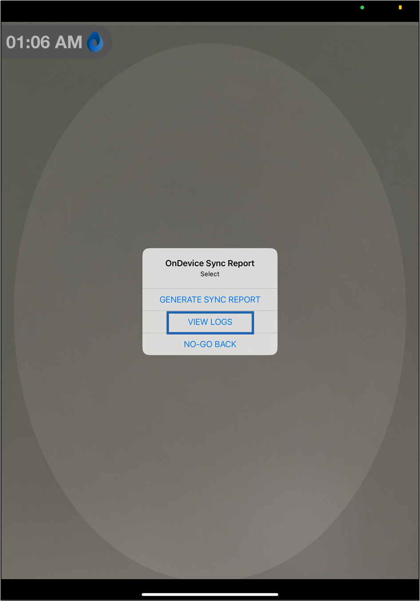
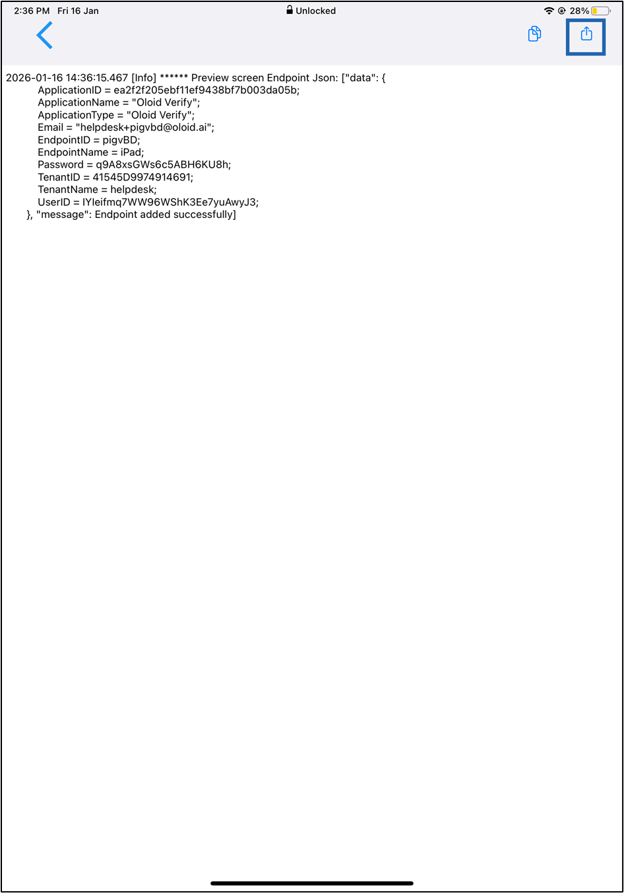
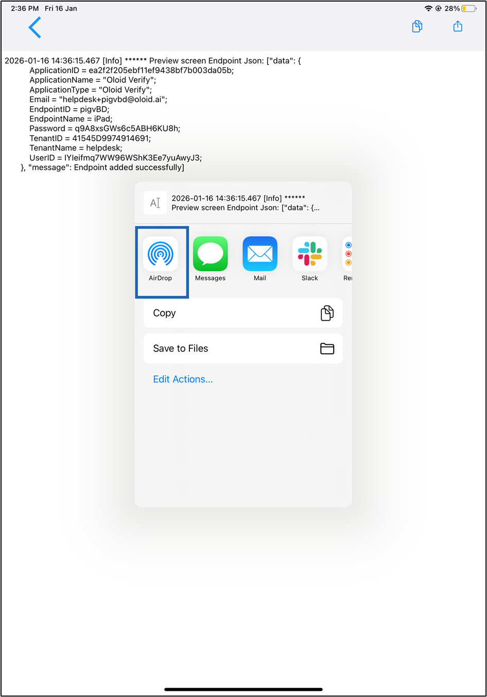
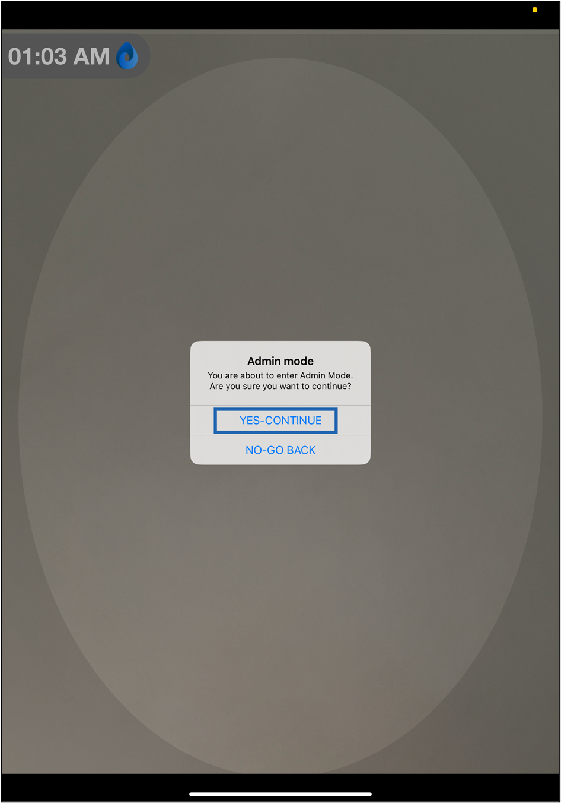
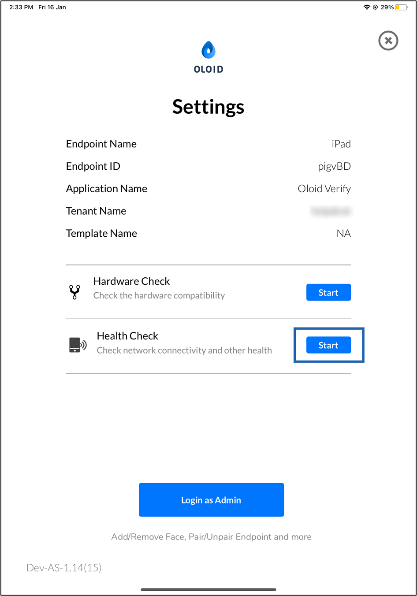
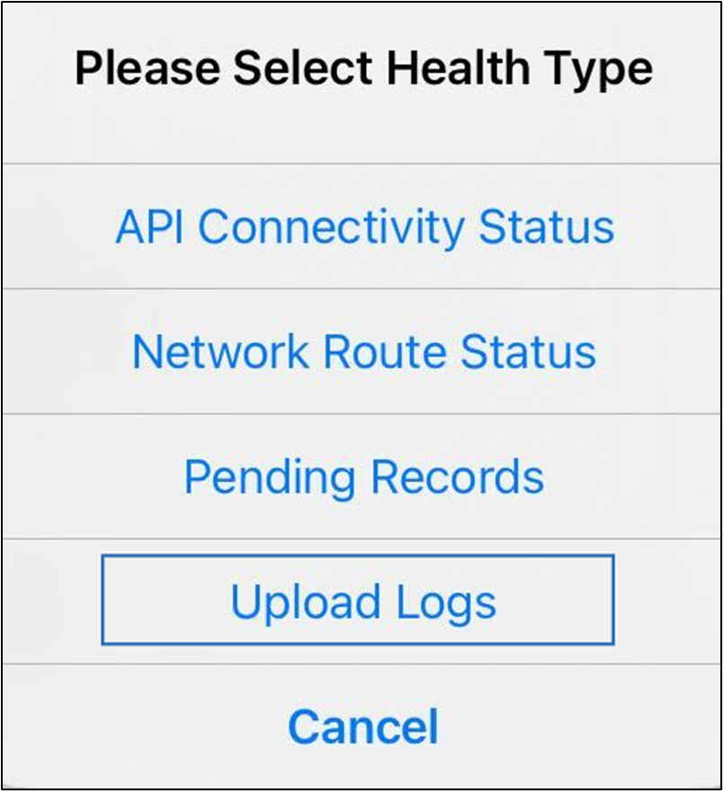
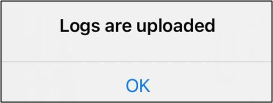

{/* Source: Intercom article 13406491 -  */}
{/* Generated by intercom_to_mintlify.py - re-running overwrites this file. */}

This document explains how to share Oloid Verify app logs with the app developer, using either of these two methods

- [View and Share Logs with the App Developer](/platforms/ios/time-clock/oloid-verify/oloid-verify-how-to-share-and-upload-logs)
- [Upload Logs to the App Developer](/platforms/ios/time-clock/oloid-verify/oloid-verify-how-to-share-and-upload-logs)

## Prerequisite

- Debug logging must be enabled for the endpoint in the Tenant Admin Portal. For instructions, see [How to Enable DebugLog](/platforms/ios/time-clock/oloid-verify/oloid-verify-how-to-configure-endpoint-in-tenant-admin-portal).
- The endpoint must already be paired, so the app opens on the preview screen. For instructions, see [How to pair an Oloid Verify endpoint](/platforms/ios/time-clock/oloid-verify/oloid-verify-how-to-pair-an-endpoint).

## View and Share Logs with the App Developer

### Steps to View and Share Logs

1. Open the **Oloid Verify** app.

   <Note>
     **Note:** Because the endpoint is already paired, the app opens on the preview screen. For more information, see [How to pair an Oloid Verify endpoint](/platforms/ios/time-clock/oloid-verify/oloid-verify-how-to-pair-an-endpoint). [How to pair an Oloid Verify endpoint](/platforms/ios/time-clock/oloid-verify/oloid-verify-how-to-pair-an-endpoint)
   </Note>

2. Tap the screen four times with one finger.

   

   The **OnDevice Sync Report** pop-up displayed.
3. Tap **VIEW LOGS.**

   

   The log report opens.
4. Tap the **Share** icon in the top-right corner of the report, then choose how to send the log report to the developer.

   

   <Note>
     **Note:** If the Mail app isn’t set up on this iPad, use **AirDrop** to send the logs to another iPad or iOS device that has Mail set up. Then email the logs from that device.
   </Note>

   

## Upload Logs to the App Developer

### Steps to Upload Logs

1. Open the **Oloid Verify** app.

   <Note>
     **Note:** Because the endpoint is already paired, the app opens on the preview screen. For more information, see [How to pair an Oloid Verify endpoint](/platforms/ios/time-clock/oloid-verify/oloid-verify-how-to-pair-an-endpoint). [How to pair an Oloid Verify endpoint](/platforms/ios/time-clock/oloid-verify/oloid-verify-how-to-pair-an-endpoint)
   </Note>

   

2. Double-tap the preview screen with two fingers to open Admin mode.
3. Tap **YES-CONTINUE.**

   

   The **Settings** screen is displayed.
4. In the **Health Check** section, tap **Start**.

   

   The **Please Select Health Type** pop-up is displayed.
5. Tap **Upload Logs.**

   

   The logs upload and are shared successfully with the app developer automatically.

   
