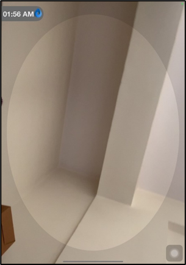
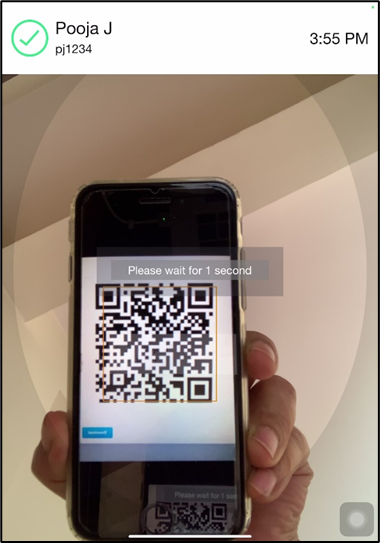

{/* Source: Intercom article 8643149 -  */}
{/* Generated by intercom_to_mintlify.py - re-running overwrites this file. */}

Based on the configuration, **Oloid Verify** **app** can be used for the following:

- [Facial recognition](/drafts/platforms/ios/time-clock/using-the-oloid-verify-connect-app)
- [Identity QR authentication](/drafts/platforms/ios/time-clock/using-the-oloid-verify-connect-app)

## Facial recognition

You can use **Oloid Verify** app for facial recognition. The app captures the face of the user and authenticates it against the reference image of the user in the application.

### To authenticate a user

**Pre-requisite**: The user and user face are added to the application.

1. Launch Oloid Connect in preview mode.

2. Stand in front of the iPad.

3. The camera captures the face.

4. The application compares your face with the reference image and on a successful face match displays the Name, Employee Id, and Time.

## Identity QR authentication

You can use the **Oloid Verify** app to authenticate the user with the QR code. The app scans the QR code generated for the user and authenticates the user.

### To authenticate using Identity QR

<Note>
  **Note:** QR code is generated by the admin and sent to the user's email address.
</Note>

When scanning a QR code, the user should not show his/her face on the camera.

1. Launch Oloid Connect in preview mode.

2. Scan the QR code on the iPad camera.

3. The camera scans the Identity QR and on successful authentication allows the user to proceed with the next steps such as opening the door or attendance punch.
