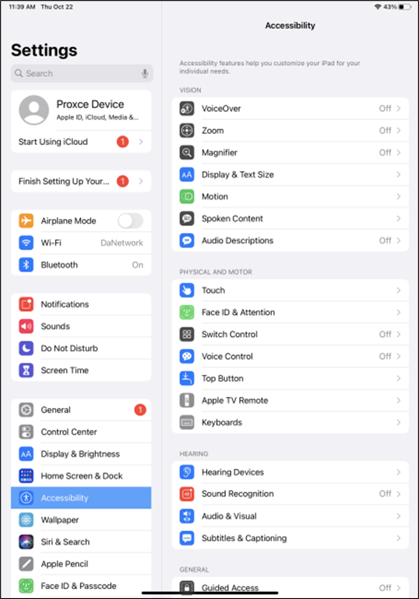
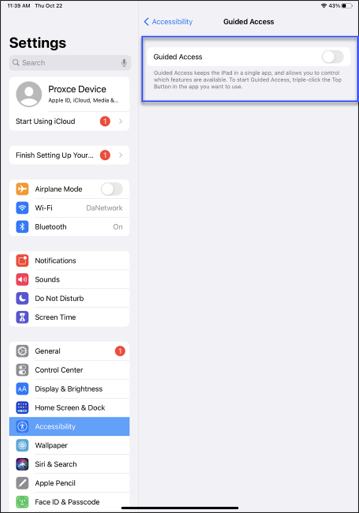
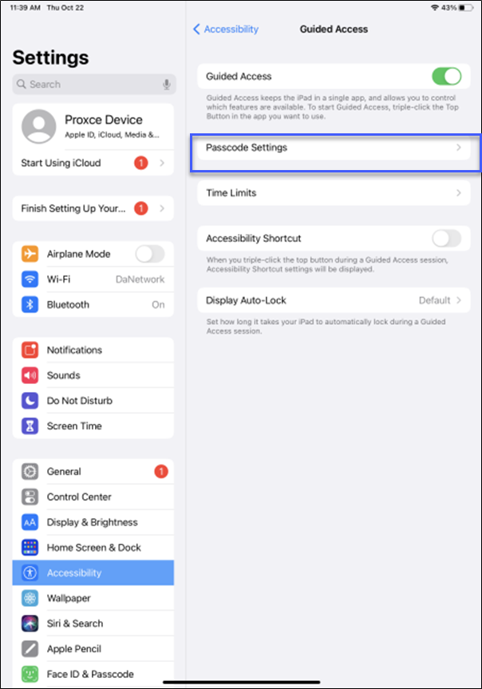
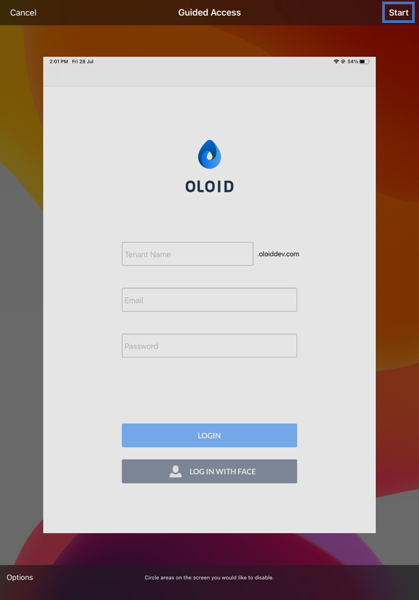
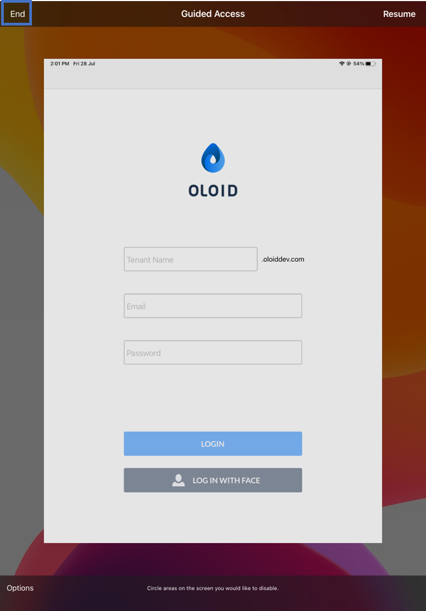

{/* Source: Intercom article 8184845 -  */}
{/* Generated by intercom_to_mintlify.py - re-running overwrites this file. */}

Kiosk mode essentially implies a device is locked to single or multiple applications to act as a kiosk.

The following topics are covered in this document.

- How to set up Guided Access in iPAD
- How to start a Guided Access Session in iPAD
- How to end a Guided Access Session in iPAD

## Setting up Guided Access

1. Open your iPAD.
2. Go to **Settings > General > Accessibility**

   

3. Scroll down the list to the bottom and tap **Guided Access.**
4. Tap the toggle to switch on Guided Access.

   

5. Tap **Passcode Settings**, then tap **Set Guided Access Passcode.**

   

6. Enter a passcode, then reenter it to confirm it.

## Start a Guided Access Session

1. Open the Oloid Verify application, then triple-press the **Home** button ( Top right of the iPad).
2. Click **Start**.

## End a Guided Access Session

1. To end a Guided Access session, triple-press the **Home** button or triple-press the **side** button.
2. Enter your **passcode** when prompted.
3. Click **End**.

