{/* Source: Intercom article 14937896 -  */}
{/* Generated by intercom_to_mintlify.py - re-running overwrites this file. */}

## Introduction

The **Oloid Vault (iOS)** application in the Tenant Admin Portal enables secure passwordless access to stored credentials. Admins can configure authentication methods such as Face, QR Code, Badge ID, NFC/ID.

## Prerequisites

- You must have access to the Tenant Admin Portal.
- You must create a connection in the Tenant Admin Portal. To create connection, refer [How to create Connections in the Tenant Admin Portal](/platform/tenant-admin-portal/tenant-admin-portal-how-to-create-connection).

## Steps to Create and Configure Oloid Vault (iOS) Application

1. Log in to the **Tenant Admin Portal**.
2. On the **Applications** page, click **Create Application** on the top right corner.

   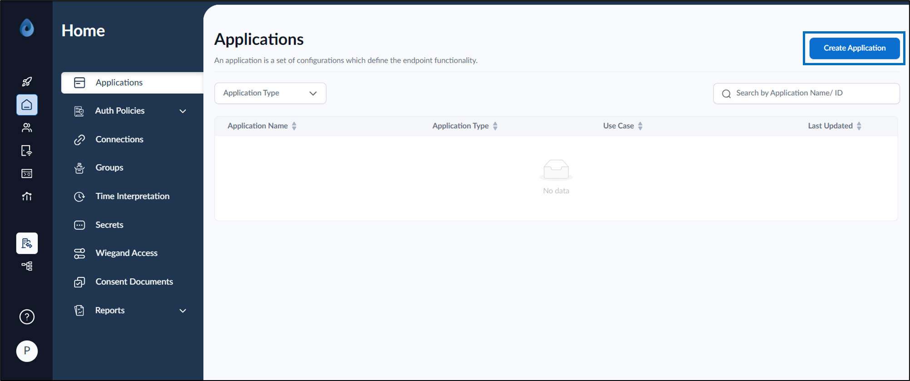

   The **Create New Application** pop-up box is displayed.
3. Do the following:
   1. Enter **Application Name.**
   2. Select **Application Type** as **Passwordless**.
   3. Click **Next**.

      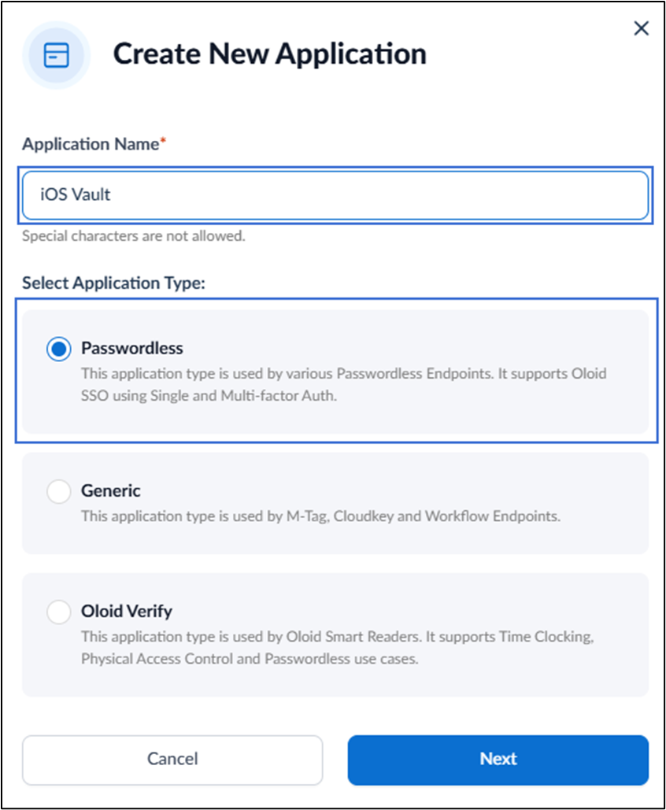

      The **Select Passwordless Use Case** screen is displayed.
   4. Select **Oloid Vault**.
   5. Click **Next**.

      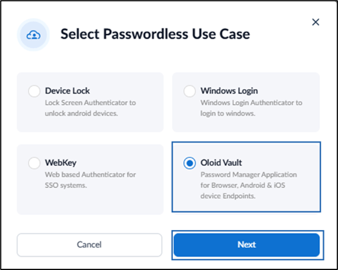

      The **Select Vault Type** pop-up box is displayed.
   6. Select **iOS**.
   7. Click **Create**

      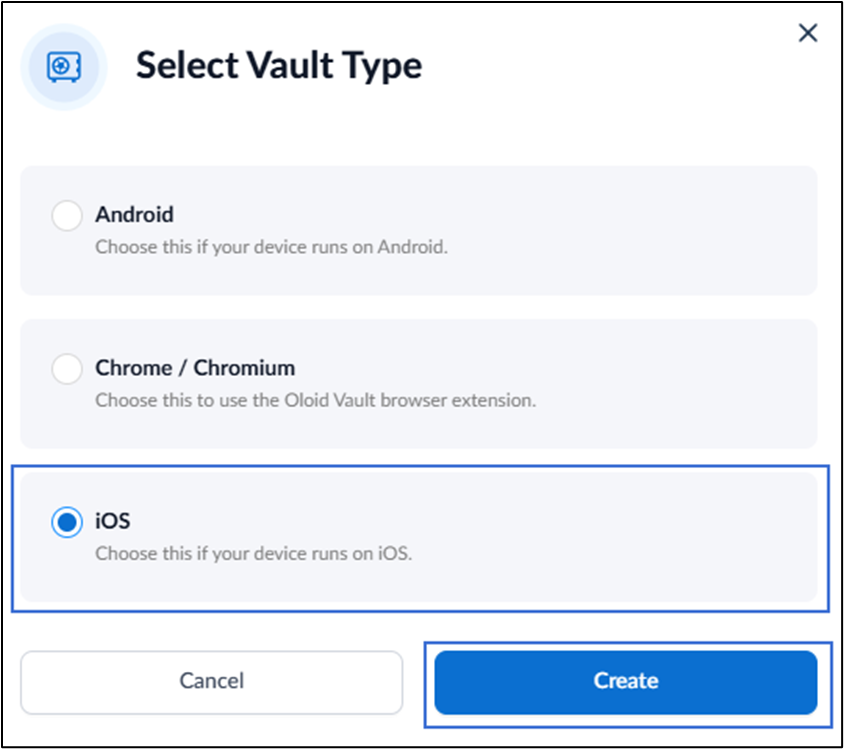

      The **Oloid Vault** application is created, and the details page is displayed.

      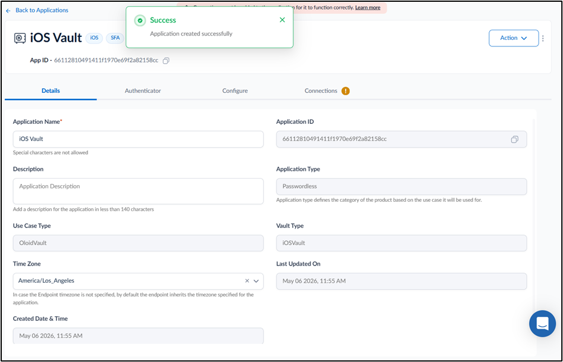

Configure the following tabs:

1. [Details tab](/platforms/web/vault/chrome/oloid-vault-chrome-chromium-how-to-create-and-configure-oloid-vault)
2. [Authenticator tab](/platforms/web/vault/chrome/oloid-vault-chrome-chromium-how-to-create-and-configure-oloid-vault)
3. [Configure tab](/platforms/web/vault/chrome/oloid-vault-chrome-chromium-how-to-create-and-configure-oloid-vault)
4. [Connections tab](/platforms/web/vault/chrome/oloid-vault-chrome-chromium-how-to-create-and-configure-oloid-vault)

<Note>
  **Note:** These settings need to be configured only once, and it is recommended to keep the default values.
</Note>

### Configure Details Tab

The **Details** tab is used to configure the basic application information, such as the application name, description, and time zone.

Do the following:

1. Update the **Application Name** (if needed).
2. Add the **Description** (Optional).
3. Select the **Time Zone** from the drop-down menu.
4. Click **Save**.

   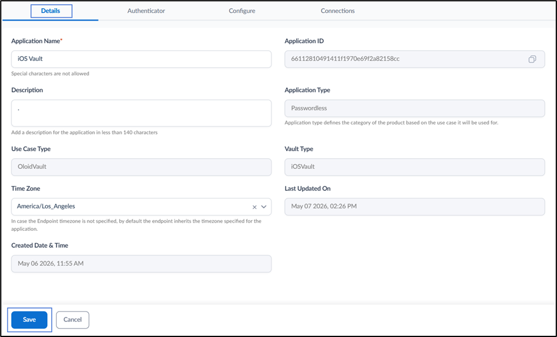

### Configure Authenticator Tab

This tab is used to enable the login methods you want to support such as Face, Badge ID, NFC/ID and Oloid Session.

<Note>
  **Note:** You can enable one or more credential options based on your requirements.
</Note>

### Face

The **Face** authenticator enables users to authenticate using facial recognition for secure passwordless access.

Do the following:

1. Enable **Face** toggle.

   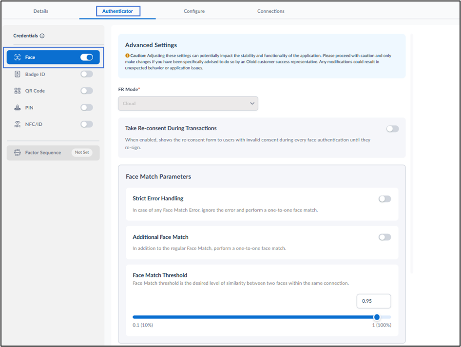

   The **Advanced Settings** page is displayed.
2. Configure the **Face Match Parameters** and **Liveness Check Parameters** on the Advanced Settings page.

   <Note>
     **Note:** The parameters are pre-configured. This is done by Oloid admin.
   </Note>

3. Click **Save**.

### Additional Settings

- **Configure Image Capture Resolution:** Select the preferred resolution from the **Select Resolution** drop-down.

  <Note>
    **Note:** If the selected resolution is not available, the browser will default to the closest supported resolution.
  </Note>

- Click **Save**.

  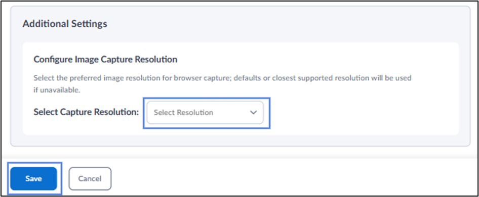

### Badge ID

The **Badge ID** authenticator allows users to authenticate using a badge for quick and secure access.

Do the following:

1. Enable **Badge ID** Toggle.

   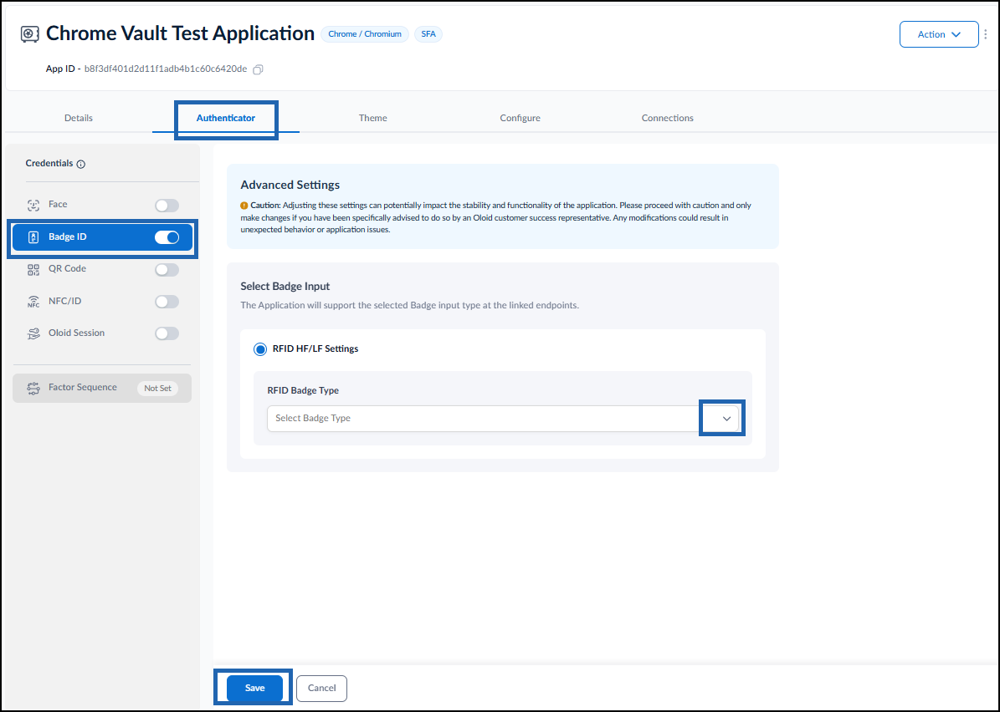

   The **Advanced Settings** page is displayed.
2. Select **RFID Badge Type** from the drop-down.
3. Click **Save**.
   The Badge ID is configured successfully.

### QR Code

The QR Code feature allows users to authenticate by scanning a QR code.

Do the following.

1. Enable **QR Code** toggle.
2. Enable **Show Camera Flip button** to allow users to switch between the front and rear cameras.

   <Note>
     **Note:** By default, the front camera opens for QR code scanning.
   </Note>

   1. Under **Default camera selection**, select a camera option:
      1. **Front Camera** (default)
      2. **Rear Camera.**
3. Click **Save**.

   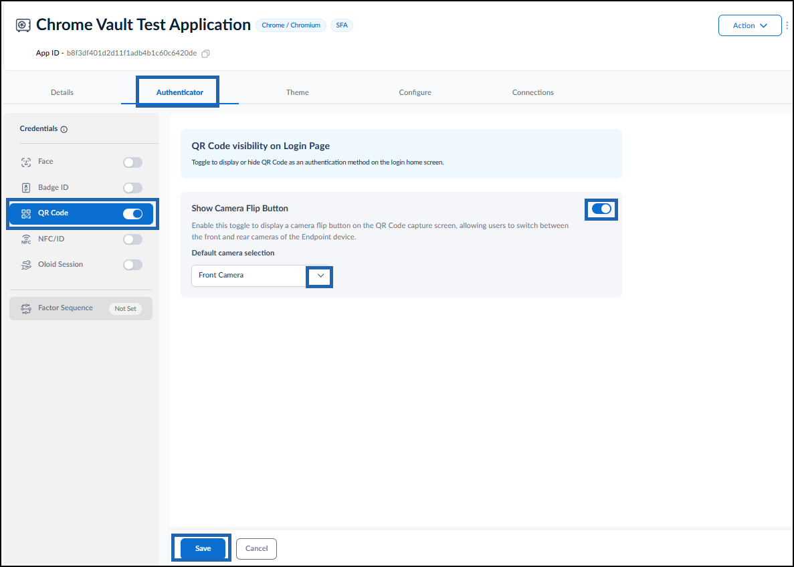

The QR code is enabled successfully.

### PIN

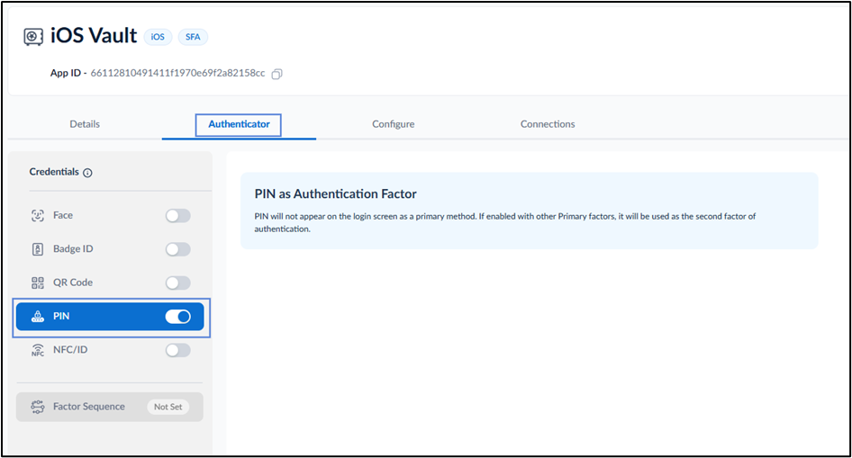

### NFC/ID

The **NFC/ID** authenticator allows users to authenticate by tapping an NFC card or ID badge on a supported reader, enabling quick and secure passwordless access.

1. Enable the **NFC/ID** toggle.
   The **NFC/ID** toggle is enabled successfully.

   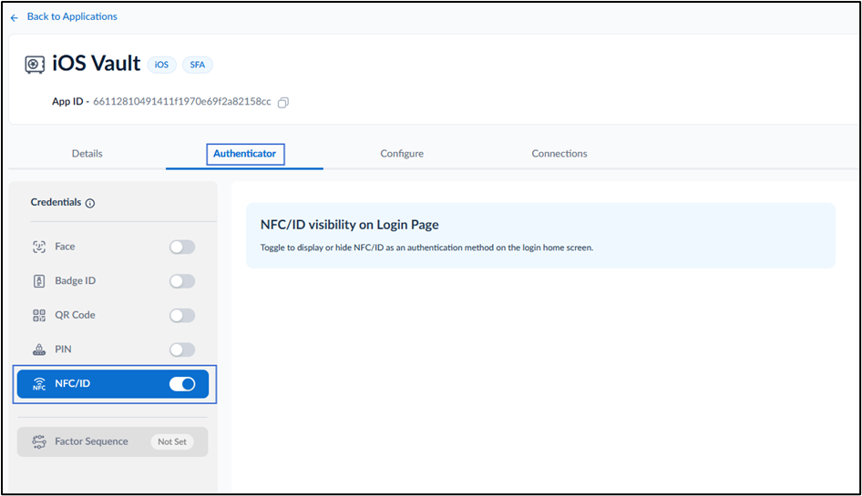

### Setup Configure Tab

Do the following:

1. [Configure Settings tab](/platforms/web/vault/chrome/oloid-vault-chrome-chromium-how-to-create-and-configure-oloid-vault)
2. [Customize Buttons tab](/platforms/web/vault/chrome/oloid-vault-chrome-chromium-how-to-create-and-configure-oloid-vault)

### Configure Settings Tab

**Vault Behaviour**

The **Vault Behaviour** section is used to control how **Oloid Vault** behaves during login, browser interaction, password handling, passkey usage, and session-based actions.

Do the following:

1. **Enable Auto-Submit:** Enable the toggle toautomatically submits prefilled passwords from Oloid Vault to websites.
2. **Enable Copy Password:** Enable the toggle to allow users to copy passwords from the Oloid Vault home page after logging in.
3. **Enable Face Camera to open in a new Tab:** Enable the toggle to open the face camera in a new tab for Oloid Vault users.
4. **Enable Saving Passkeys:** Enable the toggle to allow users to securely store and use passkeys within the Oloid Vault application for websites that support passkey authentication.
5. **Enable Browser Lock:** When enabled, the browser is locked until the user re-authenticates through Oloid Vault. This applies only when the user is logged in to Vault and manually triggers the Browser Lock feature.

   <Note>
     **Note:** Select **Lock browser when OS (Windows / MacOS / Linux) user locks screen** to automatically lock the browser when the system screen is locked.
   </Note>

6. **Clear Browser Redirect URL:** Enter the URL that opens in a new tab when a different user unlocks the browser using a Windows transaction.
7. **Clear Browser data:** Select the applicable data to clear browser data when a new user unlocks the browser or when **Logout All** is triggered.
8. **Enforce Login via Vault:** Enable the toggle to require authentication to specified URLs using **Oloid Vault** instead of manually entering credentials.
   Do the following:
   1. Enable the **Enforce Login via Oloid Vault** toggle.
   2. In the **Add URL** field, enter the login URL where Vault-based authentication must be enforced.
9. Click **Save**.

   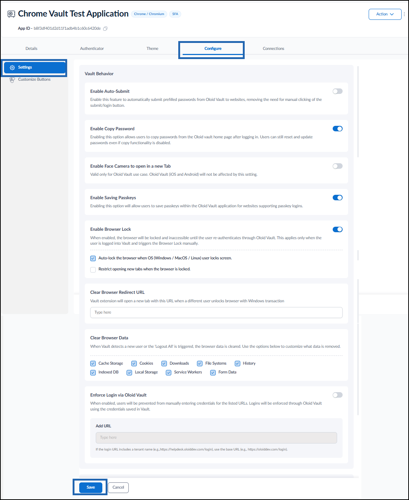

   The Vault Behaviour is configured successfully.

#### Set Time-out durations for Re-authentication

This setting is used to define the **session and inactivity time-out durations** for Oloid Vault to ensure secure user sessions.

Do the following:

1. **Session Limit:** Set the maximum duration a user can remain signed into the Oloid Vault per session.

   <Note>
     **Note:** The maximum session limit is 24 hours.
   </Note>

2. **Inactivity Timer:** Enable the toggle and set the time duration to protect user sessions from unauthorized access.

   <Note>
     **Note:** Set the timer to automatically log off the user after a specified period of inactivity.
   </Note>

3. Click **Save**.

   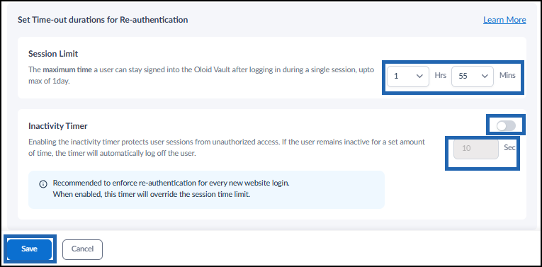

#### Apply Endpoint Template

This section isused to apply a predefined endpoint template to configure the endpoint with the required settings.

Do the following:

1. Select the Endpoint Template from the drop-down.
2. Click **Save**.

   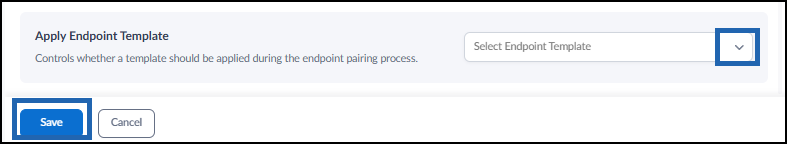

   The endpoint template is added successfully.

## Customize Buttons Tab

This section is used to customize the button label of your application's authentication page by following the on-screen instructions.

Do the following:

1. Enter the Button Label.
2. Click **Save**.

   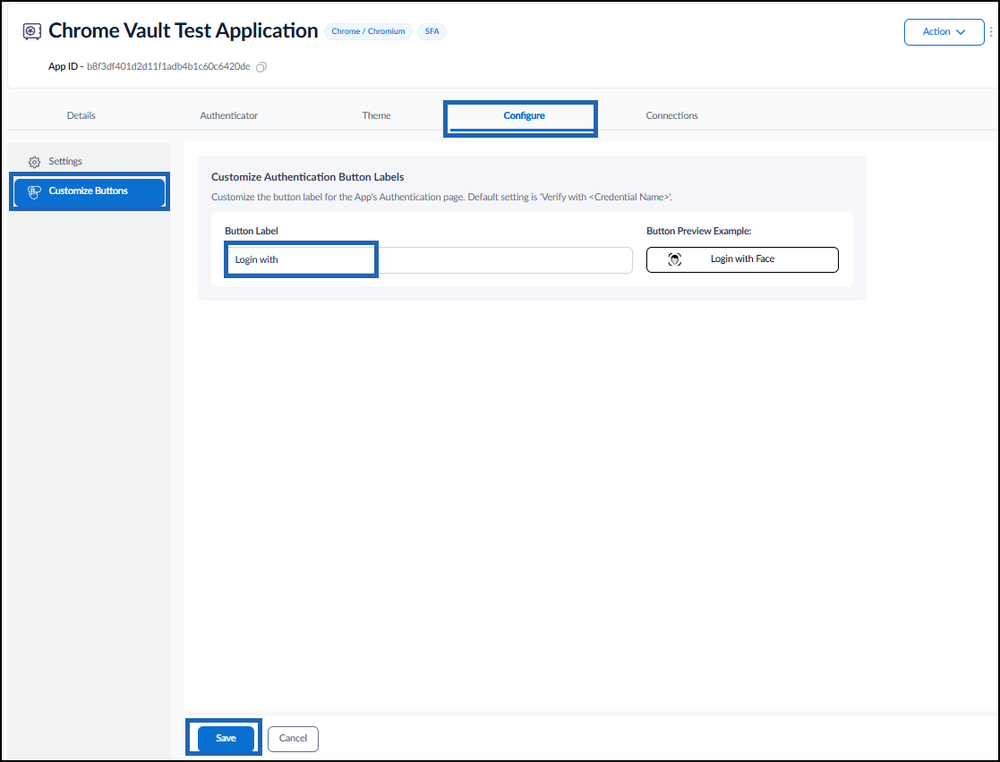

   The Customize Button is configured successfully.

### Configure Connections Tab

This tab is used to select the connections that provide the set of users allowed to authenticate via Oloid vault application.

<Note>
  **Note:** Ensure that **Oloid ID is enabled**, as it is mandatory for Oloid Vault authentication.
</Note>

Do the following:

1. Select **+ Add Connections**.

   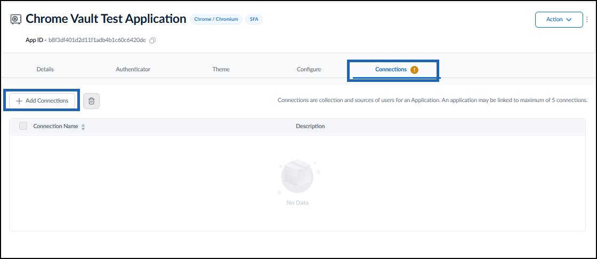

   The **Add Connections** pop-up box is displayed.
2. Select connection from the drop-down list and click **Add**.

   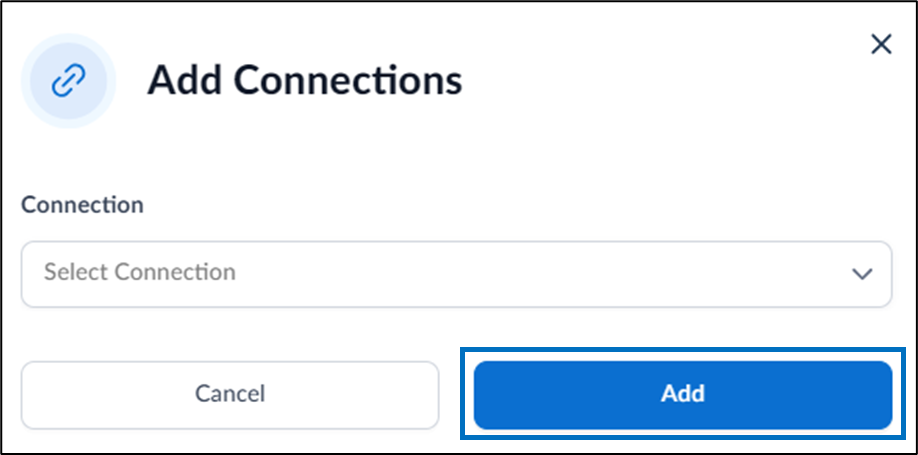

   The connection is added to the application successfully.

The Oloid Vault application is configured successfully.
