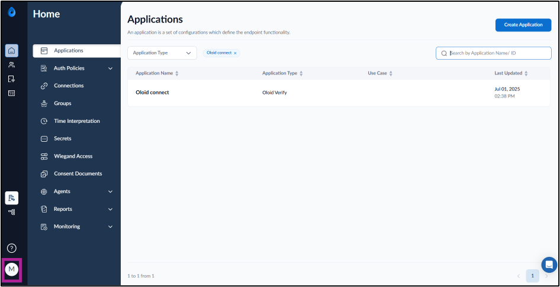
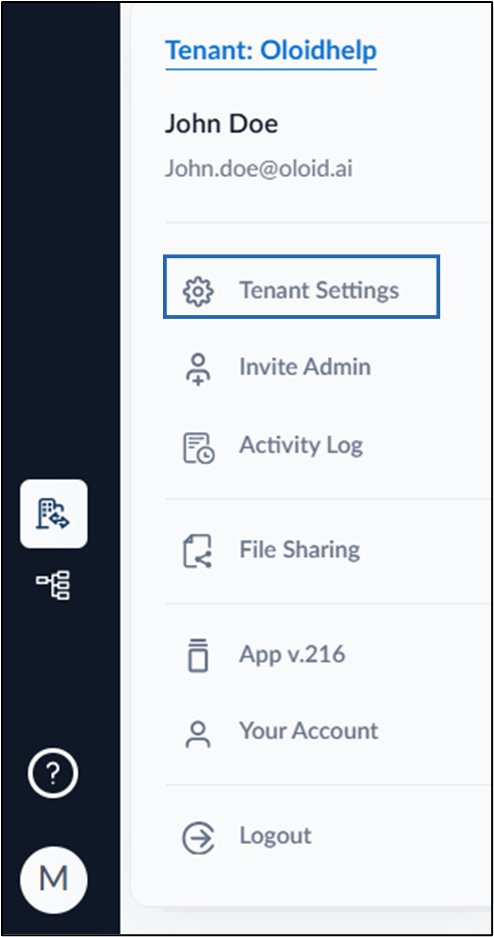
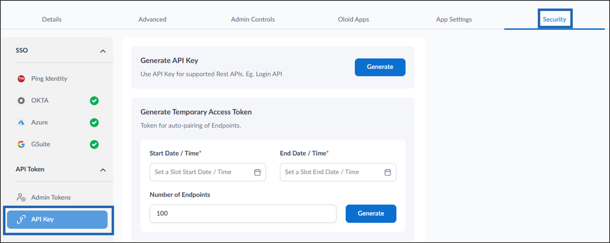
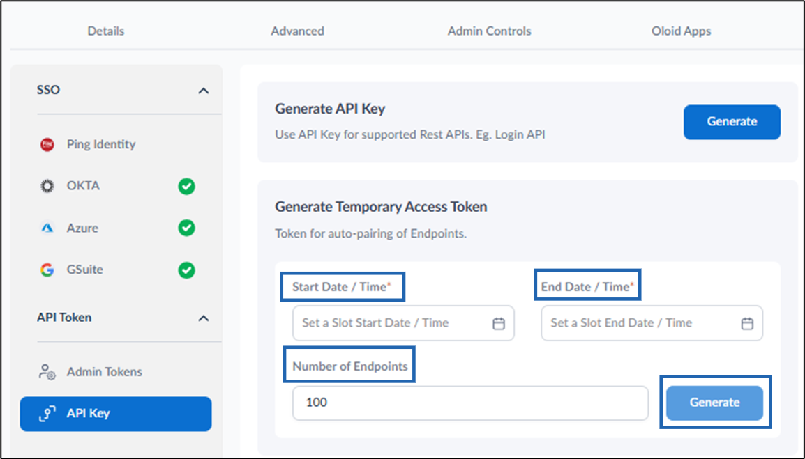
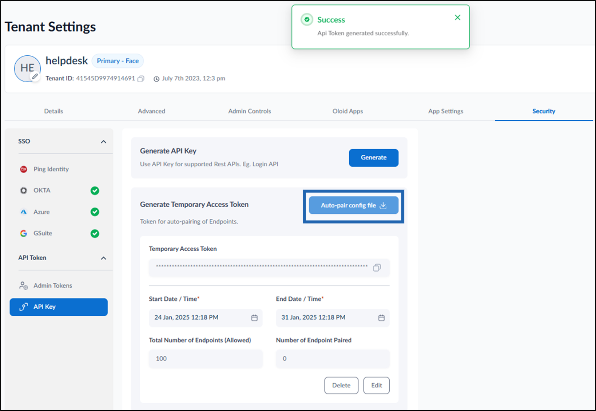
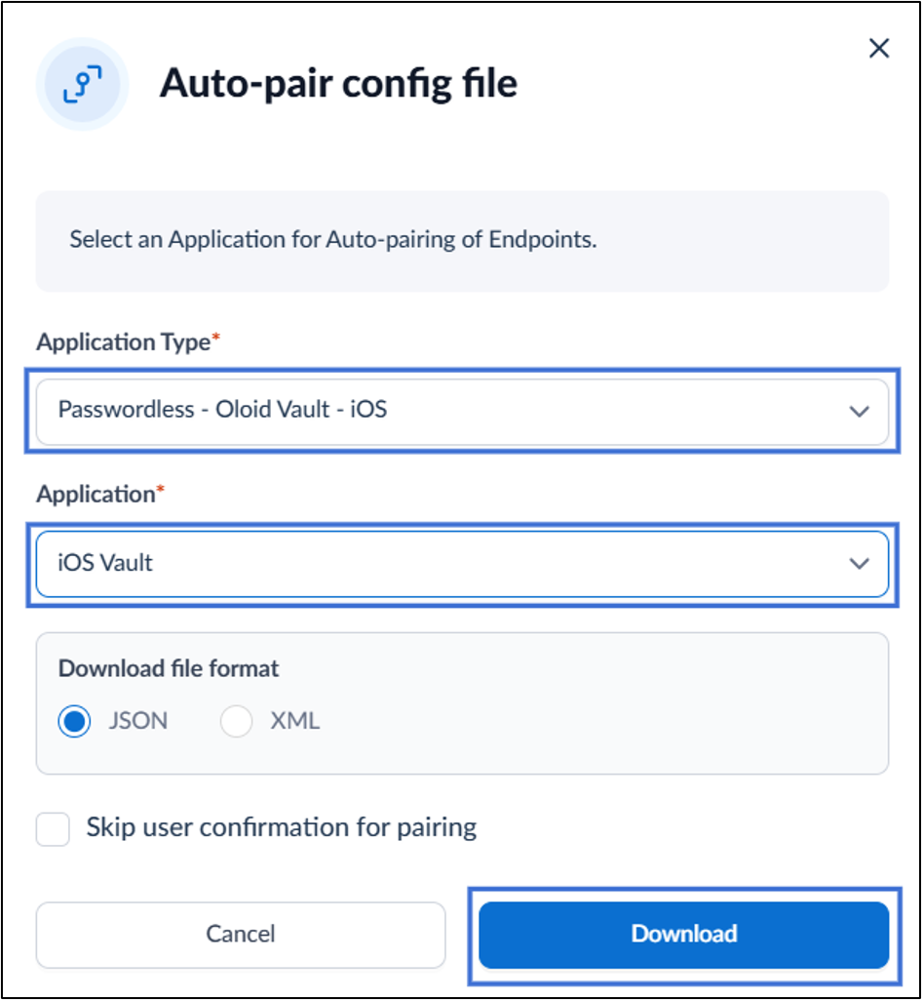

{/* Source: Intercom article 15597538 -  */}
{/* Generated by intercom_to_mintlify.py - re-running overwrites this file. */}

## Introduction

The **Auto-Pair Config File** allows the Tenant Admin to streamline the process of pairing endpoints with a configured application. By generating this file from the Tenant Admin Portal, admins can automatically connect multiple endpoints.

## Prerequisites

You must have access to Tenant Admin Account.

## Steps to generate auto-pair config file

1. Log in to the **Tenant Admin Portal**.
2. On the homepage of the portal, click **user profile icon** on the bottom left corner of the menu panel.

   

   The user profile menu is displayed.
3. Click **Tenant Settings**.

   

   The **Tenant Settings** page is displayed.
4. Go to **Security** tab > **API Token** > **API Key**.

   

5. In the **Generate Temporary Access Token** section, do the following:
   1. In the **Generate Temporary Access Token** section, select the **Start Date/Time** field.
      - To set the start date and time, click the date picker or select **Now**.
   2. Select the **End Date/Time** field.
      - Click the date picker, choose when the token will expire, and then click **OK**.
   3. Specify **Number of Endpoints** that can be created using the endpoint. (Optional)
   4. Click **Generate**.

      

      The auto-pair config file is generated.
6. Click **Auto-pair config file**.

   

   The Auto-pair config file pop-up box is displayed.
7. Do the following:
   1. Select **Application** as **Passwordless - Oloid Vault - iOS** from **Application Type** dropdown list.
   2. From the **Select Application** drop-down list, select the application that you want the endpoints to pair with.
   3. Under **Download file format**, select one of the following file formats:
      - **JSON** – Downloads the configuration file in JSON format.
      - **XML** – Downloads the configuration file in XML format.

        <Note>
          **Note:** Select **Skip user confirmation for pairing** option to auto-pair endpoints without requiring user confirmation.
        </Note>

   4. Click **Download**.

      

      The Autopair Config file is downloaded to the local device.
