{/* Source: Intercom article 10346057 -  */}
{/* Generated by intercom_to_mintlify.py - re-running overwrites this file. */}

Steps to create and configure Oloid Vault application:

1. Log in to the **Tenant Admin Portal**.
2. On the **Applications** page, click **Create Application** in the top right corner.

   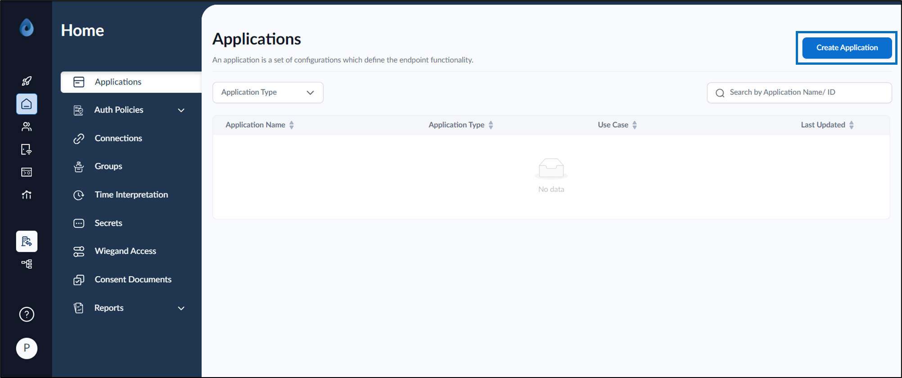

   The **Create New Application** pop-up box is displayed.
3. Do the following:
   1. Enter **Application Name** and select **Application Type** as **Passwordless**.

      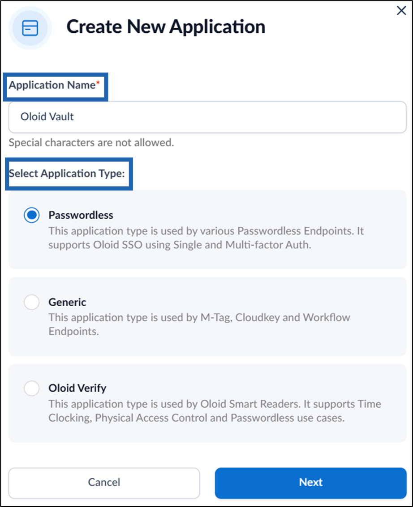

   2. Click **Next**.
      The **Select Passwordless Use Case** screen is displayed.
   3. Select **Oloid Vault** then click **Create**.

      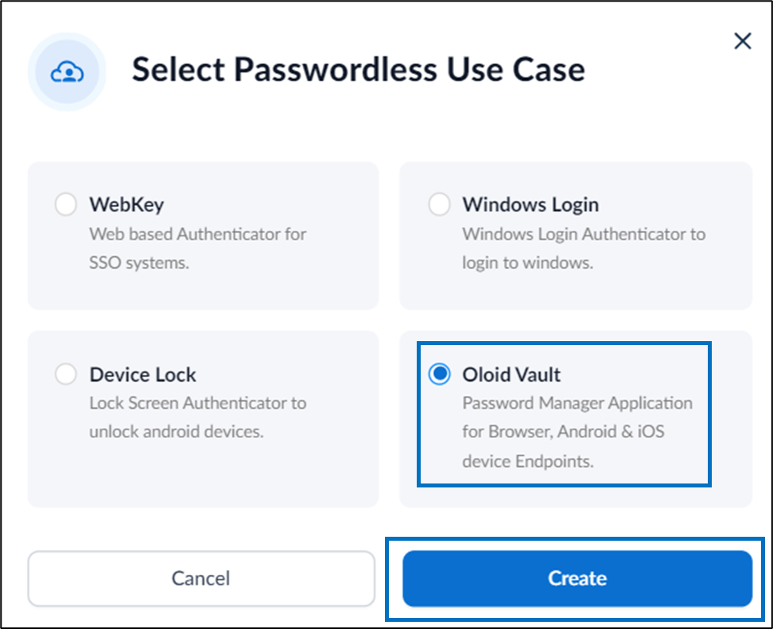

      The Passwordlessapplication of type **Oloid Vault** is created and the configuration page is displayed.
4. Configure the following:
   1. [Details tab](/platforms/web/webkey/webkey-how-to-create-and-configure-a-webkey-application-in-tenant)
   2. [Authenticator tab](/platforms/web/webkey/webkey-how-to-create-and-configure-a-webkey-application-in-tenant)
   3. [Configure tab](/platforms/web/webkey/webkey-how-to-create-and-configure-a-webkey-application-in-tenant)
   4. [Connections tab](/platforms/web/webkey/webkey-how-to-create-and-configure-a-webkey-application-in-tenant)

<Note>
  **Note:** These are one-time settings and all the default settings are recommended.
</Note>

## Configure Details Tab

1. Modify **Application Name**.
2. Add **Description**. (Optional)
3. Factor Sequence *...Coming Soon....*

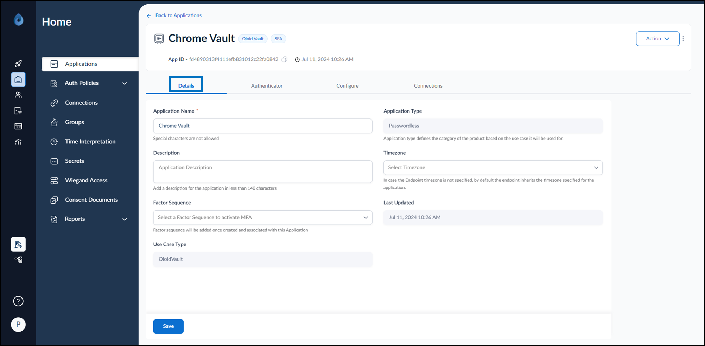

## Configure Authenticator Tab

You may enable one or more credential options based on your requirements.

### Face

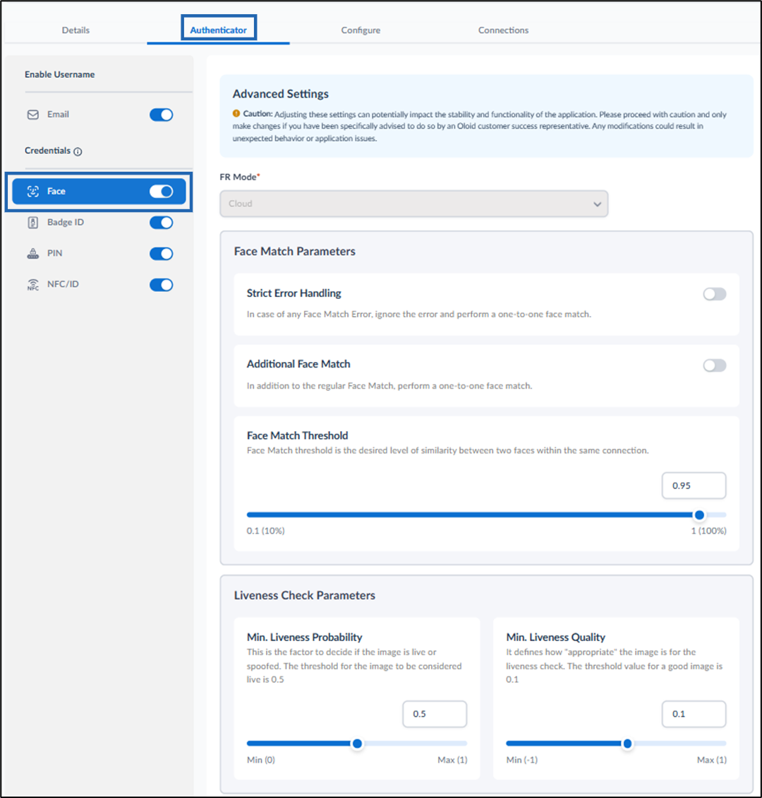

- To use face as credential, enable **Face** option.
  The **Advanced Settings** page is displayed.
  - Configure **Face Match Parameters**, and **Liveliness Check Parameters** on the Advanced Settings page.

<Note>
  **Note:** The parameters are pre-configured. This is done by Oloid admin.
</Note>

**Additional Settings**

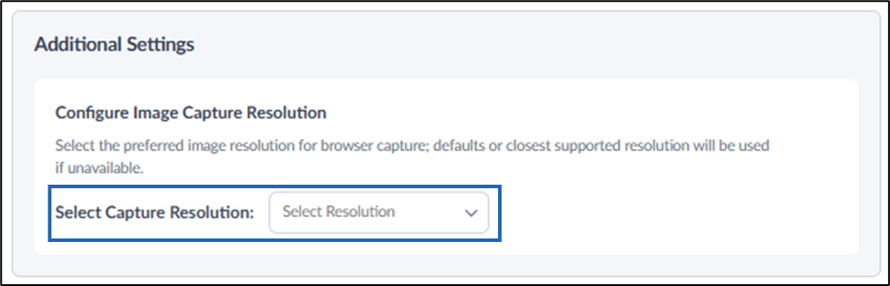

- **Configure Image Capture Resolution:** Select the preferred resolution from the **Select Resolution** dropdown list for image capture during facial authentication.
- Click **Save**.

  <Note>
    **Note:** If the selected resolution is not available, the browser will default to the closest supported resolution.
  </Note>

### Badge ID

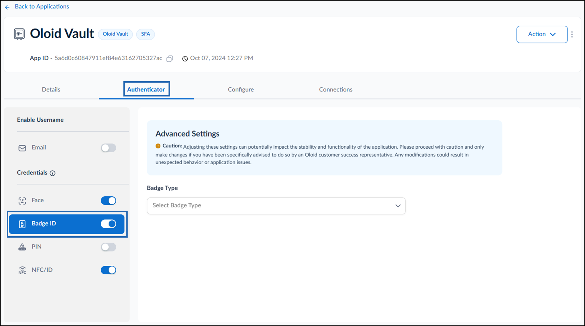

Select a **Badge Type** from the dropdown list. To use Badge ID as credential, enable **Badge ID**.

### PIN

*Coming Soon*

### NFC/ID

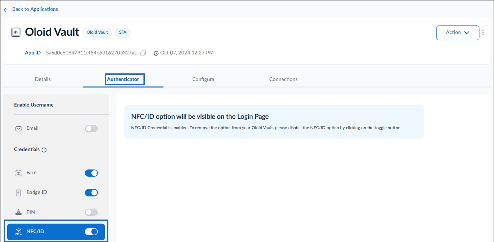

To use NFC/ID as credential, enable **NFC/ID** option.

## Design Configure Tab

Do the following:

1. [Configure Settings tab](https://app.intercom.com/)
2. [Customize Buttons tab](/platforms/windows/windows-login/windows-login-how-to-create-and-configure-windows-login-application)

### Configure Settings Tab

### Vault Behavior

- **Enable Auto-Submit:** *Coming Soon*
- **Enable Copy Password:** Select this option to allow users to copy passwords from the Oloid Vault home page after logging in.
- **Enable Face Camera to open in a new Tab:** Select this option to open the face camera in a new tab for Oloid Vault users.

  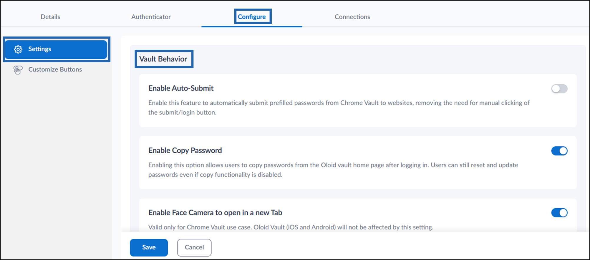

### Set Time-out durations for Re-authentication

- **Session Limit:** Set the maximum duration a user can remain signed into the Oloid Vault per session, up to a max of 55 mins.
- **Inactivity Timer:** Enable this option to protect user sessions from unauthorized access. Set the timer to automatically log off the user after a specified period of inactivity.

**Apply Endpoint Template:** *Coming Soon*

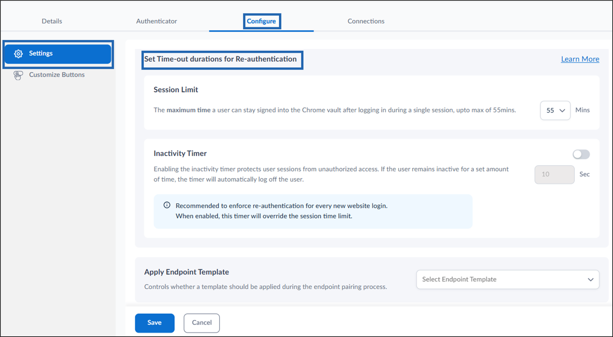

### Customize Buttons Tab

You can customize the button label of your application's authentication page by following the onscreen instructions.

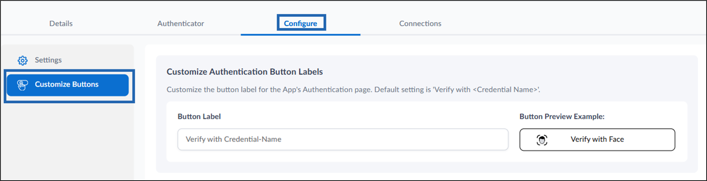

## Configure Connections Tab

1. Do the following:
   1. Select **+ Add Connections** to map a connection to the application.

      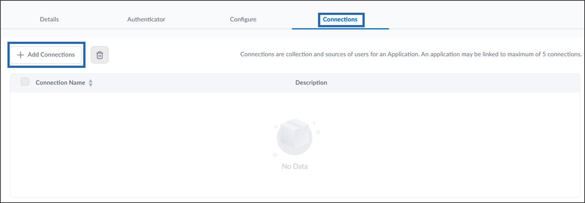

   2. On the **Add Connections** pop-up box, select connection name(s) from the **Select Connection** dropdown list and click **Add**.

      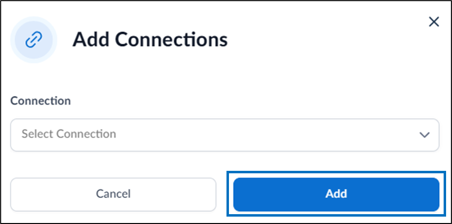

      <Note>
        **Note:** Click **Save** after each action to save your configuration.
      </Note>

      The **Oloid Vault** application is configured and listed on the Application page.
