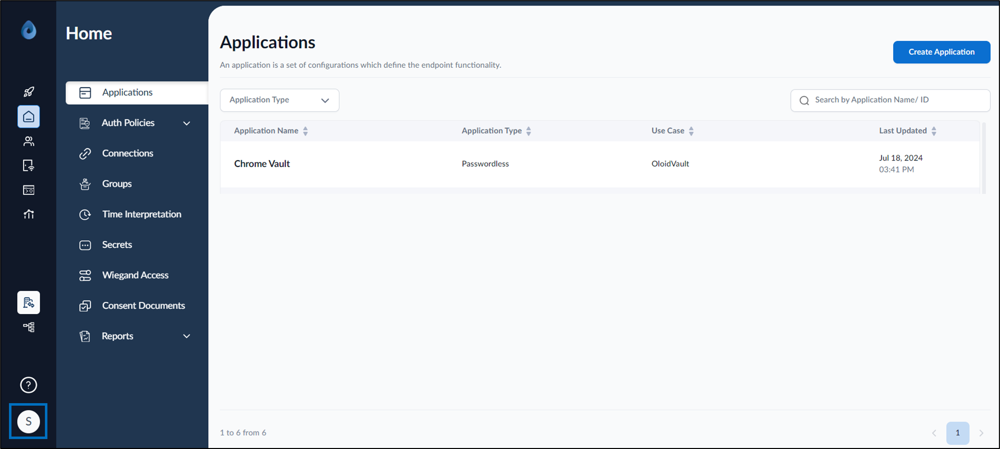
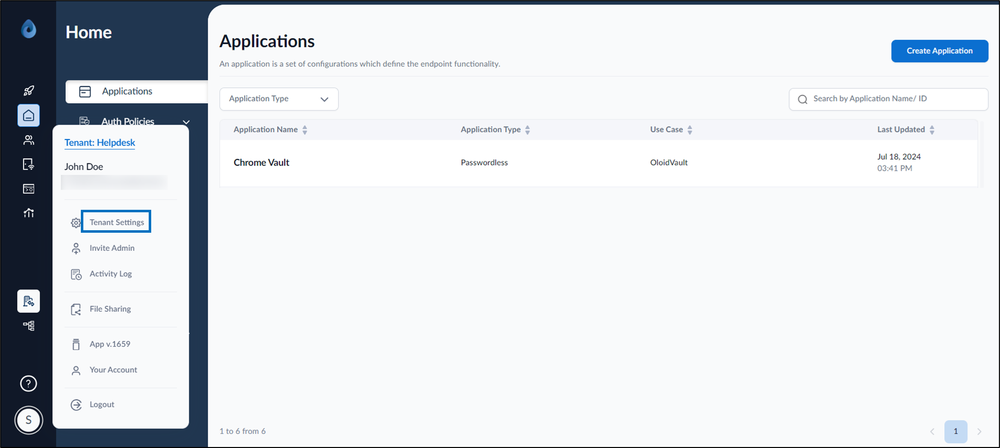
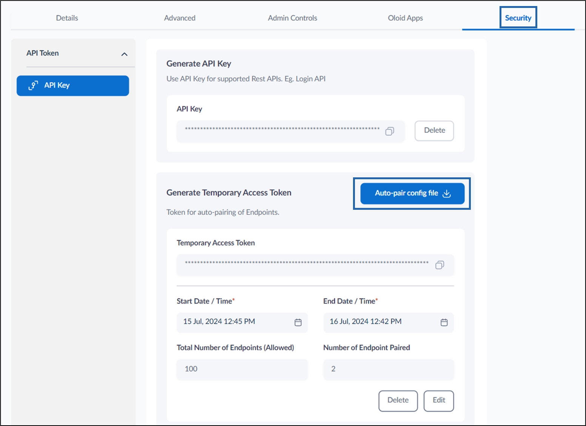
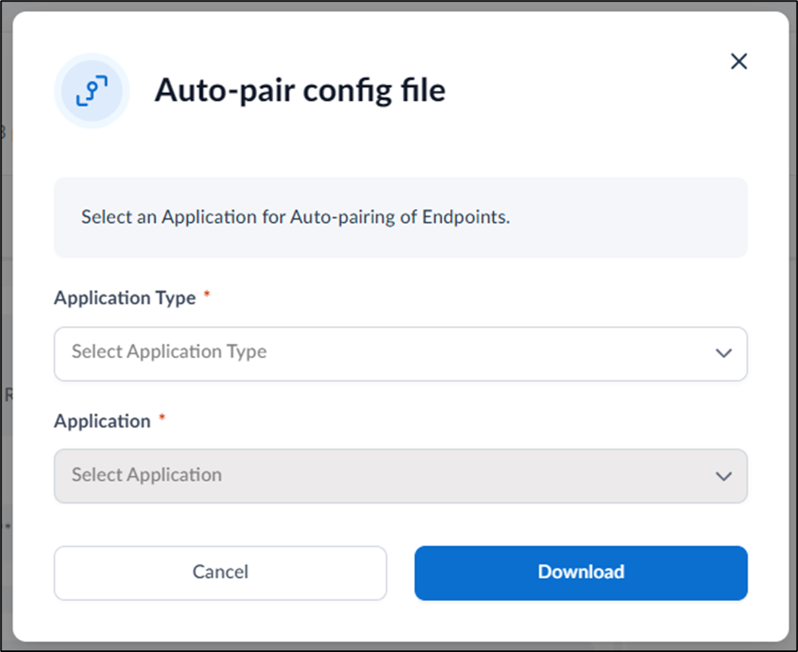
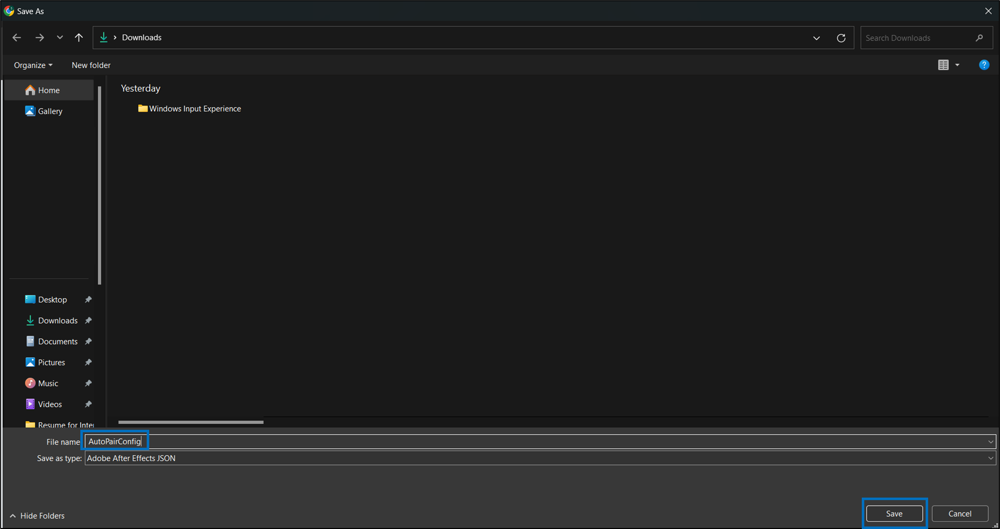

{/* Source: Intercom article 9611773 -  */}
{/* Generated by intercom_to_mintlify.py - re-running overwrites this file. */}

To download an endpoint config file:

1. Log in to the **Oloid Portal**.
2. On the homepage of the portal, click **user profile icon** on the bottom left corner of the menu panel.

   

   The user profile menu is displayed.
3. Select **Tenant Settings**.

   

   The Tenant Settings page is displayed.
4. Go to **Security** > **API Key** > **Auto-pair config file**.

   

   The Auto-pair config file pop-up box is displayed.

   

5. Do the following:
   1. Select application type from the **Application Type** dropdown field.
   2. Select application from **Application** dropdown field.
   3. Select **Download**.
      The Save As dialog box is displayed.
   4. Select the preferred folder to save the fileand then select **Save**.

      

      The Config File is saved to the local device.
