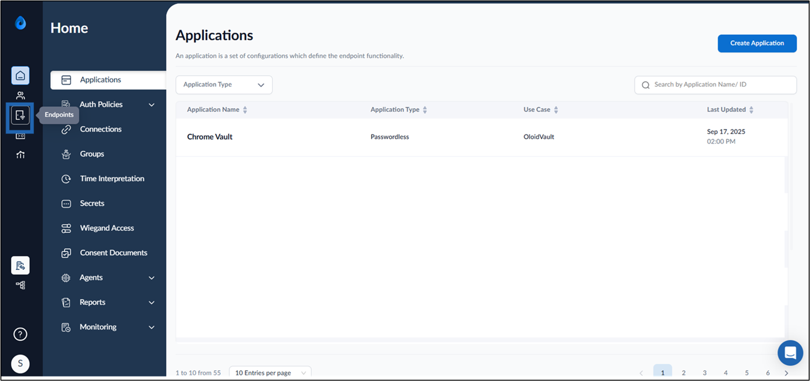
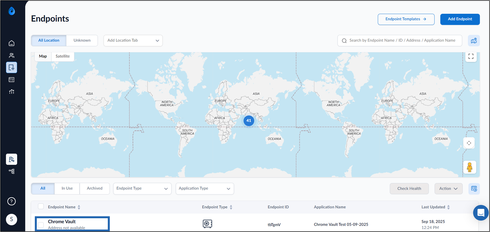
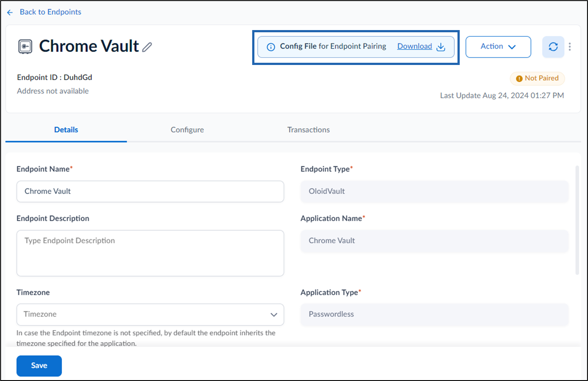

{/* Source: Intercom article 9767186 -  */}
{/* Generated by intercom_to_mintlify.py - re-running overwrites this file. */}

## No longer supported

## Introduction

This document explains how to download the Chrome Vault endpoint configuration file from the Tenant Admin Portal.

## Prerequisites

- You are a registered user in the **Tenant Admin Portal** with the Admin role.
- The Chrome Vault endpoint must be created from Oloid Portal. For further details, see [How to manually create endpoint for Chrome Vault.](/drafts/platforms/web/vault/chrome/how-to-manually-create-endpoint-for-chrome-vault)

## Steps to download endpoint config file

1. Log in to the **Tenant Admin Portal**.
2. On the homepage of the portal, click **Endpoints** on the left menu panel.

   

   The Endpoints page is displayed.
3. Click applicable **Endpoint Name**.

   <Note>
     **Note:** Make sure you select an endpoint that was created through the Oloid Portal.
   </Note>

   

   The Endpoint detail page is displayed.
4. Click **Download** to download the config file for endpoint pairing.

   

   The Config file is downloaded and saved in the local device.

## Related Video

**[How to download endpoint config file for Chrome Vault- Video Tutorial](/drafts/platforms/web/videos/how-to-download-endpoint-config-file-for-chrome-vault-video-tutorial)**
