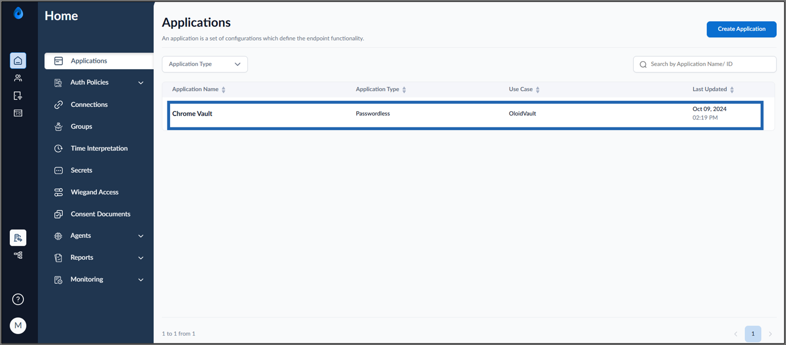
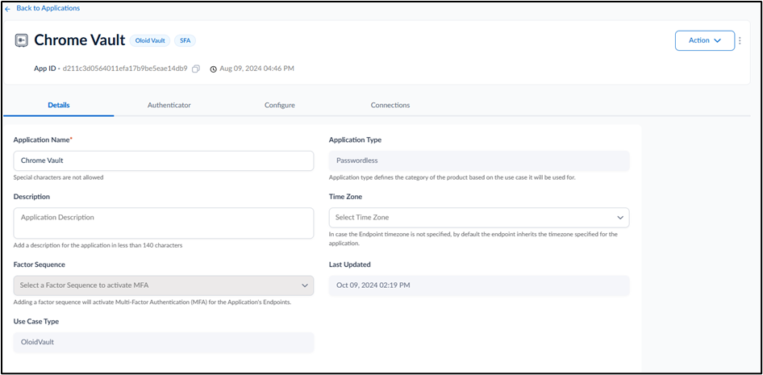
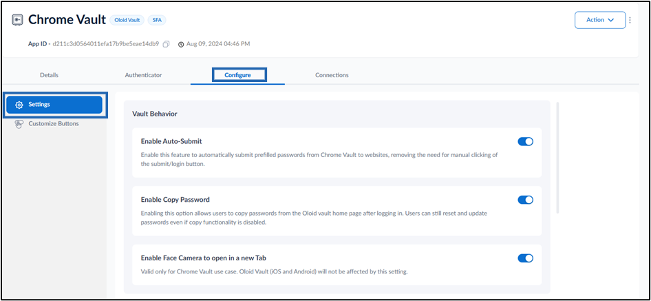
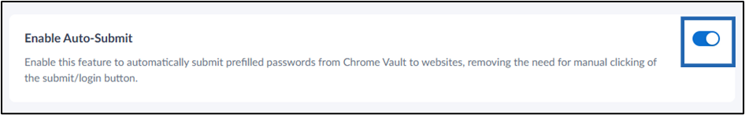
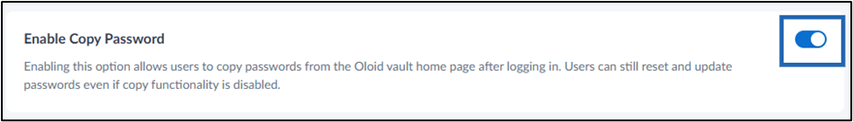
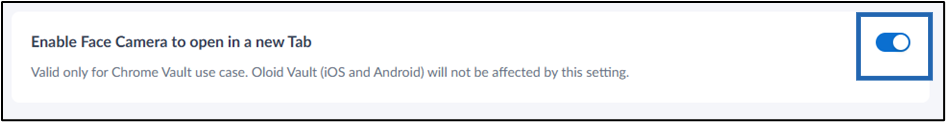
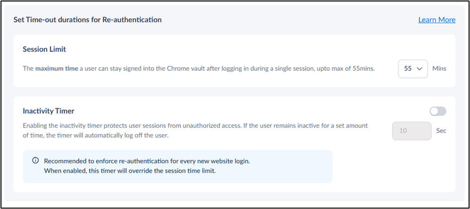
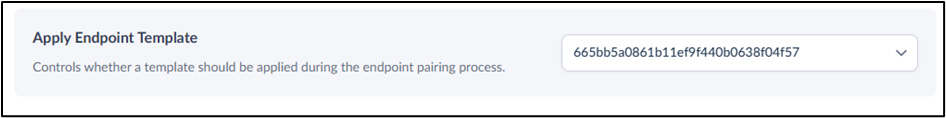

{/* Source: Intercom article 10832515 -  */}
{/* Generated by intercom_to_mintlify.py - re-running overwrites this file. */}

**Pre-requisite:**

You must create a Passwordless application of type Chrome Vault. For further details, refer How to create [How to create and configure Chrome Vault application](/platforms/web/vault/chrome/oloid-vault-chrome-chromium-how-to-create-and-configure-oloid-vault)

Steps to edit Configure tab:

1. Log in to the **Oloid Portal**.
2. On the **Applications** page, click on the Chrome Vault application to edit.

   

   The application page is displayed.

   

3. Go to **Configure** tab > Click **Settings**.

   

Do the following:

## Configure Settings Tab

## Vault Behavior

- **Enable Auto-Submit:** Select this option to allow automatic login using saved passwords from Chrome Vault without clicking Submit.

  

- **Enable Copy Password:** Select this option to allow users to copy passwords from the Chrome Vault home page after logging in.

  

**Enable Face Camera to open in a new Tab:** Select this option to open the face camera in a new tab for Chrome Vault users.

## Set Time-out durations for Re-authentication

- 

  - **Session Limit:** Set the maximum duration a user can remain signed into the Chrome Vault per session, up to a max of 55 mins.

**Inactivity Timer:** Enable this option to protect user sessions from unauthorized access. Set the timer to automatically log off the user after a specified period of inactivity.

## Apply Endpoint Template**:**

- 

Select an endpoint template from the dropdown list to ensure the template is applied during endpoint pairing.
