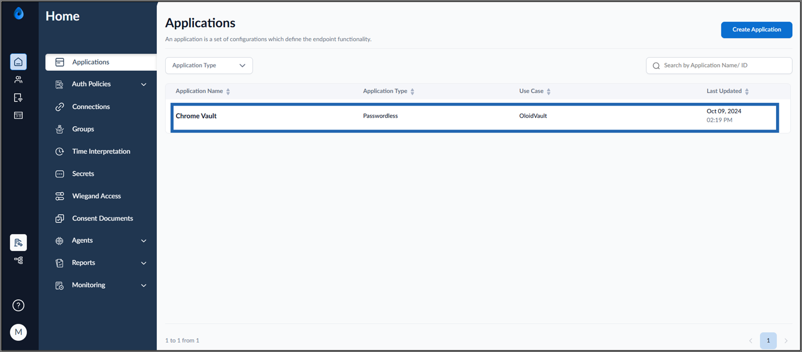
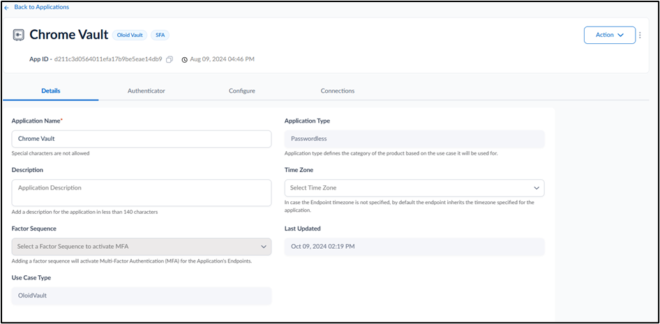
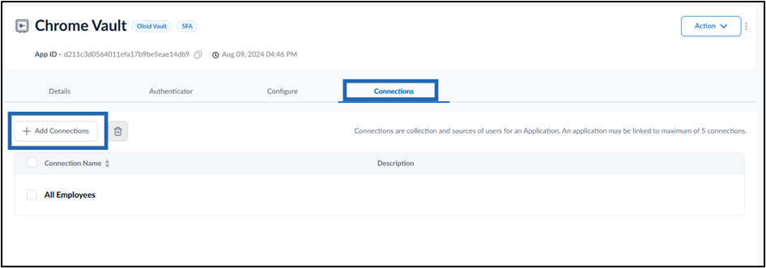
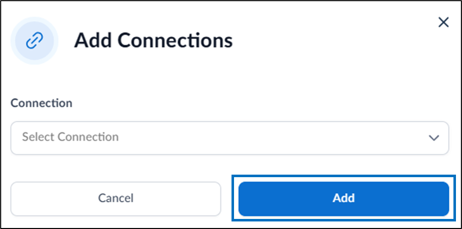

{/* Source: Intercom article 10832713 -  */}
{/* Generated by intercom_to_mintlify.py - re-running overwrites this file. */}

**Pre-requisite:**

You must create a Passwordless application of type Chrome Vault. For further details, refer How to create [How to create and configure Chrome Vault application](/platforms/web/vault/chrome/oloid-vault-chrome-chromium-how-to-create-and-configure-oloid-vault)

Steps to edit Connections tab:

1. Log in to the **Oloid Portal**.
2. On the **Applications** page, click on the Chrome Vault application to edit.

   

   The application page is displayed.

   

3. Go to **Connections** tab > Select **+ Add Connections**.

   

4. On the **Add Connections** pop-up box, select connection name(s) from the **Select Connection** dropdown list and click **Add**.

   
