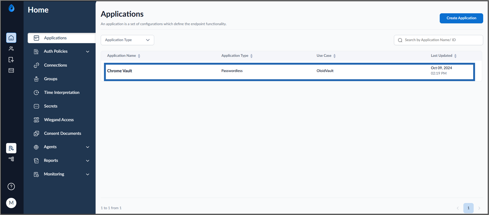
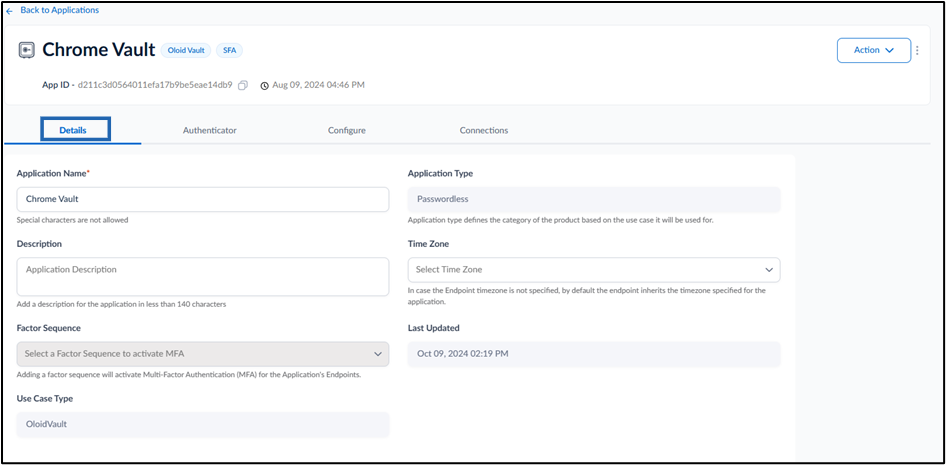

{/* Source: Intercom article 10814228 -  */}
{/* Generated by intercom_to_mintlify.py - re-running overwrites this file. */}

**Pre-requisite:**

You must create a Passwordless application of type Chrome Vault. For further details, refer How to create [How to create and configure Chrome Vault application](/platforms/web/vault/chrome/oloid-vault-chrome-chromium-how-to-create-and-configure-oloid-vault)

Steps to edit Details tab:

1. Log in to the **Oloid Portal**.
2. On the **Applications** page, click on the Chrome Vault application to edit.

   

   The application page is displayed.

3. Do the following:

a. Edit **Application Name** if required.

b. Add **Description**. (Optional)

c. Select **Factor Sequence**. (Coming Soon)

d. Select **Time Zone** from the dropdown list. (Optional)

<Note>
  **Note:** These are one-time settings and all the default settings are recommended.
</Note>
