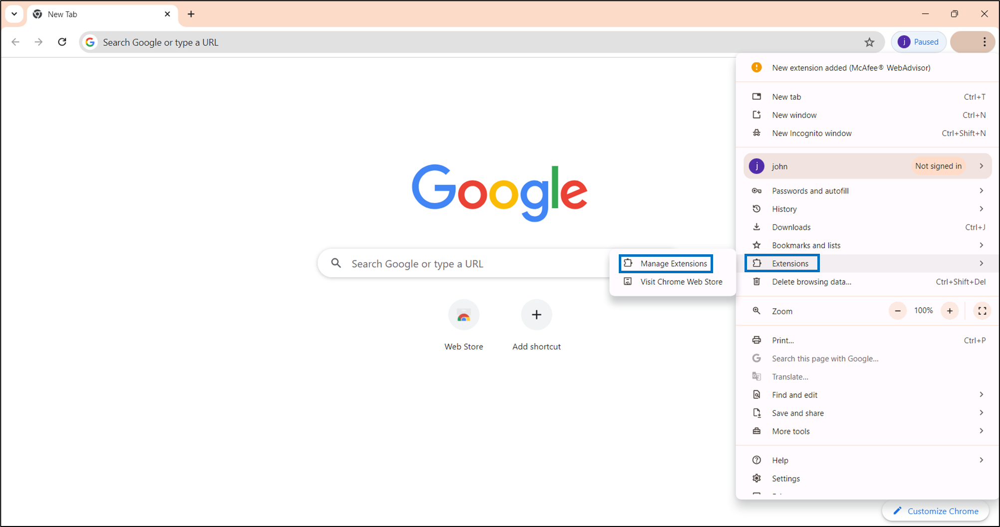
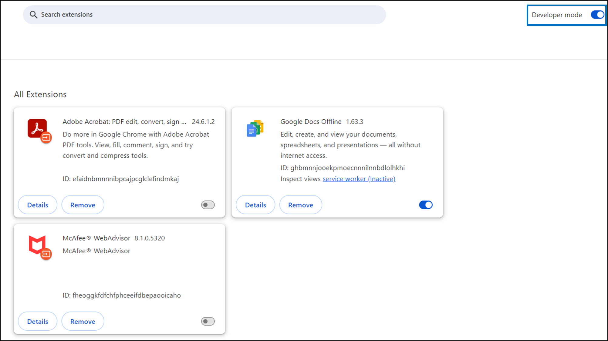
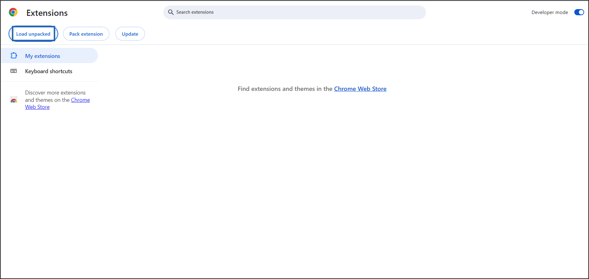
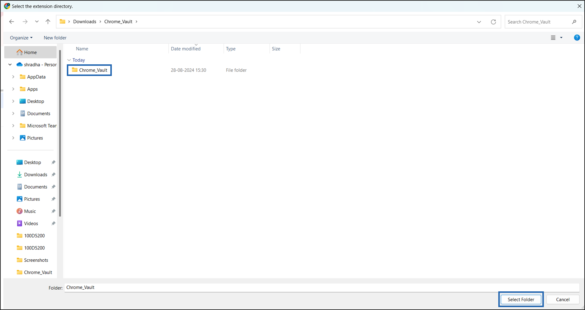
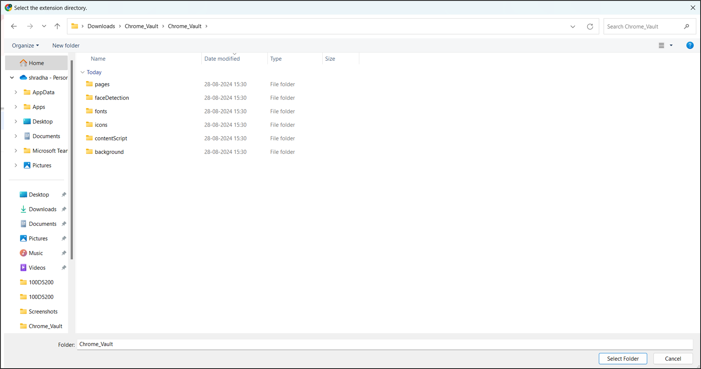
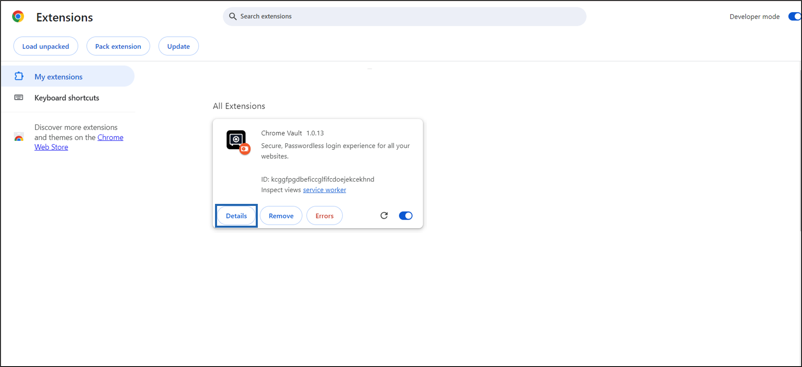
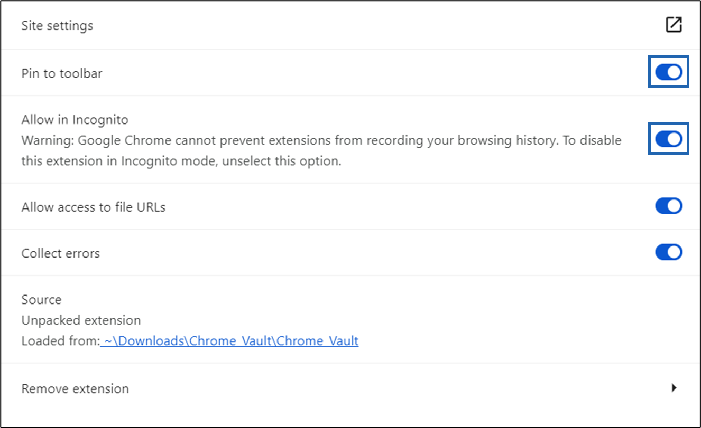
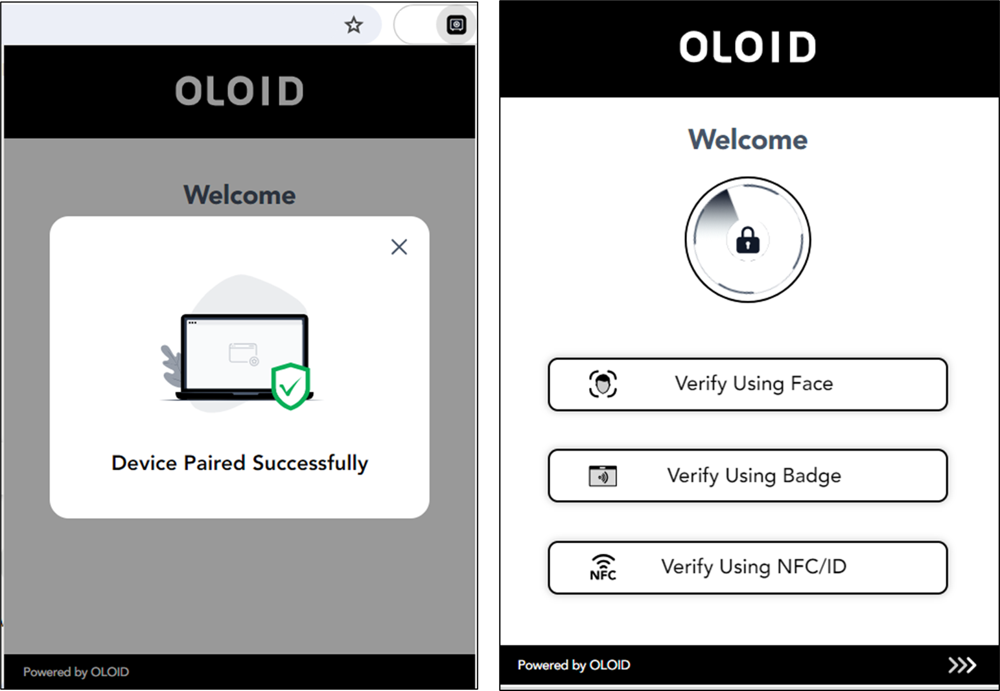
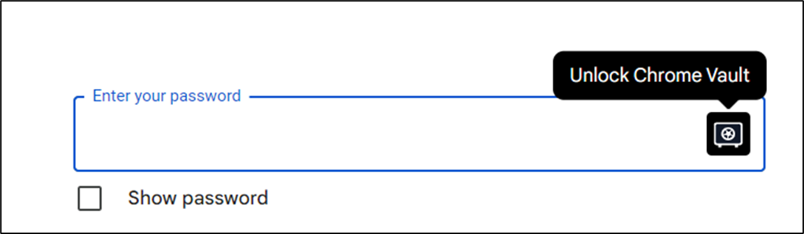
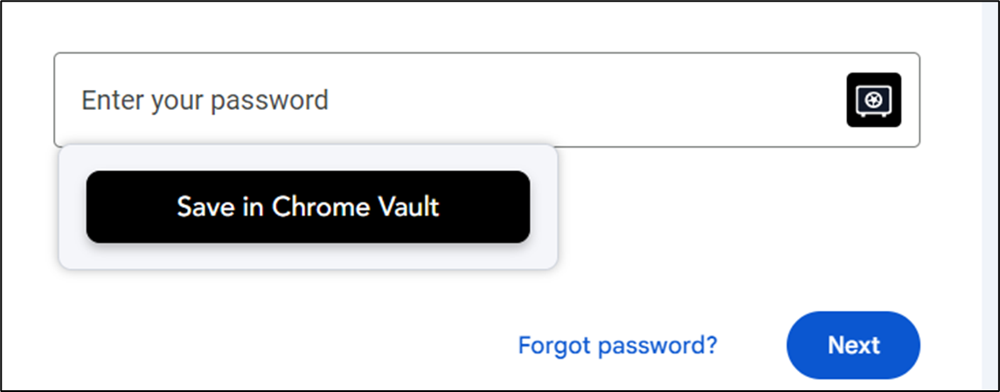

{/* Source: Intercom article 9610642 -  */}
{/* Generated by intercom_to_mintlify.py - re-running overwrites this file. */}

Steps to install Chrome Vault application:

1. Download the Chrome Vault installer file on your system.

   <Note>
     **Note:** Reach out to [Oloid Support](mailto:Support@oloid.ai) for the installer file.
   </Note>

2. Right-click the zipper folder and then choose **Extract All**.
   The extracted files are saved in the same folder as the original .zip file.
3. Open **Google Chrome** browser.
4. Navigate to **Extensions** > **Manage Extensions**.

   

5. On the top right, enable **Developer Mode**.

   

6. Select **Load unpacked** to select the extension directory.

   

7. Open the Chrome Vault folder,then click **Select Folder**.

   

   

   The Chrome Vault folder is uploaded.
8. Select **Details** and do the following:

   

   1. Enable **Pin to toolbar** toggle button.
   2. Enable **Allow in Incognito** toggle button.

      

      The Chrome Vault application is successfully installed. You can view Chrome Vault icon on the toolbar.

      

   3. Click **Chrome Vault** icon to open.
      The Welcome screen is displayed. The application is automatically paired successfully and ready to use.

      <Note>
        **Note:** If auto pairing fails, you can manually pair the Chrome Vault application. For detailed instructions, see [How to manually pair endpoint in Chrome Vault.](/platforms/web/vault/chrome/oloid-vault-chrome-chromium-how-to-manually-pair-an-endpoint)
      </Note>

      

<Note>
  **Note:** After installation, the Chrome Vault icon will also appear when you visit any website in your browser and click on credential fields.
</Note>

- You can click **Chrome Vault** icon in the credential field to unlock and then save your credentials. This will show up when you are not logged into Chrome Vault application.

  

- You can click the **Chrome Vault** icon in the credential field to save your credentials securely. This will show up when you are already logged into Chrome Vault app.

  
