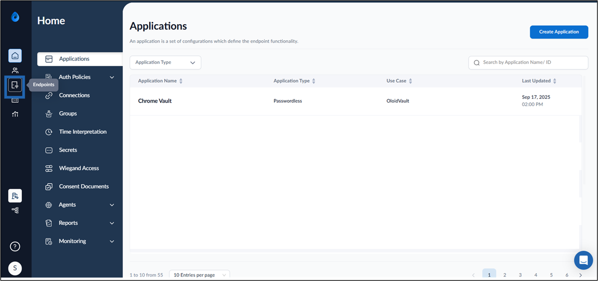
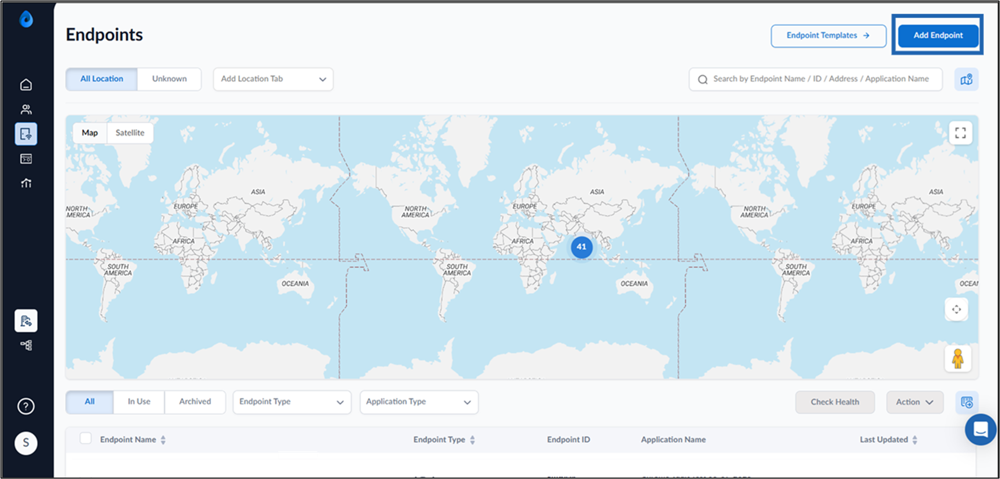
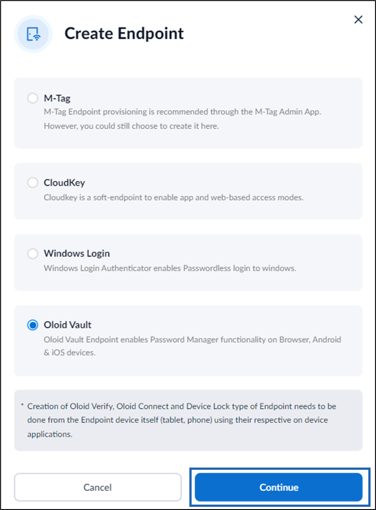
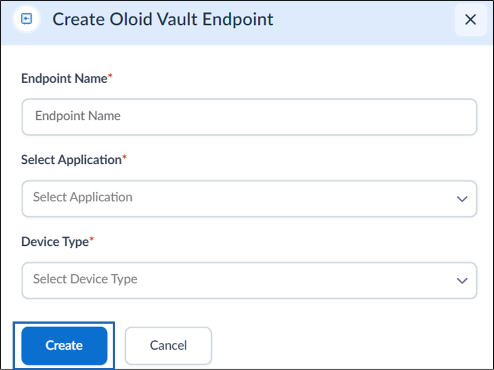

{/* Source: Intercom article 9776746 -  */}
{/* Generated by intercom_to_mintlify.py - re-running overwrites this file. */}

## No longer supported

## Introduction

This document provides step-by-step instructions on how to create **Chrome Vault endpoint** in the Oloid Portal.
A Chrome Vault endpoint allows the Oloid Vault to integrate with the Chrome browser so that credentials can be securely managed and updated.

## Prerequisites

You are a registered user in the **Tenant Admin Portal** with the Admin role.

## Steps to create Chrome Vault endpoint

1. Log in to the **Tenant Admin Portal**.
2. On the homepage of the portal, click **Endpoints** on the left panel menu.

   

   The **Endpoints** page is displayed.
3. Click **Add Endpoint** on the top right corner.

   

   The **Create Endpoint** pop-up box is displayed.
4. Select **Oloid Vault** and select **Continue**.

   

   The **Create Oloid Vault Endpoint** pop-up box is displayed.
5. Do the following:
   1. Enter **Endpoint Name**.
   2. Select **Application** from the application list**.**
   3. Select **Device Type** as Chrome Browser from the dropdown list.
   4. Click **Create**.

      

      The endpoint is created and listed on the **Endpoints** page.

## Related Video

**[How to manually create endpoint for Chrome Vault- Video Tutorial](/drafts/platforms/web/videos/how-to-manually-create-endpoint-for-chrome-vault-video-tutorial)**
