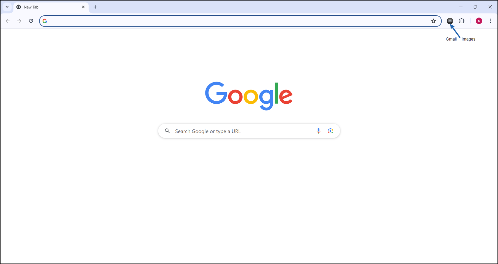
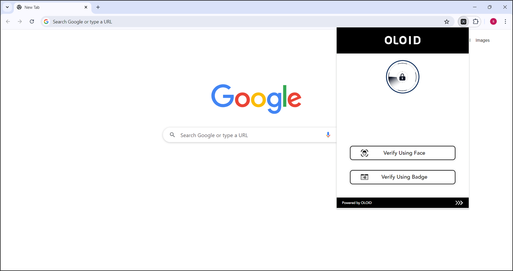
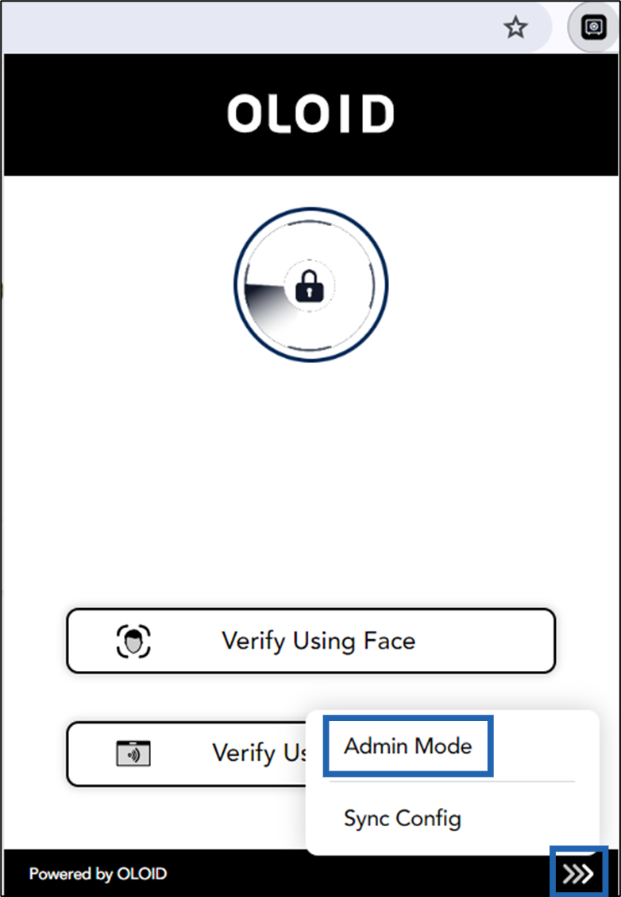
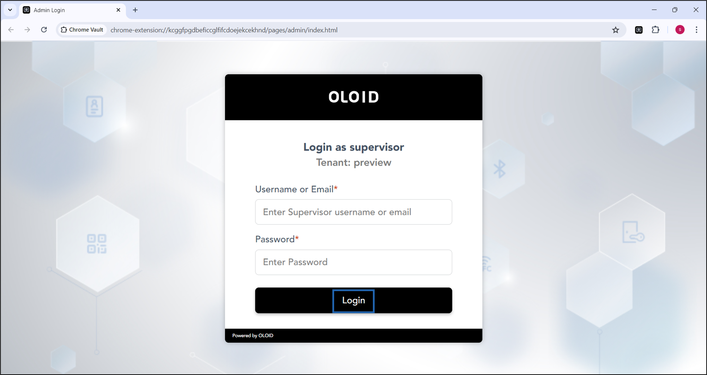
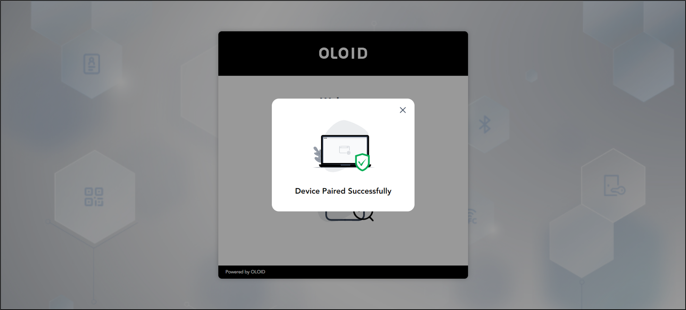

{/* Source: Intercom article 9611988 -  */}
{/* Generated by intercom_to_mintlify.py - re-running overwrites this file. */}

**Pre-requisite**

You need to download the config file of the preferred endpoint from the Oloid Portal. For details, refer How to download endpoint config file for Chrome Vault application?

To pair an endpoint:

1. Open **Google Chrome** browser and click **Chrome Vault** icon located on the toolbar.

   

   The Chrome Vault home page is displayed.

   

2. Go to **More**  option icon > **Admin Mode**.

   

   The Chrome Vault login screen is displayed on a new tab.
3. Enter your credentials to log in to admin mode.

   

   The Welcome screen is displayed.
4. Select **Pair Using Config File**.
5. Select the json file you want to upload and click **Open**.
   The device is paired successfully.

   
