{/* Source: Intercom article 12425279 -  */}
{/* Generated by intercom_to_mintlify.py - re-running overwrites this file. */}

## Introduction

## Prerequisites

- You must have a Tenant Admin account.
- You must create a connection to map the application. To create connection refer [How to create Connections in the Tenant Admin Portal](/platform/tenant-admin-portal/tenant-admin-portal-how-to-create-connection).

**This document contain following sections:**

- [Steps to create Chrome Vault application](/platforms/web/vault/chrome/oloid-vault-chrome-chromium-how-to-create-and-configure-oloid-vault)
- [Steps to configure Chrome Vault application](/platforms/web/vault/chrome/oloid-vault-chrome-chromium-how-to-create-and-configure-oloid-vault)

## Steps to create Chrome Vault application

1. Log in to the **Tenant Admin Portal**.
2. On the **Applications** page, click **Create Application** in the top right corner.

   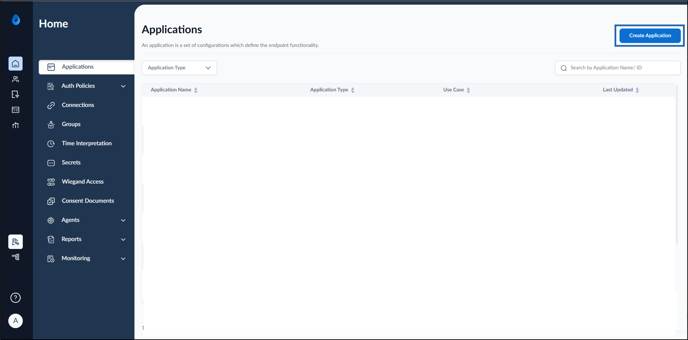

   The **Create New Application** pop-up box is displayed.
3. Do the following:
   1. Enter **Application Name.**
   2. Select **Application Type** as **Passwordless**.
   3. Click **Next**.

      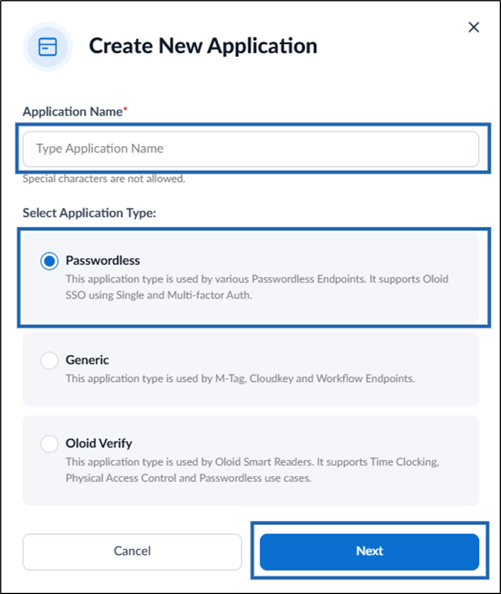

      The **Select Passwordless Use Case** pop-up box is displayed.
4. Do the following:
   1. Select **Oloid Vault.**
   2. Click **Create**.

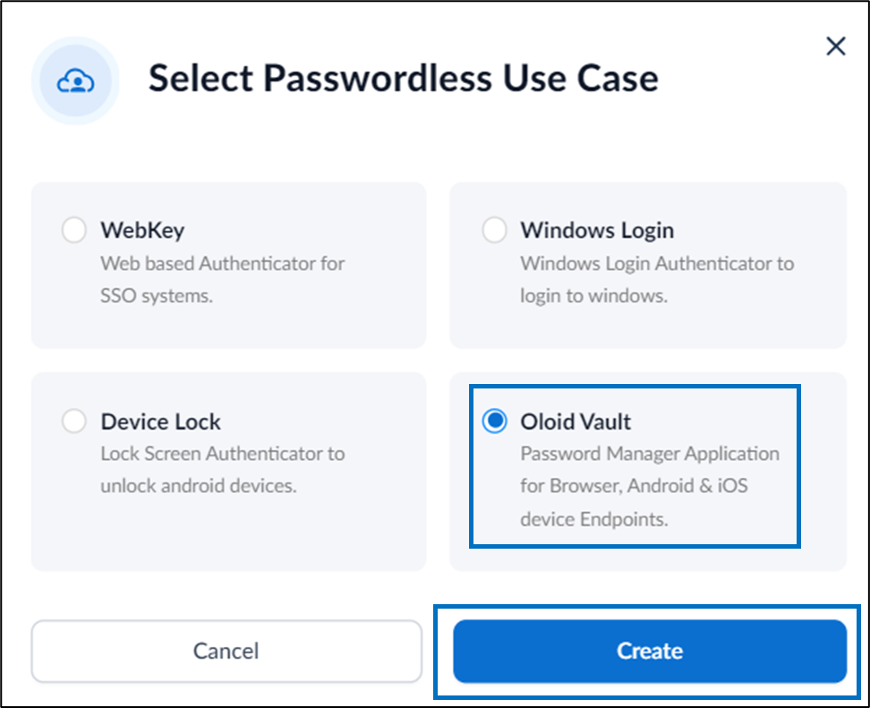

The Application is created successfully and listed in the application list page

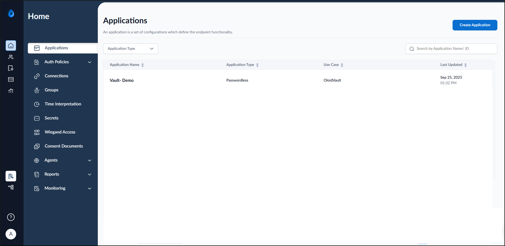

## Steps to Configure Chrome Vault application

1. Click on the preferred Oloid Vault application.

   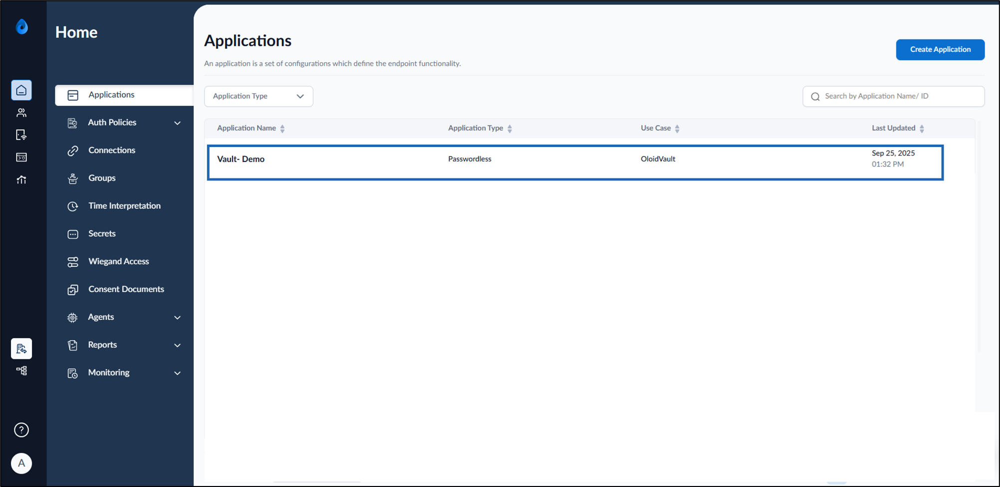

   The application details page is displayed.

   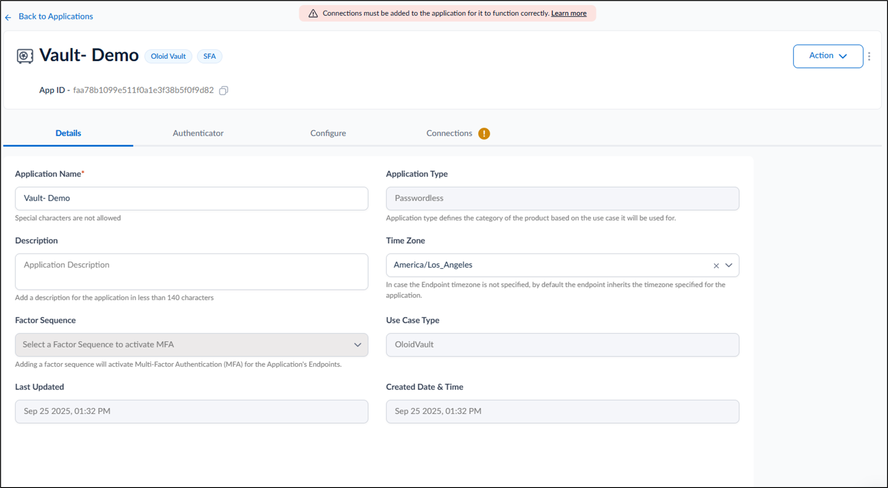

2. Configure the following:
   1. [Details tab](/platforms/web/vault/chrome/oloid-vault-chrome-chromium-how-to-create-and-configure-oloid-vault)
   2. [Authenticator tab](/platforms/web/vault/chrome/oloid-vault-chrome-chromium-how-to-create-and-configure-oloid-vault)
   3. [Configure tab](/platforms/web/vault/chrome/oloid-vault-chrome-chromium-how-to-create-and-configure-oloid-vault)
   4. [Connections tab](/platforms/web/vault/chrome/oloid-vault-chrome-chromium-how-to-create-and-configure-oloid-vault)

<Note>
  **Note:** These are one-time settings, and all the default settings are recommended.
</Note>

### Configure Details Tab

1. Update the **Application Name** (If needed).
2. Add the **Description** (Optional).

   <Note>
     **Note:** The description should be less than 140 characters.
   </Note>

3. Factor Sequence: *Coming Soon....*
4. Select the **Time Zone** from the drop-down menu.

   <Note>
     **Note:** If the endpoint time zone is not set, it will automatically use the application’s time zone.
   </Note>

5. Click **Save.**

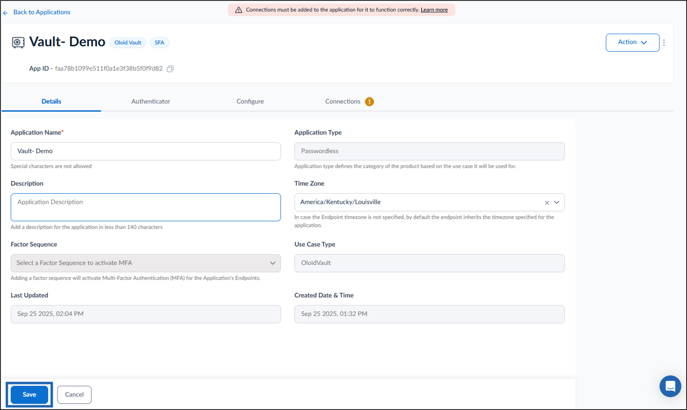

The details tab is updated successfully.

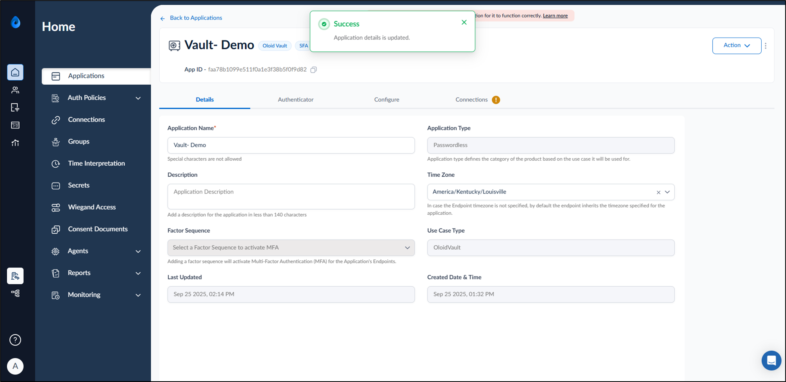

### Configure Authenticator Tab

Go to Authenticator tab and configure the following:

1. [Face](/platforms/web/vault/chrome/oloid-vault-chrome-chromium-how-to-create-and-configure-oloid-vault)
2. [Badge ID](/platforms/web/vault/chrome/oloid-vault-chrome-chromium-how-to-create-and-configure-oloid-vault)
3. [PIN](/platforms/web/vault/chrome/oloid-vault-chrome-chromium-how-to-create-and-configure-oloid-vault)
4. [NFC/ID](/platforms/web/vault/chrome/oloid-vault-chrome-chromium-how-to-create-and-configure-oloid-vault)

### Face

1. Select **Face** option from the left menu panel > turn on **Face** toggle.

   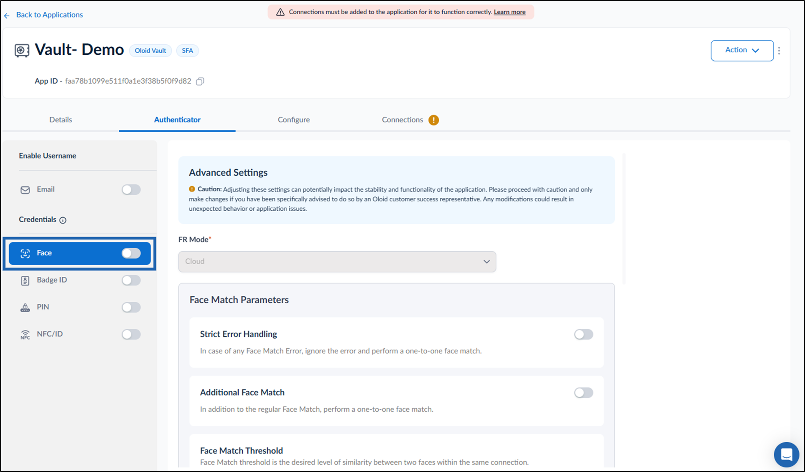

2. Adjust the following setting for **Face Match Parameters**.

   <Note>
     **Note:** You must consult your Oloid representative before making any changes to the **Face Match Parameters** to ensure optimal authentication performance.
   </Note>

   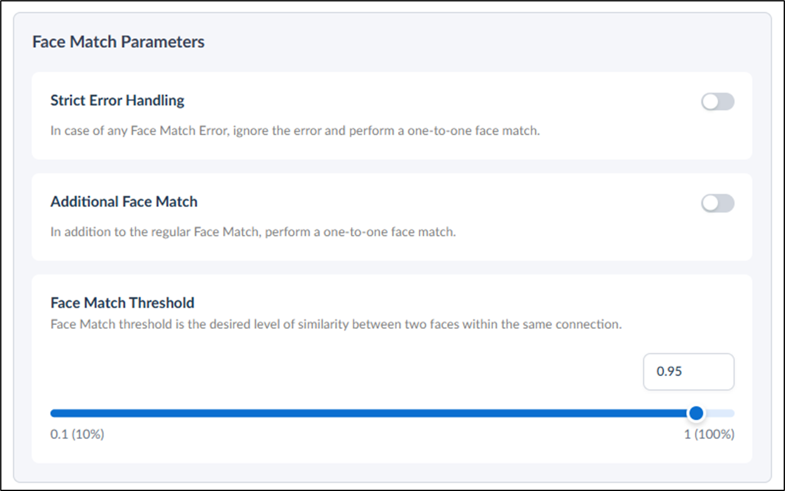

   1. Turn on **Strict Error Handing** toggle to skip the error and perform a direct one-to-one face match.

      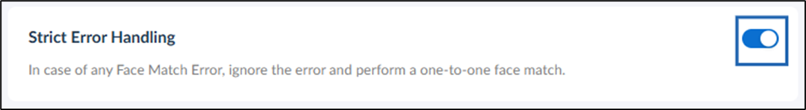

   2. Turn on **Additional Face Match** toggle to perform a one-to-one face match alongside the standard face matching process.

      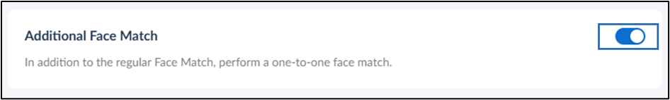

   3. Adjust the **Face Match Threshold** slider or enter a value directly into the input box to set the face match threshold value.

      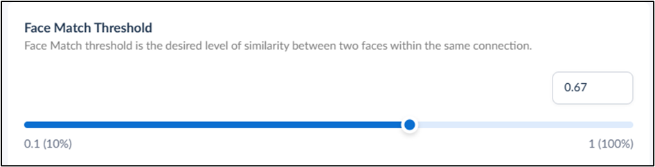

3. Adjust the following setting for **Liveness check parameters**.

   <Note>
     **Note:** You must consult your Oloid representative before making any changes to the **Liveness check parameters** value to ensure optimal authentication performance.
   </Note>

   - **Min Liveness Probability**: Specifies the threshold used to determine whether an image is live or spoofed.
     - Default value: 0.5
     - Images with a liveness probability of **0.5 or higher** are classified as live.
   - **Min Liveness Quality**: Specifies the minimum quality required for an image to be suitable for a liveness check.
     - Default: 0.1
     - Images with a quality score of **0.1 or higher** are considered suitable for liveness verification.

       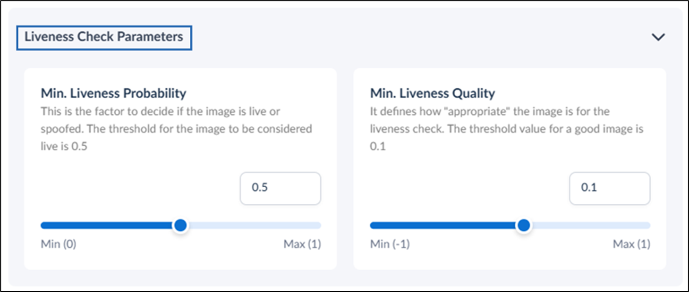

4. Click **Save**.

<Note>
  **Note:** The parameters are pre-configured. This is done by Oloid admin.
</Note>

### Additional Settings

1. **Configure Image Capture Resolution:** Select the preferred resolution from the **Select Resolution** dropdown list for image capture during facial authentication.

   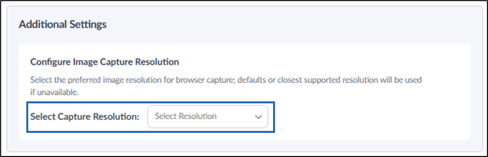

2. Click **Save**.

   <Note>
     **Note:** If the selected resolution is not available, the browser will default to the closest supported resolution.
   </Note>

### Badge ID

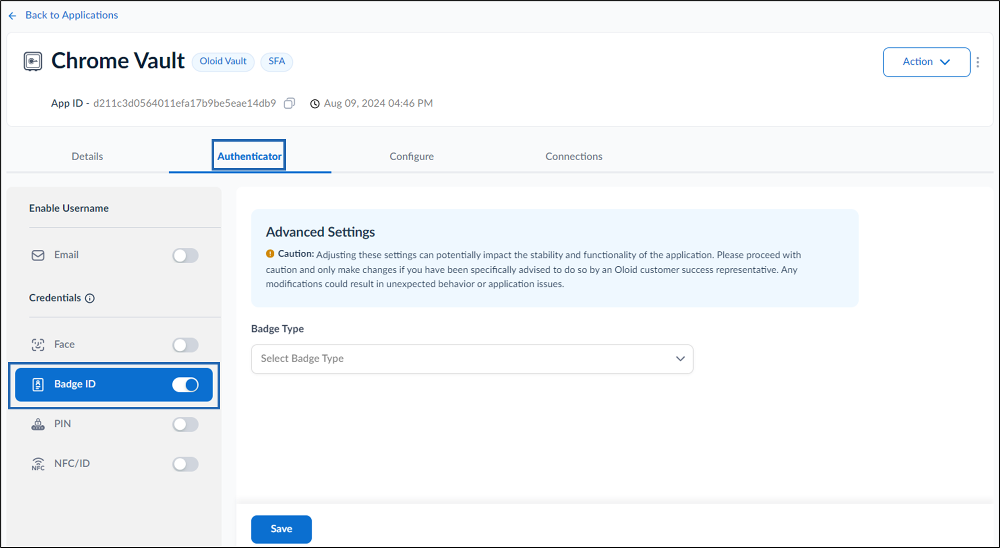

Select a **Badge Type** from the dropdown list. To use Badge ID as credential, enable **Badge ID**.

### PIN

*Coming Soon*

### NFC/ID

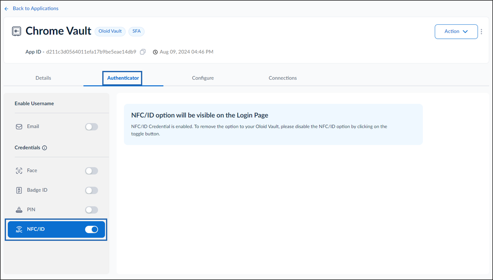

To use NFC/ID as credential, enable **NFC/ID** option.

## Setup Configure Tab

Do the following:

1. [Configure Settings tab](/platforms/web/vault/chrome/oloid-vault-chrome-chromium-how-to-create-and-configure-oloid-vault)
2. [Customize Buttons tab](/platforms/web/vault/chrome/oloid-vault-chrome-chromium-how-to-create-and-configure-oloid-vault)

### Configure Settings Tab

### Vault Behavior

- **Enable Auto-Submit:** Select this option toautomatically submits credentials after successful authentication, streamlining the login process for users.
- **Enable Copy Password:** Select this option to allow users to copy passwords from the Oloid Vault home page after logging in.
- **Enable Face Camera to open in a new Tab:** Select this option to open the face camera in a new tab for Chrome Vault users.
- Enable Saving Passkey: Select this option allow users to save passkeys within the Chrome vault application for websites supporting passkey logins.

  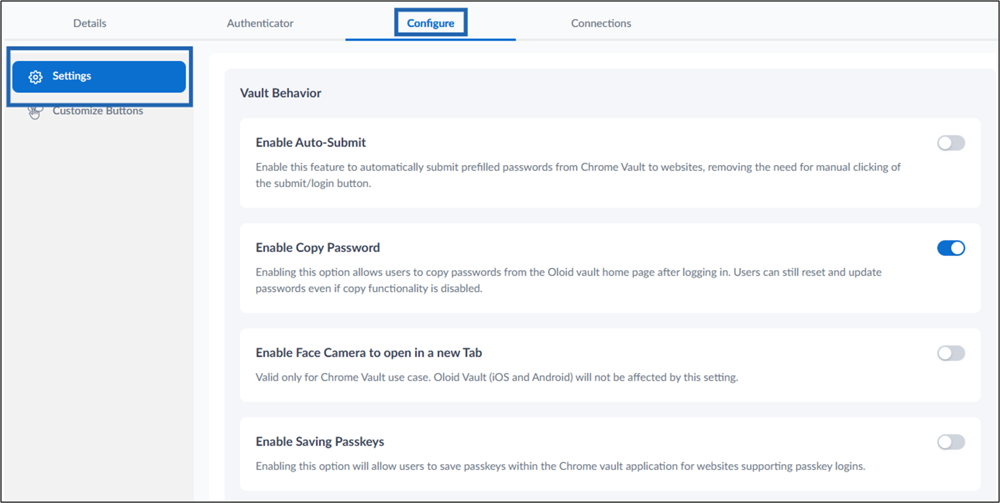

### Set Time-out durations for Re-authentication

- **Session Limit:** Set the maximum duration a user can remain signed into the Chrome Vault per session, up to a max of 55 mins.
- **Inactivity Timer:**  Enable this option to protect user sessions from unauthorized access. Set the timer to automatically log off the user after a specified period of inactivity.

### Apply Endpoint Template**:** *Coming Soon*

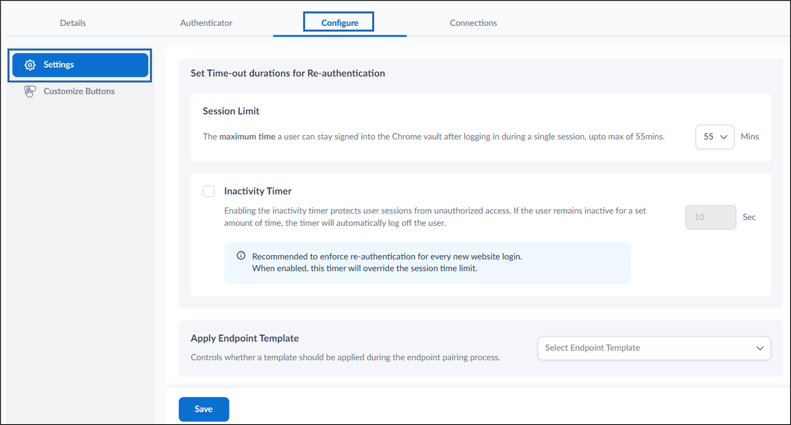

### Customize Buttons Tab

You can customize the button label of your application's authentication page by following the onscreen instructions.

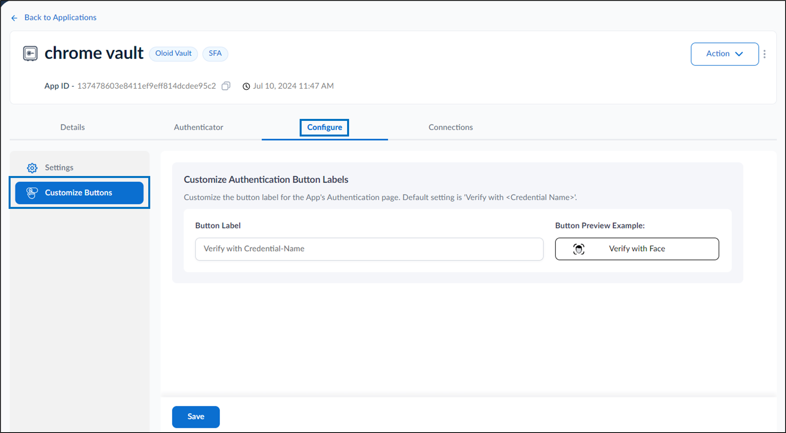

## Configure Connections Tab

1. Do the following:
   1. Select **+ Add Connections** to map a connection to the application.

      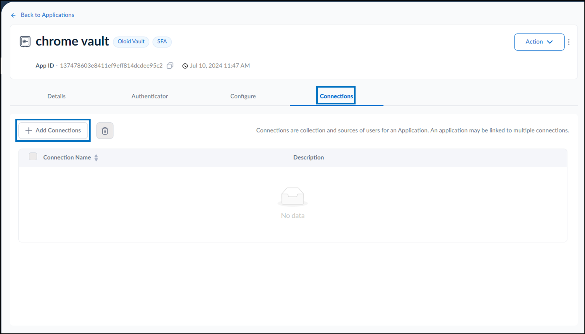

   2. On the **Add Connections** pop-up box, select connection name(s) from the **Select Connection** dropdown list and click **Add**.

      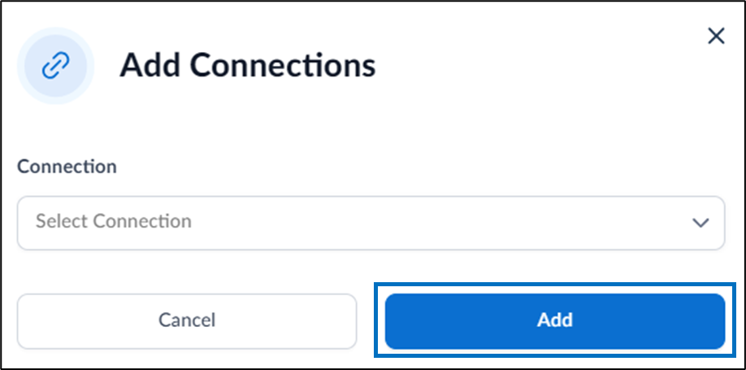

      <Note>
        **Note:** Click **Save** after each action to save your configuration.
      </Note>

      The **Chrome Vault** application is configured and listed on the Application page.
