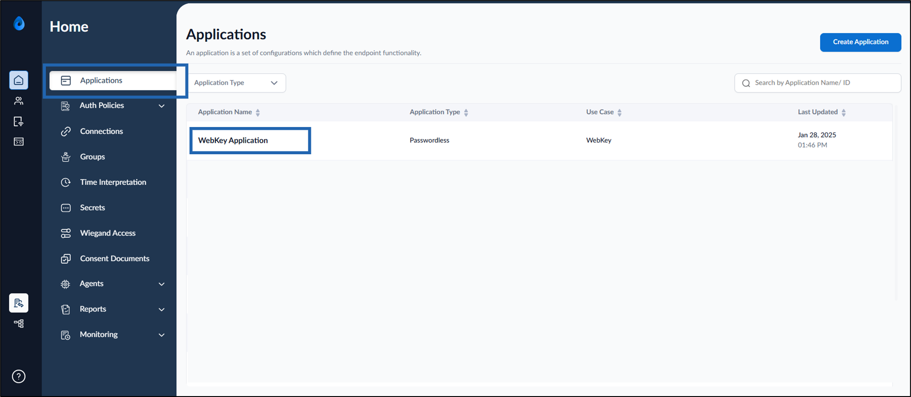
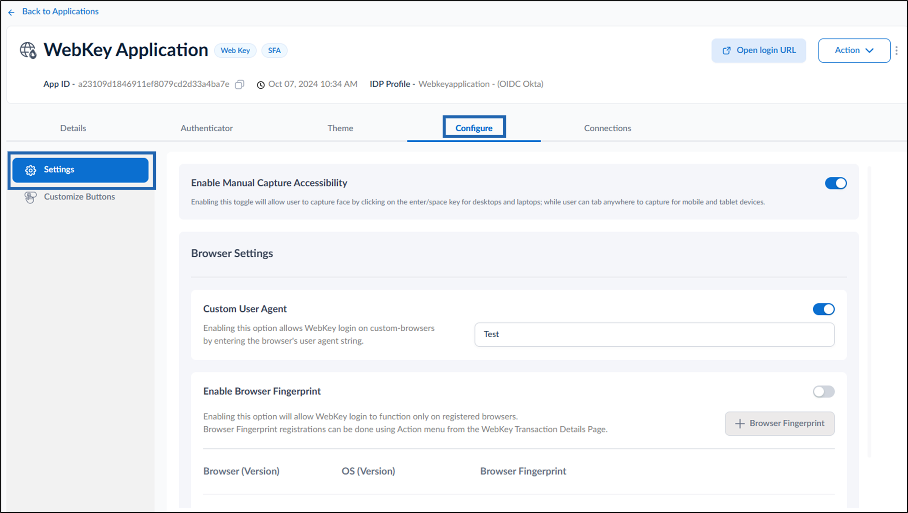
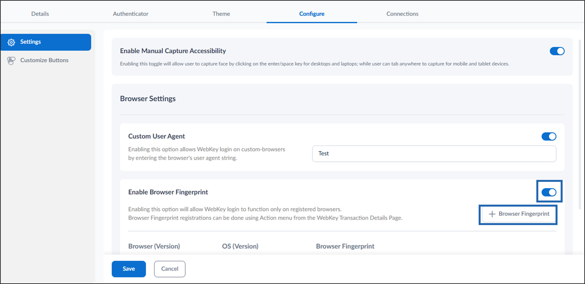
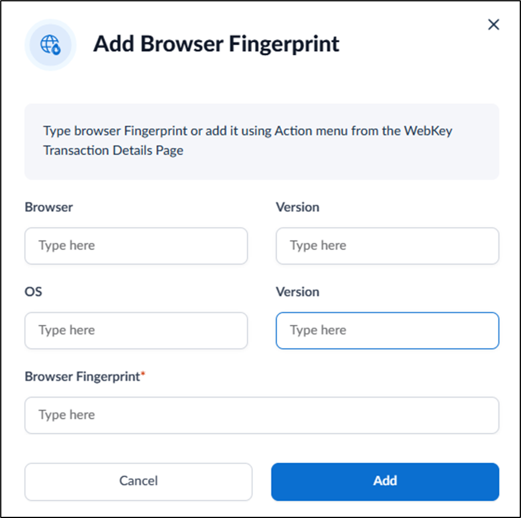

{/* Source: Intercom article 10473440 -  */}
{/* Generated by intercom_to_mintlify.py - re-running overwrites this file. */}

Steps to configure browser fingerprint manually:

1. Log in to **Oloid Portal**.
2. On the homepage, select **WebKey application**.

   

   The **WebKey Details** page is displayed.
3. Go to **Configure** > select **Settings** tab.

   

4. Do the following:

   

   1. Turn on **Enable Browser Fingerprint**.
   2. Click **+ Browser Fingerprint**.
      The **Add Browser Fingerprint** pop-box is displayed.
5. Do the following:

   

   1. Enter **Browser**.
   2. Enter **bowser Version**.
   3. Enter **OS**.
   4. Enter **Version** of the OS.
   5. Enter **Browser Fingerprint**.
   6. Click **Add**.
6. Click **Save**.

The Browser Fingerprint is added to the WebKey application successfully.
