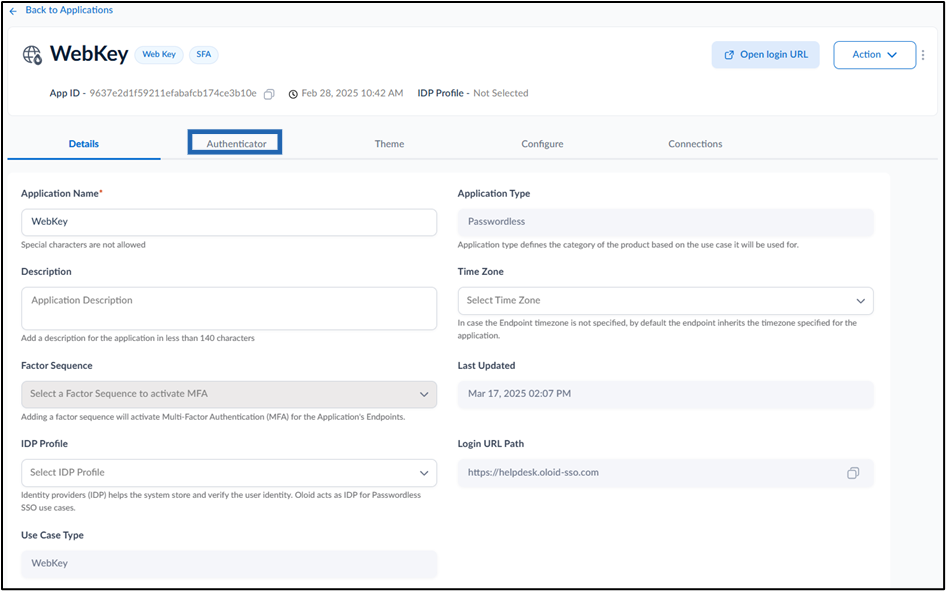
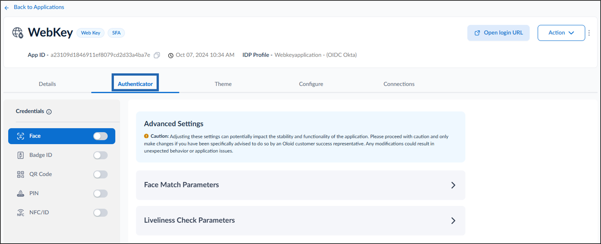
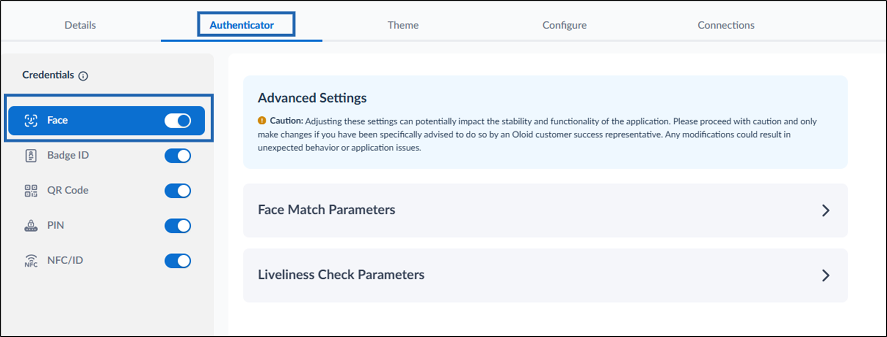
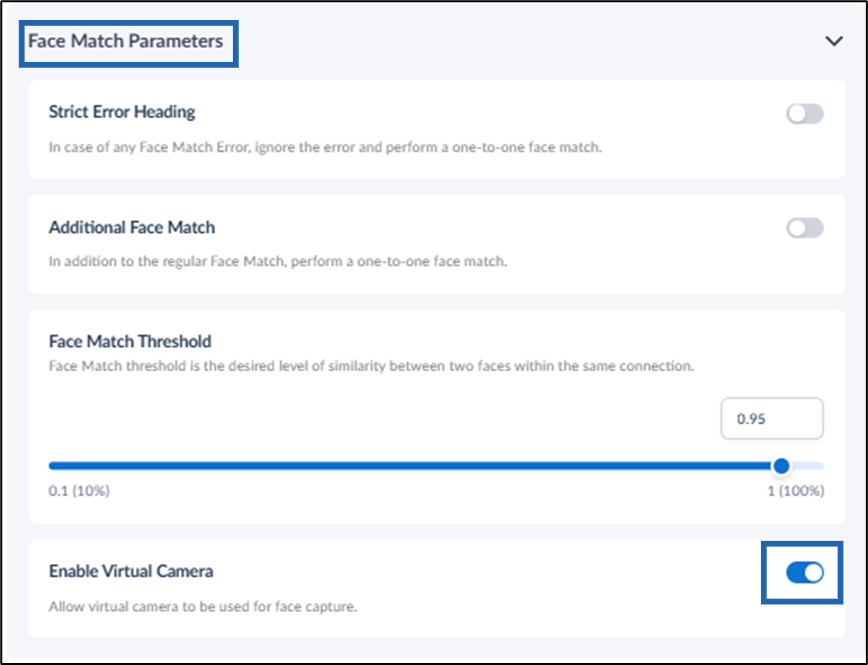
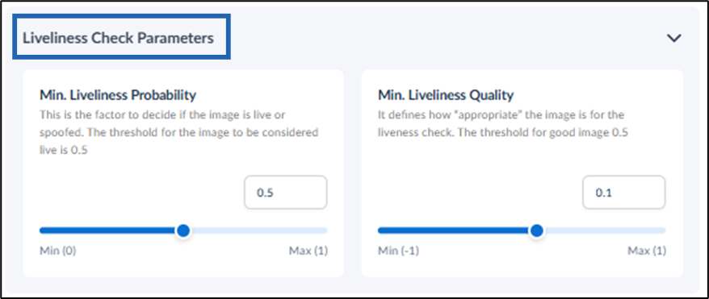
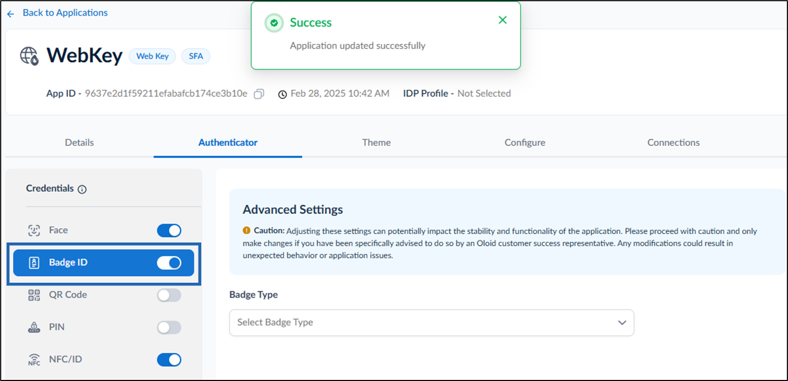
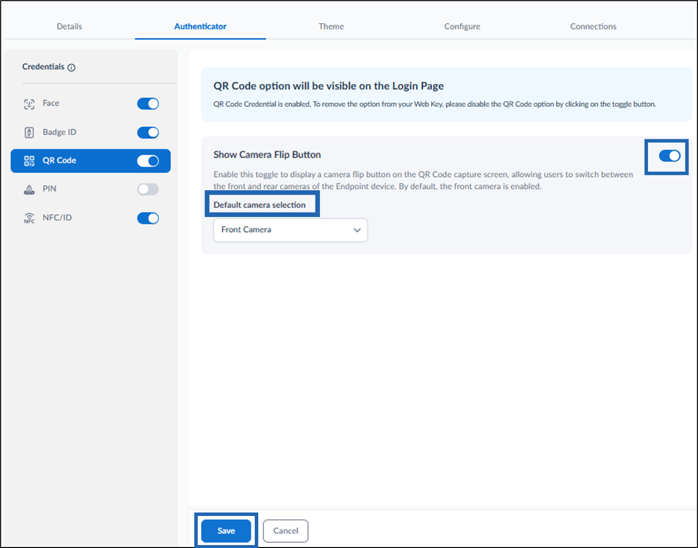
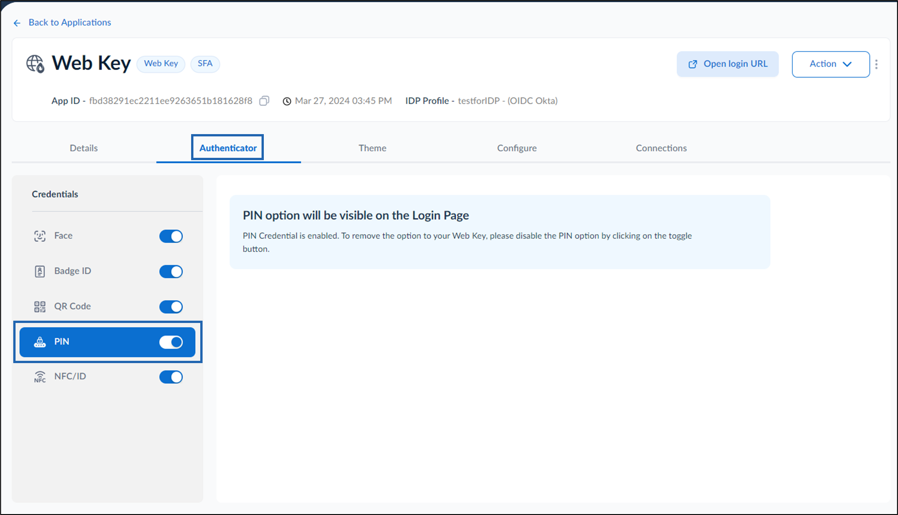
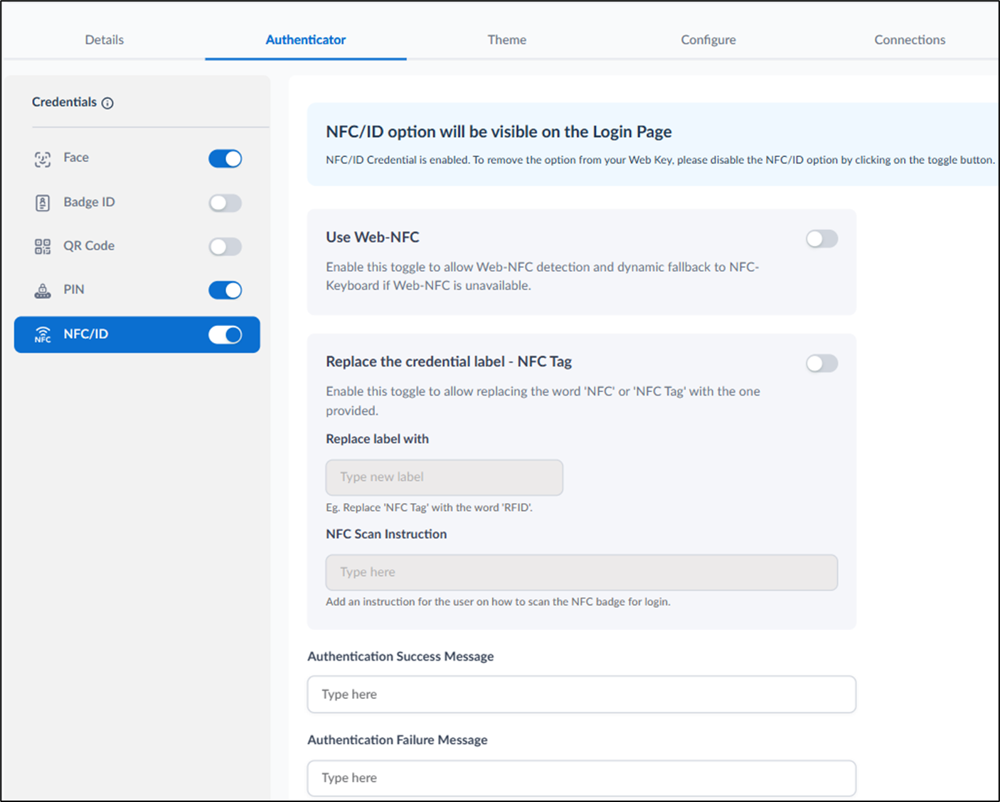

{/* Source: Intercom article 10800064 -  */}
{/* Generated by intercom_to_mintlify.py - re-running overwrites this file. */}

**Pre-requisite:**

You must create a Passwordless application of type WebKey. For further details, refer [How to create a WebKey application](/platforms/web/webkey/webkey-how-to-create-and-configure-a-webkey-application-in-tenant)

Steps to edit Authenticator tab:

1. Log in to the **Oloid Portal**.
2. On the **Applications** page, click on the Webkey application to edit.

   

   The application page is displayed.

   

3. Go to **Authenticator** tab:

   

   The **Authenticator** page is displayed.

Do the following:

## Face

- To use face as credential, enable **Face** option.

  

  The **Advanced Settings** section is displayed.
  Configure the following:
- [Face Match Parameters](/platforms/web/webkey/webkey-how-to-create-and-configure-a-webkey-application-in-tenant)
- [Liveliness Check Paraments](/platforms/web/webkey/webkey-how-to-create-and-configure-a-webkey-application-in-tenant)

## Face Match Parameters

Turn on **Enable Virtual Camera** to allow third-party virtual camera app to be used for face capture. If a user attempts to spoof the system using a third-party app, this feature helps detect and flag potential spoofing attempts.

## Liveliness Check Parameters

- Set **Min. Liveliness Probability** level to decide if the image is live and not spoofed.

  <Note>
    **Note:** Set the value of **Min. Liveliness Probability** 0.5 for the images to be considered live.
  </Note>

- Set **Min. Liveliness Quality** level to define how appropriate the image is for the liveliness check.

  <Note>
    **Note:** Set the value of **Min. Liveliness Quality** 0.5 for good image.
  </Note>

  

  <Note>
    **Note:** For auto capture of Face, DisableFaceDetection option should be configured. This is done by Oloid Admin.
  </Note>

## Badge ID

To use **Badge ID** as credential, enable **Badge ID**. Select a **Badge Type** from the dropdown list.

<Note>
  **Note:** Enable Badge ID, then enable PIN for multi-factor authentication.
</Note>

## QR Code

- To use QR Code as credential, enable **QR Code** option to sign in to Webkey application.
  By default, the front camera opens for QR code scanning.
- Enable **Show Camera Flip button** to allow users to switch between the front and rear cameras.
  This option displays a camera flip button on the preview screen during QR code scanning.
- Under **Default camera selection**, select a camera option:
  - **Front Camera** (default)
  - **Rear Camera**

    <Note>
      **Note:** This feature is available only for Android phones, tablets, and dual-camera laptops and laptops with external cameras.
    </Note>

## PIN

To use **PIN** credential, enable PIN for multi-factor authentication to sign into WebKey application.

## NFC/ID

To use NFC/IDcredential, enable **NFC/ID** to sign in to WebKey application from your desktop/laptop.

The **NFC/ID option** section is displayed.

Do the following:

1. Enable **Use Web-NFC** to allow NFC Login from the Mobile Phone and Tablet browser that supports NFC (such as Google Chrome on Android)
2. Enable **Replace the Credential Label - NFC Tag** to replace the default **"NFC"** or **"NFC Tag"** label with a custom name.
3. Enter the new label in the **Replace label with** field. Example: Replace **NFC Tag** with **RFID**.
4. Provide **NFC Scan Instruction** to guide users on scanning their NFC badge for login.
5. **Authentication Success Message**: Enter a message to display when authentication is successful.
6. **Authentication Failure Message**: Enter a message to display when authentication fails.

   

   <Note>
     **Note:** Enable NFC/ID, and then enable PIN for multi-factor authentication.
   </Note>
