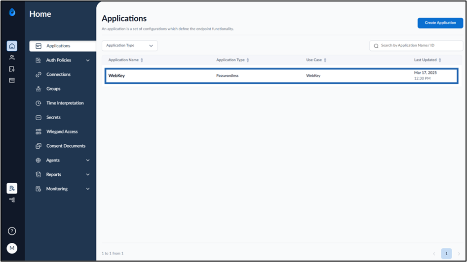
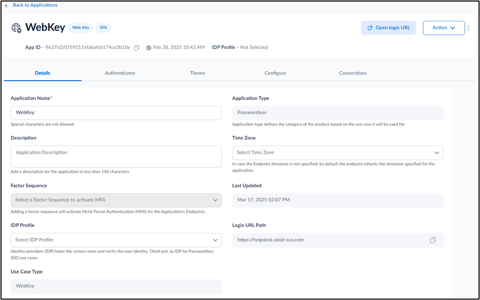
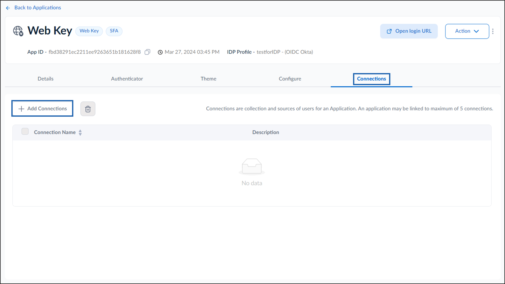
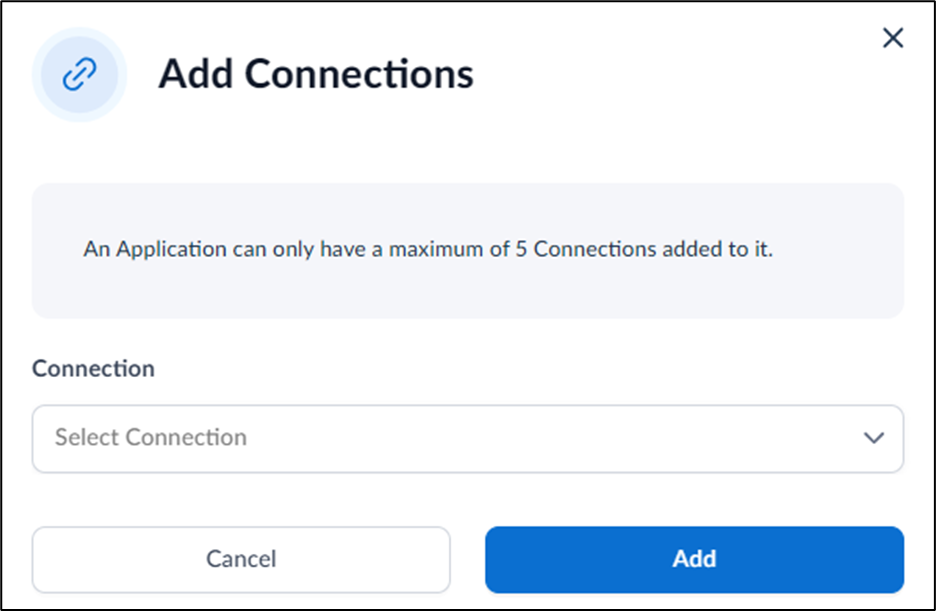

{/* Source: Intercom article 10801745 -  */}
{/* Generated by intercom_to_mintlify.py - re-running overwrites this file. */}

**Pre-requisite:**

You must create a Passwordless application of type WebKey. For further details, refer [How to create a WebKey application](/platforms/web/webkey/webkey-how-to-create-and-configure-a-webkey-application-in-tenant)

Steps to edit Connections tab:

1. Log in to the **Tenant Admin Portal**.
2. On the **Applications** page, click on the Webkey application to edit.

   

   The application page is displayed.

   

3. Go to **Connections** tab > Click **Add Connections**.

   

   The Connections page is displayed.
4. Do the following:
   1. Select **+ Add Connections** to map a connection to the application.
   2. On the **Add Connections** pop-up box, select connection name(s) from the **Select Connection** dropdown list and click **Add**.

      

      A connection is created successfully and listed on the **Connections** page.
